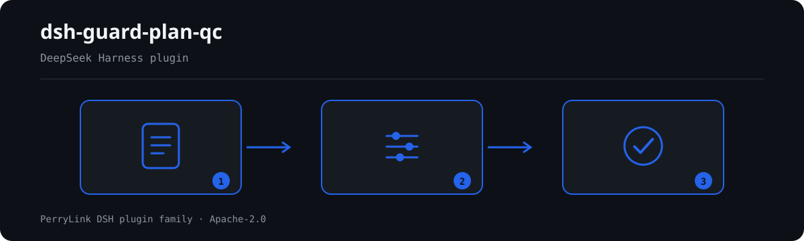

# dsh-guard-plan-qc — श्रम सुरक्षा एवं सुरक्षात्मक उपकरण विन्यास तालिका की जाँच

[English](README.md) · [简体中文](README-zh.md) · [Español](README-es.md) · [Português](README-pt.md) · [हिन्दी](README-hi.md)

[](https://dsh.market/)

`dsh-guard-plan-qc` एक श्रम सुरक्षा उपकरण विन्यास तालिका पढ़ता है — सामग्री में घोषित व्यक्तियों की संख्या और विन्यास अवधि, तथा प्रत्येक उपकरण की एक पंक्ति — और उसी तालिका की पूर्णता तथा आंतरिक संगति की जाँच करता है: क्या हर पंक्ति में 品名 (नाम), 规格型号 (विनिर्देश) और 配置数量 (मात्रा) भरे हैं, क्या मात्रा शून्य से बड़ी संख्या के रूप में पढ़ी जाती है, क्या वह घोषित व्यक्तियों की संख्या और आपके द्वारा कॉन्फ़िगर किए प्रति-व्यक्ति आधार से निकाली जा सकती है, क्या 发放日期 (वितरण तिथि) विन्यास अवधि के भीतर पड़ती है, क्या 有效截止日期 (वैधता अंत तिथि) वितरण तिथि के बाद है, और क्या तालिका आपकी अपेक्षित उपकरण श्रेणियों को समेटती है।

## Install

```sh
dsh plugin --profile <name> add dsh-guard-plan-qc
dsh --profile <name> --dump-config | grep 'dsh-guard-plan-qc'
```

## आउटपुट कैसा दिखता है



*कार्यप्रवाह: कॉल → प्लगइन → परिणाम। नीचे के उदाहरण वास्तविक कमांड सतह का उपयोग करते हैं।*


इस प्लगइन का अपने ही `GP-002` टेस्ट फ़िक्स्चर पर वास्तविक आउटपुट — कोई नकली चित्र नहीं। नियम-पैक उद्धरण नहीं गढ़ता, इसलिए हर निष्कर्ष लागू किए गए खंड का नाम और यह भी बताता है कि उसका मूल पाठ इस बार प्राप्त नहीं हुआ।

## यह किन सवालों का जवाब देता है

### उदाहरण

नीचे दी गई तालिका उदाहरण-समुच्चय है: पहली पंक्ति विस्तृत केस है, बाकी संक्षिप्त केस हैं।

| आपका सवाल | इसका जवाब |
|---|---|
| एक पंक्ति में नाम है पर 规格型号 खाली है। क्या यह दर्ज होता है? | हाँ। `GP-001` अपेक्षा करता है कि हर पंक्ति `requiredFields` के क्षेत्र भरे — फ़ैक्टरी में 品名, 规格型号 और 配置数量, जिन्हें आप अपनी तालिका के स्तंभों से बदल सकते हैं — और जो क्षेत्र छूटे हैं उनके नाम के साथ वह पंक्ति दर्ज करता है; खाली सेल अपूर्ण माना जाता है। यह देखता है कि स्तंभ भरे हैं, यह नहीं कि उपकरण या उसका विनिर्देश सही है। |
| 配置数量 के सेल में 若干 लिखा है। क्या यह शून्य मात्रा जैसा ही है? | नहीं। `GP-002` दोनों को अलग-अलग दर्ज करता है: जो मान पढ़ा न जा सके (जैसे 若干) वह «संख्या नहीं है» के रूप में दर्ज होता है, जबकि जो मान पढ़ा जाए पर शून्य से बड़ा न हो वह स्वयं उस अंक के साथ दर्ज होता है। «2双», «１，２００» और «2 件» पढ़े जाते हैं, इकाई साथ लिखी हो तो भी। यह नहीं जाँचता कि अंक सच है या मात्रा पर्याप्त है; `checkQuantity` false होने पर यह नियम चलता ही नहीं। |
| व्यक्तियों की संख्या 20 है और `factors` में इंसुलेटिंग दस्ताने प्रति व्यक्ति 2 हैं, पर पंक्ति में 30 दर्ज है। क्या यह पकड़ में आता है? | हाँ, `factors` कॉन्फ़िगर होने पर। `GP-003` प्रति-व्यक्ति आधार को व्यक्तियों की संख्या से गुणा करता है और वह मेल खाती पंक्ति दर्ज करता है जिसकी मात्रा उसकी `tolerance` से अधिक हटती है। `factors` फ़ैक्टरी में खाली है, इसलिए जैसा वितरित होता है वह नियम उसी कारण के साथ `skipped` में स्वयं को दर्ज करता है, चुपचाप पास नहीं होता; सामग्री में व्यक्तियों की संख्या न हो तो भी वह वहीं दर्ज होता है। आधार वही आँकड़ा है जो आपने देखा, राष्ट्रीय आँकड़ा नहीं: यह नियम उसकी उपयुक्तता नहीं आँकता। |
| विन्यास अवधि 2026-03-01 से 2026-03-31 है और एक 发放日期 में 2026-02-20 लिखा है। क्या यह दर्ज होता है? | हाँ। `GP-004` दर्ज करता है कि वह पंक्ति `periodFrom` से पहले है। अवधि सामग्री के शीर्ष स्तर पर दिए `periodFrom` / `periodTo` से आती है; दोनों न हों तो यह नियम कोई अवधि मान लेने के बजाय `skipped` में स्वयं को दर्ज करता है, और जो तिथि पढ़ी न जा सके वह चुपचाप छोड़े जाने के बजाय अलग से दर्ज होती है। |
| 有效截止日期 और 发放日期 एक ही दिन की हैं। क्या यह पास हो जाता है? | नहीं। `GP-005` अपेक्षा करता है कि वैधता अंत तिथि वितरण तिथि के बाद हो और जहाँ ऐसा नहीं है वह पंक्ति दर्ज करता है; यह तभी चलता है जब पंक्ति में दोनों तिथियाँ दर्ज हों। वह वैधता अवधि पर्याप्त लंबी है या नहीं — यह उपकरण और कार्य पर निर्भर है — यह नहीं आँका जाता। |
| तालिका में 安全帽 लिखा है और मेरी अपेक्षित श्रेणियों की सूची में 安全头盔। क्या यह «कवर नहीं» के रूप में दर्ज होगा? | हाँ। `GP-006` 品名 और 规格型号 के साथ शब्दशः समावेश की तुलना करता है, इसलिए उसी उपकरण का दूसरा नाम लिखा होने पर वह «कवर नहीं» के रूप में दर्ज होता है; सामान्य वर्तनियाँ भी सूची में रखें या तालिका की शब्दावली एक करें। `requiredCategories` फ़ैक्टरी में खाली है, इसलिए जैसा वितरित होता है वह नियम `skipped` में स्वयं को दर्ज करता है। यह केवल देखता है कि श्रेणी दिखती है या नहीं, यह नहीं कि उपकरण इस परियोजना के लिए उपयुक्त है। |

## यह किन मानकों पर आधारित है

| दस्तावेज़ | संख्यांक | इन्हें उद्धृत करने वाले नियम |
|---|---|---|
| 《个体防护装备配备规范》 | GB 39800.1—2020（个体防护装备配备规范 第1部分：总则；标准号不带"/T"⇒强制性；2020-12-24 发布、2022-01-01 实施；主管部门应急管理部；条号本次未取得） | GP-001, GP-002, GP-003, GP-004, GP-005, GP-006 |

**Boundary:** this plugin checks one **劳动防护用品配置表** for what a table can be held to — that every row
names a product with a specification and a quantity, that the quantity is a positive number, that it
reconciles with the headcount the plan states, that the issue date falls inside the plan period, that an
expiry date follows the issue date, and that the table covers the categories you require. It does **not**
judge whether a given product is the right protection for a given hazard, whether its protection level
suffices, or whether it counts as special protective equipment.

> ### ⚠️ Read this before trusting a citation in the report
>
> **Every `excerpt` in this plugin's rule pack says, in so many words, that the clause text was not
> obtained.** The regime lives in **GB 39800.1《个体防护装备配备规范》** and 《劳动防护用品监督管理规定》.
> The verification pass for this plugin could not retrieve verbatim clause text from them, so rather than
> paraphrase a quotation the pack states the gap in the `excerpt` field itself and puts the honest
> reasoning in `note`. Everything is therefore capped at `warn` (principle-derived) or `info` (locally
> configured), and a test asserts that no rule claims a quotation it does not have. **When the texts are
> in hand, two things must be done: replace each `excerpt` with the real clause, and raise `kind` to
> `direct`.**
>
> **The two numbers that would make this plugin powerful are the two it refuses to invent.** How many
> items each person needs (`GP-003` `factors`) and which product categories a job must cover (`GP-006`
> `requiredCategories`) depend on the hazard identification for *your* project, not on a national figure.
> Both ship **empty**, and a rule whose list is unset reports itself in `skipped` rather than passing.

## Compatibility

| सतह | स्थिति |
|---|---|
| Harness | peer रेंज `>=0.1.2-rc.1 <0.2.0 \|\| >=0.2.0-0 <0.3.0` — `0.2.0-rc.2` और `0.2.1-rc.2` दोनों को स्वीकार करने के लिए सत्यापित। **`engines.dsh` `>=0.2.1-0 <0.3.0` के रूप में घोषित है** और 0.2.1 से होस्ट इसे लागू करता है |
| Node | `^22.19.0 || >=24.0.0` |
| प्लेटफ़ॉर्म | सभी (शुद्ध ESM; कोई नेटिव कोड नहीं, कोई नेटवर्क नहीं, कोई मॉडल कॉल नहीं) |
| टूल मोड | `native` और `ptc` में काम करता है; पूरे फ़ोल्डर के लिए `ptc` चुनें |

## What it does

नियम-सूची, फ़ील्ड और विस्तृत व्यवहार [README.md](README.md#what-it-does) (अंग्रेज़ी मुख्य संस्करण) में हैं। यह प्लगइन केवल उद्धृत धाराओं के सामने शाब्दिक अंतर सूचीबद्ध करता है और हर न चल पाई जाँच को `skipped` में बताता है।

## Configuration

सभी समायोज्य पैरामीटर `src/config.ts` की Schemastery स्कीमा में हैं, इसलिए कोड बदले बिना `cordis.yml` से बदले जा सकते हैं; प्रति-नियम सीमाएँ `rules/` के नियम-पैक में हैं।

| कुंजी | प्रकार | डिफ़ॉल्ट | विवरण |
|---|---|---|---|
| `rulesFile` | string | `rules/guard-plan-qc.yaml` | नियम-पैक का पथ, पैकेज रूट के सापेक्ष |
| `disabledRules` | string[] | `[]` | बंद करने वाले नियम id; प्रत्येक `skipped` में दिखता है |
| `onlyRules` | string[] | `[]` | केवल ये नियम चलाएँ; खाली होने पर सभी नियम चलते हैं |
| `skipNotes` | string | `""` | हर `skipped` कारण के आगे जोड़ी जाने वाली टिप्पणी |
| `timeoutMs` | number | `120000` | उपकरण का सहकारी समय-सीमा बजट |

## Material format

JSON या YAML स्वीकार्य है। पूरा फ़ील्ड उदाहरण [README.md](README.md#material-format) (अंग्रेज़ी मुख्य संस्करण) में है। पढ़ने की परत में फ़ील्ड वैकल्पिक हैं और जाँच इंजन उन्हें सत्यापित करता है, इसलिए आंशिक निर्यात पर क्रैश के बजाय "अनुपस्थित" श्रेणी के निष्कर्ष मिलते हैं।

## Rule sources

नियम-डेटा कोड से अलग है: प्रत्येक नियम में दस्तावेज़, संख्या, स्रोत की अपनी क्रमांकन-प्रणाली के अनुसार धारा, शब्दशः उद्धरण और स्रोत URL होता है। लोडर लागू करता है कि उद्धरण कम से कम आठ अक्षरों का वास्तविक उद्धरण हो, और जिस जाँच का आधार केवल सामान्य सिद्धांत (`kind: derived-from-principle`, अधिकतम `warn`) या स्थानीय नीति (`kind: institutional-configuration`, अधिकतम `info`) हो, उसे कभी `error` घोषित न किया जाए।

सत्यापित सीमाएँ और जान-बूझकर **न** कहे गए निष्कर्ष [README.md](README.md#rule-sources) (अंग्रेज़ी मुख्य संस्करण) और `rules/evidence/` में हैं।

## Troubleshooting

- **प्लगइन इंस्टॉल हो गया पर टूल दिखता नहीं**: जाँचें कि `main` `lib/index.mjs` पर जाता है और `pnpm run build` ने उसे बनाया है।
- **`dsh plugin add` असंगत बताकर मना करता है**: peer range `0.1.x` और `0.2.x` दोनों को कवर करती है; बाहर होने पर स्पष्ट छूट दें: `dsh plugin --profile <name> allow-version <pkg@ver> --dsh-version <runtime> --accept-risk`।
- **कोई नियम नहीं चला**: `skipped` सरणी देखें।
- **`check` में `manifest-peers` विफल दिखता है**: यह `dsh-plugin-dev` की ज्ञात अपस्ट्रीम समस्या है; रनटाइम इंस्टॉल के समय अनुकूलता लागू करता है।
- **समय खिसका हुआ लगता है**: सारी गणना दिए गए स्ट्रिंग पर वॉल-क्लॉक है।

## Development

```sh
pnpm install
pnpm run typecheck
pnpm test
pnpm run build
node ../scripts/sync-shared.mjs dsh-guard-plan-qc
```

अंतिम कमांड `../_shared` का साझा किट `src/shared/` में कॉपी करता है; हर साझा बदलाव के बाद इसे दोबारा चलाएँ।

## PerryLink DSH Plugin Family

यह प्रोजेक्ट [PerryLink](https://github.com/PerryLink) के DeepSeek Harness प्लगइन परिवार का हिस्सा है। पूरी सूची नीचे संक्षिप्त रखी गई है ताकि हर README की पहली स्क्रीन छोटी रहे; हर पंक्ति और उसकी स्थिति देखने के लिए इसे खोलें।

<details>
<summary>सभी प्लगइन खोलें</summary>

| प्लगइन | स्थिति |
|---|---|
| **[dsh-aqua-input-check](https://github.com/PerryLink/dsh-aqua-input-check)** |  |
| **[dsh-archive-check](https://github.com/PerryLink/dsh-archive-check)** |  |
| **[dsh-auto-review](https://github.com/PerryLink/dsh-auto-review)** |  |
| **[dsh-autotier](https://github.com/PerryLink/dsh-autotier)** |  |
| **[dsh-bid-ca-precheck](https://github.com/PerryLink/dsh-bid-ca-precheck)** |  |
| **[dsh-bid-qual-check](https://github.com/PerryLink/dsh-bid-qual-check)** |  |
| **[dsh-cert-mcp](https://github.com/PerryLink/dsh-cert-mcp)** |  |
| **[dsh-checkpoint-rewind](https://github.com/PerryLink/dsh-checkpoint-rewind)** |  |
| **[dsh-click](https://github.com/PerryLink/dsh-click)** |  |
| **[dsh-composer-history](https://github.com/PerryLink/dsh-composer-history)** |  |
| **[dsh-contract-stance](https://github.com/PerryLink/dsh-contract-stance)** |  |
| **[dsh-customs-doc-check](https://github.com/PerryLink/dsh-customs-doc-check)** |  |
| **[dsh-data-quality](https://github.com/PerryLink/dsh-data-quality)** |  |
| **[dsh-demurrage-ledger](https://github.com/PerryLink/dsh-demurrage-ledger)** |  |
| **[dsh-doublecheck](https://github.com/PerryLink/dsh-doublecheck)** |  |
| **[dsh-drill-script-check](https://github.com/PerryLink/dsh-drill-script-check)** |  |
| **[dsh-eia-guide-check](https://github.com/PerryLink/dsh-eia-guide-check)** |  |
| **[dsh-emergency-plan](https://github.com/PerryLink/dsh-emergency-plan)** |  |
| **[dsh-essay-rubric-check](https://github.com/PerryLink/dsh-essay-rubric-check)** |  |
| **[dsh-evidence-check](https://github.com/PerryLink/dsh-evidence-check)** |  |
| **[dsh-export-ctl-check](https://github.com/PerryLink/dsh-export-ctl-check)** |  |
| **[dsh-fast](https://github.com/PerryLink/dsh-fast)** |  |
| **[dsh-fmea-table-check](https://github.com/PerryLink/dsh-fmea-table-check)** |  |
| **[dsh-forecast-penalty](https://github.com/PerryLink/dsh-forecast-penalty)** |  |
| **[dsh-fund-research](https://github.com/PerryLink/dsh-fund-research)** |  |
| **[dsh-github](https://github.com/PerryLink/dsh-github)** |  |
| **[dsh-gongwen-flow-check](https://github.com/PerryLink/dsh-gongwen-flow-check)** |  |
| **[dsh-gongwen-word-check](https://github.com/PerryLink/dsh-gongwen-word-check)** |  |
| **[dsh-guard-plan-qc](https://github.com/PerryLink/dsh-guard-plan-qc)** |  |
| **[dsh-hazchem-check](https://github.com/PerryLink/dsh-hazchem-check)** |  |
| **[dsh-hazplan-check](https://github.com/PerryLink/dsh-hazplan-check)** |  |
| **[dsh-hidden-risk-map](https://github.com/PerryLink/dsh-hidden-risk-map)** |  |
| **[dsh-hs-classify](https://github.com/PerryLink/dsh-hs-classify)** |  |
| **[dsh-icd-rule-check](https://github.com/PerryLink/dsh-icd-rule-check)** |  |
| **[dsh-industry-research](https://github.com/PerryLink/dsh-industry-research)** |  |
| **[dsh-lawcite-adapter](https://github.com/PerryLink/dsh-lawcite-adapter)** |  |
| **[dsh-laya](https://github.com/PerryLink/dsh-laya)** |  |
| **[dsh-lc-doc-check](https://github.com/PerryLink/dsh-lc-doc-check)** |  |
| **[dsh-learning-gap-check](https://github.com/PerryLink/dsh-learning-gap-check)** |  |
| **[dsh-library](https://github.com/PerryLink/dsh-library)** |  |
| **[dsh-local-ai](https://github.com/PerryLink/dsh-local-ai)** |  |
| **[dsh-lsp-actions](https://github.com/PerryLink/dsh-lsp-actions)** |  |
| **[dsh-mask](https://github.com/PerryLink/dsh-mask)** |  |
| **[dsh-mcp-panel](https://github.com/PerryLink/dsh-mcp-panel)** |  |
| **[dsh-medrec-qc](https://github.com/PerryLink/dsh-medrec-qc)** |  |
| **[dsh-memento](https://github.com/PerryLink/dsh-memento)** |  |
| **[dsh-nsfc-form-check](https://github.com/PerryLink/dsh-nsfc-form-check)** |  |
| **[dsh-nurse-record-check](https://github.com/PerryLink/dsh-nurse-record-check)** |  |
| **[dsh-observe](https://github.com/PerryLink/dsh-observe)** |  |
| **[dsh-origin-rvc-check](https://github.com/PerryLink/dsh-origin-rvc-check)** |  |
| **[dsh-ota-review-check](https://github.com/PerryLink/dsh-ota-review-check)** |  |
| **[dsh-output-styles](https://github.com/PerryLink/dsh-output-styles)** |  |
| **[dsh-paper-doc-adapter](https://github.com/PerryLink/dsh-paper-doc-adapter)** |  |
| **[dsh-permission-rules](https://github.com/PerryLink/dsh-permission-rules)** |  |
| **[dsh-permit-report-check](https://github.com/PerryLink/dsh-permit-report-check)** |  |
| **[dsh-pipeline-check](https://github.com/PerryLink/dsh-pipeline-check)** |  |
| **[dsh-pleading-draft](https://github.com/PerryLink/dsh-pleading-draft)** |  |
| **[dsh-plugin-doctor](https://github.com/PerryLink/dsh-plugin-doctor)** |  |
| **[dsh-plugin-guide](https://github.com/PerryLink/dsh-plugin-guide)** |  |
| **[dsh-plugin-kit](https://github.com/PerryLink/dsh-plugin-kit)** |  |
| **[dsh-plugin-upgrade](https://github.com/PerryLink/dsh-plugin-upgrade)** |  |
| **[dsh-policy-brief-draft](https://github.com/PerryLink/dsh-policy-brief-draft)** |  |
| **[dsh-power-loss-split](https://github.com/PerryLink/dsh-power-loss-split)** |  |
| **[dsh-power-ticket-check](https://github.com/PerryLink/dsh-power-ticket-check)** |  |
| **[dsh-ppap-check](https://github.com/PerryLink/dsh-ppap-check)** |  |
| **[dsh-protest-deadline](https://github.com/PerryLink/dsh-protest-deadline)** |  |
| **[dsh-railway-window](https://github.com/PerryLink/dsh-railway-window)** |  |
| **[dsh-repair-order-qc](https://github.com/PerryLink/dsh-repair-order-qc)** |  |
| **[dsh-research-report](https://github.com/PerryLink/dsh-research-report)** |  |
| **[dsh-review-reply-check](https://github.com/PerryLink/dsh-review-reply-check)** |  |
| **[dsh-rulefile-check](https://github.com/PerryLink/dsh-rulefile-check)** |  |
| **[dsh-safety-brief-check](https://github.com/PerryLink/dsh-safety-brief-check)** |  |
| **[dsh-score](https://github.com/PerryLink/dsh-score)** |  |
| **[dsh-session-sync](https://github.com/PerryLink/dsh-session-sync)** |  |
| **[dsh-site-log-check](https://github.com/PerryLink/dsh-site-log-check)** |  |
| **[dsh-skill-pack-security](https://github.com/PerryLink/dsh-skill-pack-security)** |  |
| **[dsh-soe-decision-check](https://github.com/PerryLink/dsh-soe-decision-check)** |  |
| **[dsh-soilwater-check](https://github.com/PerryLink/dsh-soilwater-check)** |  |
| **[dsh-sop-sync-check](https://github.com/PerryLink/dsh-sop-sync-check)** |  |
| **[dsh-spc-gbt-adapter](https://github.com/PerryLink/dsh-spc-gbt-adapter)** |  |
| **[dsh-talk](https://github.com/PerryLink/dsh-talk)** |  |
| **[dsh-tender-extract](https://github.com/PerryLink/dsh-tender-extract)** |  |
| **[dsh-tender-matrix](https://github.com/PerryLink/dsh-tender-matrix)** |  |
| **[dsh-test-drive](https://github.com/PerryLink/dsh-test-drive)** |  |
| **[dsh-ticktick](https://github.com/PerryLink/dsh-ticktick)** |  |
| **[dsh-translate](https://github.com/PerryLink/dsh-translate)** |  |
| **[dsh-warranty-calc](https://github.com/PerryLink/dsh-warranty-calc)** |  |
| **[dsh-budget](https://github.com/PerryLink/dsh-budget)** | 🧊 फ़्रोज़न — रिपॉज़िटरी README देखें |
| **[dsh-claude-move](https://github.com/PerryLink/dsh-claude-move)** | 🧊 फ़्रोज़न — रिपॉज़िटरी README देखें |
| **[dsh-defend](https://github.com/PerryLink/dsh-defend)** | 🧊 फ़्रोज़न — रिपॉज़िटरी README देखें |
| **[dsh-draw](https://github.com/PerryLink/dsh-draw)** | 🧊 फ़्रोज़न — रिपॉज़िटरी README देखें |
| **[dsh-reach](https://github.com/PerryLink/dsh-reach)** | 🧊 फ़्रोज़न — रिपॉज़िटरी README देखें |
| **[dsh-background-agents](https://github.com/PerryLink/dsh-background-agents)** | 🚫 सेवानिवृत्त — रिपॉज़िटरी README देखें |
| **[dsh-session-pin](https://github.com/PerryLink/dsh-session-pin)** | 🚫 सेवानिवृत्त — रिपॉज़िटरी README देखें |
| **[dsh-team-rooms](https://github.com/PerryLink/dsh-team-rooms)** | 🚫 सेवानिवृत्त — रिपॉज़िटरी README देखें |

</details>

## License

[Apache License 2.0](LICENSE) © 2026 dsh-guard-plan-qc contributors.
