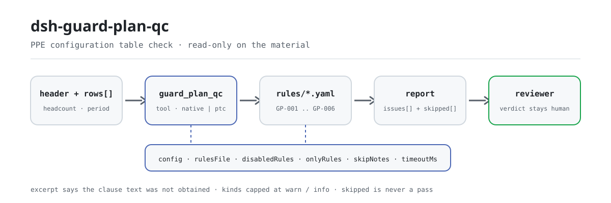

<div align="center">

<picture>
  <source media="(prefers-color-scheme: dark)" srcset="docs/assets/dsh-guard-plan-qc-flow-dark.svg">
  
</picture>

# dsh-guard-plan-qc

**Turn one labour-protection PPE configuration table into a row-by-row list of which row, which column, and what to fix — the verdict stays with the reviewer.**

A data-only checker plugin for DeepSeek Harness: it reads one PPE configuration table (the header states the headcount and the plan period, then one row per product), applies the 6-rule pack it ships (GP-001..GP-006), and lists only the differences it can point to inside the material — never a compliance verdict, never a liability finding.

[Install](#three-step-setup) · [Configuration](#configuration) · [FAQ](#faq) · [简体中文](README.md) · [English](README.en.md) · [Español](README.es.md) · [Português](README.pt.md) · [हिन्दी](README.hi.md)

[](LICENSE)
[](#compatibility)
[](https://www.npmjs.com/package/dsh-guard-plan-qc)
[](https://github.com/PerryLink/dsh-guard-plan-qc/actions/workflows/ci.yml)
[](#compatibility)

[](https://github.com/PerryLink/dsh-guard-plan-qc/stargazers)
[](https://www.npmjs.com/package/dsh-guard-plan-qc)
[](https://dshfind.com/plugins/PerryLink/dsh-guard-plan-qc?ref=badge)
[](https://securityscorecards.dev/viewer/?uri=github.com/PerryLink/dsh-guard-plan-qc)
[](https://dsh.market/)
[](https://gitee.com/perrylink/dsh-guard-plan-qc)

```sh
dsh plugin --profile <name> add dsh-guard-plan-qc
```

</div>

<sub>Community plugin, not affiliated with DeepSeek. Canonical repository: <https://github.com/PerryLink/dsh-guard-plan-qc> (Gitee is a mirror).</sub>

## What it is

`dsh-guard-plan-qc` reads one labour-protection PPE configuration table — the headcount and plan period the material states, plus one row per configured product — and checks that table's own completeness and internal consistency: that every row fills the product name, the specification and the configured quantity, that the quantity parses as a number greater than zero, that it reconciles with the stated headcount times the per-person factor you configure, that the issue date falls inside the plan period, that the expiry date is later than the issue date, and that the table covers the product categories you require.

It does not judge whether a given product is the right protection against a given hazard, whether its protection level suffices, or whether it counts as special protective equipment; it also does not decide whether the configuration is compliant or whether liability attaches.

- **Who it is for**: safety officers and PPE administrators; no command line required — hand the material over in chat.
- **What you give it**: the source material the check works on (a table, register, or document); the original is never modified. Excel can be converted to JSON/YAML first, in chat if the platform supports it.
- **What you get back**: a list of "which row, which column, what is missing, how to fix it"; every check that could not run is listed in `skipped` with its reason.

## Three-step setup

1. **Install** (pick one channel):

   ```sh
   # git channel (latest main; equivalent to git+https://github.com/PerryLink/dsh-guard-plan-qc.git)
   dsh plugin --profile <name> add github:PerryLink/dsh-guard-plan-qc
   # npm channel (published releases)
   dsh plugin --profile <name> add dsh-guard-plan-qc
   # tarball channel: pnpm pack in this repo, then
   dsh plugin --profile <name> add ./dsh-guard-plan-qc-<version>.tgz
   ```

   The npm channel ships the built `lib/`; the git channel builds it at install time through the `prepare` script (tsdown), so no manual build is needed.

2. **Minimal config** (sane defaults; a bundle row without `config` uses every default, with the rule-pack path pointing at the bundled `rules/guard-plan-qc.yaml`):

   ```yaml
   - insert:
       - id: dsh-guard-plan-qc
         name: dsh-guard-plan-qc
   ```

3. **Verify it mounts**:

   ```sh
   dsh --profile <name> --dump-config | grep 'dsh-guard-plan-qc'
   ```

   Then hand it a table. The bundled sample's expected output (`samples/quickstart/expected/result.json`, input `samples/quickstart/input/GP-001-unsafe.json`):

   ```json
   {"tool":"guard_plan_qc","issueCount":1,"summary":{"error":0,"warn":0,"info":1},"skippedCount":5}
   ```

   Re-run it in this repository (build `lib/` first with `pnpm run build`):

   ```sh
   node samples/quickstart/run.mjs --json
   ```

**Uninstall**: `dsh plugin --profile <name> remove dsh-guard-plan-qc` (or remove the row from the profile patch).

<details>
<summary>Use it in WorkBuddy / Coze</summary>

Search "Safety Compliance Suite" in WorkBuddy / Coze (this check is one part of it; availability as listed) to call the same checking capability without a command line.

</details>

<details>
<summary>Install from the DSH Desktop market</summary>

Every PerryLink plugin is listed in the built-in DSH Desktop market: **Market → Sources → Add source → paste** `https://perrylink-dsh-catalog.perrylink.workers.dev/catalog-source.json` **→ select**. Installation still requires the market's npm identity check and your confirmation.

</details>

## Core capabilities

`dsh-guard-plan-qc` registers the `guard_plan_qc` tool: it reads one configuration table, applies a versioned rule pack, and returns a report.

- **Six rules in one data pack** — the rule pack is data, not code (`rules/guard-plan-qc.yaml`); replacing it switches the whole rule set without touching a line of TypeScript.
- **Read-only on the material** — accepts JSON or YAML and never modifies the original; pure ESM, no network requests, no model calls.
- **No fabricated citations** — every rule carries `document` / `number` / `clause` / `excerpt` / `kind` / `source`; this pack obtained no verbatim clause text from GB 39800.1 this pass, so every `excerpt` says so explicitly and is marked `derived-from-principle` or `institutional-configuration`: a description is never dressed up as a quotation.
- **Severity follows the evidence** — `derived-from-principle` is capped at `warn`, institutional configuration (`institutional-configuration`) at `info`, and a test asserts it.
- **An empty issue list is never "nothing is wrong"** — every check that could not run is reported in `skipped` with its reason; a rule whose `factors` or `requiredCategories` list is unset reports itself in `skipped` rather than passing silently.
- **No built-in per-person factors or product list** — "how many items per person" and "which products this project must cover" change with the product category, the job type and your institution's standard, so the plugin hard-codes neither. That also means it cannot find the most consequential gap: a product that should have been configured and is missing.
- **No adjudicating wording** — the report lists differences and never pronounces on compliance, liability, or correctness; a wording guard enforces this and every report carries the disclaimer.

| Rule | Check | Severity | Basis kind |
|---|---|---|---|
| `GP-001` | every row fills the product name, the specification and the quantity | info | institutional-configuration |
| `GP-002` | the quantity parses to a number greater than zero | warn | derived-from-principle |
| `GP-003` | the quantity reconciles with the headcount times your per-person factor (off by default) | info | institutional-configuration |
| `GP-004` | the issue date falls inside the plan period | warn | derived-from-principle |
| `GP-005` | the expiry date is later than the issue date | warn | derived-from-principle |
| `GP-006` | the table covers the categories you require (off by default) | info | institutional-configuration |

### Examples

These are the plugin's real entry points; install once, then call one. The first row of the table below is the detailed walkthrough, the remaining rows are short cases.

**Detailed example** — tool `guard_plan_qc`, input:

```json
{"headcount":20,"rows":[{"品名":"安全帽","配置数量":"若干"}]}
```

Output:

```json
{
  "id": "dsh-guard-plan-qc.GP-002.4f14475e",
  "ruleId": "GP-002",
  "severity": "warn",
  "locator": {
    "column": "配置数量",
    "row": 1
  },
  "found": "第 1 行配置数量「若干」不是数字",
  "expected": "配置数量应写成数字（可带单位，如「2双」）",
  "fix": "改用数字填写，例如 2 或 2双"
}
```

*Observed from `tests/fixtures/GP-002/GP-002-unsafe.json (cases.json expects GP-002 count 1); run via lib/index.mjs rules/guard-plan-qc.yaml`*

| You ask | What it answers |
|---|---|
| A row names the product but leaves the specification empty. Is that reported? | Yes. `GP-001` requires every row to fill the fields in `requiredFields` — shipped as product name, specification and quantity, replaceable with your own form's columns — and reports the row together with the fields it is missing; an empty string counts as unfilled. It checks that the columns are filled, not whether the product or its specification is the right one. |
| The quantity cell holds words instead of a figure. Is that the same as a quantity of zero? | No. `GP-002` reports the two separately: a value it cannot parse (a word, or a blank) is reported as not being a number, while a value that parses but is not greater than zero is reported with the figure itself. A unit may be attached (`2` plus a unit such as pairs), and full-width digits and thousands separators parse too. The rule does not check whether the figure is true or whether the quantity is enough; with `checkQuantity` set to false it does not run at all. |
| The headcount is 20 and `factors` gives 2 pairs of insulating gloves per person, but the row configures 30. Will that be caught? | Yes, once `factors` is configured. `GP-003` multiplies the per-person factor by the headcount and reports a matching row whose quantity differs by more than its `tolerance`. `factors` ships empty, so as delivered the rule reports itself in `skipped` with that reason instead of passing silently; it also reports itself there when the material declares no headcount. The factor is the figure you looked up, not a national one — the rule does not judge whether it is reasonable. |
| The plan period is 2026-03-01 to 2026-03-31 and an issue date reads 2026-02-20. Is it reported? | Yes. `GP-004` reports that row as earlier than `periodFrom`. The period comes from the material's top-level `periodFrom` / `periodTo`; when both are missing the rule reports itself in `skipped` rather than assuming a period, and a date it cannot parse is reported separately instead of being skipped silently. |
| The expiry date is the same day as the issue date. Does it pass? | No. `GP-005` requires the expiry date to be later than the issue date and reports the row when it is not, and it runs only when the row states both dates. Whether that validity period is long enough — it depends on the product and the job — is not judged. |
| The table lists one product name but my required list spells the same product differently. Will it be reported as uncovered? | Yes. `GP-006` compares by literal containment against the product name and the specification, so a different wording for the same product is reported as uncovered; list the common spellings as well, or unify the table's wording. `requiredCategories` ships empty, so as delivered the rule reports itself in `skipped`. It checks only whether the category appears, not whether the product suits the project. |

## Standards it follows

| Document | Number | Cited by rules |
|---|---|---|
| Specification for the Provision of Personal Protective Equipment | GB 39800.1—2020 (Part 1: General; no "/T" in the standard number, hence mandatory; published 2020-12-24, effective 2022-01-01; administered by the Ministry of Emergency Management; clause number not obtained this pass) | GP-001, GP-002, GP-003, GP-004, GP-005, GP-006 |

**Boundary:** this plugin checks one **labour-protection PPE configuration table** for what a table can be held to — that every row names a product with a specification and a quantity, that the quantity is a positive number, that it reconciles with the headcount the material states, that the issue date falls inside the plan period, that an expiry date follows the issue date, and that the table covers the categories you require. It does **not** judge whether a given product is the right protection for a given hazard, whether its protection level suffices, or whether it counts as special protective equipment.

> ### ⚠️ Read this before trusting a citation in the report
>
> **Every `excerpt` in this plugin's rule pack says, in so many words, that the clause text was not obtained.** The regime lives in **GB 39800.1, the Specification for the Provision of Personal Protective Equipment** (issued in parts), and in the Provisions on the Supervision and Administration of Labour Protection Articles. The verification pass for this plugin could not retrieve verbatim clause text from them, so rather than paraphrase a quotation the pack states the gap in the `excerpt` field itself and puts the honest reasoning in `note`. Everything is therefore capped at `warn` (principle-derived) or `info` (locally configured), and a test asserts that no rule claims a quotation it does not have. **When the texts are in hand, two things must be done: replace each `excerpt` with the real clause, and raise `kind` to `direct`.**
>
> **The two numbers that would make this plugin powerful are the two it refuses to invent.** How many items each person needs (`GP-003` `factors`) and which product categories a job must cover (`GP-006` `requiredCategories`) depend on the hazard identification for *your* project, not on a national figure. Both ship **empty**, and a rule whose list is unset reports itself in `skipped` rather than passing.
>
> The conclusion is the reviewer's: this plugin lists differences it can point to in the material and does not decide facts or compliance.

## Configuration

All tunables are Schemastery `Config` fields in `src/config.ts` (changeable from cordis.yml); the per-rule thresholds live in the rule pack under `rules/`. An id-targeted override replaces the whole row — restate every key you need.

| Key | Type | Default | Description |
|---|---|---|---|
| `rulesFile` | string | `rules/guard-plan-qc.yaml` | Rule-pack path, relative to the package root |
| `disabledRules` | string[] | `[]` | Rule ids to stop running; each appears in `skipped` |
| `onlyRules` | string[] | `[]` | Run only these rule ids; empty runs every rule |
| `skipNotes` | string | `""` | Note appended to every `skipped` reason |
| `timeoutMs` | number | `120000` | Cooperative tool timeout budget |

Rule-level parameters worth knowing:

- `GP-001` `requiredFields` — defaults to the three required columns (product name, specification, configured quantity); replace them with your own form's columns.
- `GP-002` `checkQuantity` — set to `false` to stop checking quantities.
- `GP-003` `factors` — your per-person factors; each entry is `{ match, perPerson, tolerance }`, where `match` is a substring test on the product name (e.g. 2 units per person, tolerance 0).
- `GP-006` `requiredCategories` — the product categories your project must cover; each entry is matched literally against the product name and the specification. It can also be passed per call.

Example override in your profile patch:

```yaml
- insert:
    - id: dsh-guard-plan-qc
      name: dsh-guard-plan-qc
      config:
        disabledRules: [GP-006]
        timeoutMs: 180000
```

## Material format

The tool accepts JSON or YAML:

```yaml
subject: 某某厂房工程
headcount: 20
periodFrom: 2026-03-01
periodTo: 2026-03-31
rows:
  - { 品名: 安全帽,   规格型号: V 型 黄色, 配置数量: "20", 发放日期: 2026-03-05, 有效截止日期: 2028-03-04 }
  - { 品名: 绝缘手套, 规格型号: 12kV,      配置数量: "40", 发放日期: 2026-03-05 }
```

Quantities are read from strings, so a spreadsheet export works as-is: `2` with a unit attached, `1,200`, full-width digits and `1.5` all parse. A cell that is not a number (words, or blank) is reported as unparseable, which is **different** from a quantity of zero — the two need different fixes, so they produce different findings.

`GP-004` needs `periodFrom` and/or `periodTo`; with neither, it reports itself in `skipped` rather than assuming a period. `GP-003` needs `headcount`; without it, it says so. Fields are optional at the reader layer and validated by the check engine, so a partially exported table produces "missing item" findings instead of a crash.

## Rule sources

Rule data lives in `rules/guard-plan-qc.yaml`, separated from the code: every rule carries document, number, clause in the source's own numbering, a verbatim excerpt, and a source URL. The pack's header states the citation gap in full, and each rule's `note` repeats the part that matters for that rule. The load-time guard requires `document` / `clause` / `excerpt` / `source` and forbids a principle-derived or locally configured check from being `error`; but it cannot tell a quotation from a description — so this pack leans on the header, the per-rule notes and a test that asserts every `excerpt` admits the gap. `check:citations` audits the excerpts: this pass counts all 6 rules as "text not obtained" placeholders, `rules/citations-baseline.json` holds a baseline of 0 that can only shrink. A pack that overstates its basis fails at load time instead of producing a confident-looking report.

## FAQ

<details>
<summary>Will it tell us what to configure and how much?</summary>

No — this is the plugin's most important boundary. How many items each person needs (`GP-003` `factors`) and which product categories a project must cover (`GP-006` `requiredCategories`) depend on the hazard identification for your project; both ship empty, and an unconfigured rule reports itself in `skipped` instead of handing you a generic number. Judging whether a product suffices and fits takes hazard identification and product certification, so the conclusion stays with occupational-health and safety professionals.

</details>

<details>
<summary>Why does the report carry no `error`, only `warn` or `info`?</summary>

Because severity follows the evidence: a principle-derived check (`kind: derived-from-principle`) is capped at `warn`, an institutional configuration (`kind: institutional-configuration`) at `info`, and a test asserts it. This pack obtained no verbatim clause text from GB 39800.1, so no `direct` basis exists and an `error` would be unjustified. It lists differences; it does not make statutory findings.

</details>

<details>
<summary>Can an empty `issues` list be read as "nothing is wrong"?</summary>

No. Every check that could not run is listed in `skipped` with its reason (an unset list, a missing `headcount`, no declared plan period, and so on). Read `issues` and `skipped` together before drawing any conclusion from a report; `skippedCount` counts only rules that genuinely did not run, not rules that ran clean.

</details>

<details>
<summary>My table is an Excel file. Can I use it directly?</summary>

Yes — convert it to JSON or YAML first; in chat the platform can do the conversion for you if supported. The tool only reads the material and never modifies the original; no network requests and no model calls, so the material stays on your machine.

</details>

<details>
<summary>Will it cope with a whole set of tables or a directory at once?</summary>

The tool works in both `native` and `ptc` modes; for batch work (a full site's set of configuration tables, for instance) use `ptc`, where the schema cost is paid once. The checks themselves are local field and number comparison — no network requests, no model calls; `timeoutMs` (default 120 s) is the cooperative timeout budget.

</details>

## Troubleshooting

- **`GP-003` or `GP-006` report themselves as skipped.** Their lists are empty. `factors` and `requiredCategories` come from your hazard identification, and the plugin will not guess them.
- **`GP-003` fires on a quantity I set deliberately.** The factor you configured is not the one in use, or the headcount in the material is stale. Raise `tolerance`, or fix the factor.
- **`GP-006` fires on a product that is in the table.** The comparison is a literal substring test against the product name and the specification, so a different spelling of the same product does not match. List the spellings you use, or normalise the table.
- **`GP-004` reports nothing about dates.** No plan period was declared, or the table carries no issue date; either way the rule says so in `skipped`.
- **The plugin installs but the tool never appears.** Check that `main` resolves to `lib/index.mjs` and that `pnpm run build` produced it; a wrong `main` makes the loader skip the entry silently.
- **`dsh plugin add` refuses the package as incompatible.** The peer range covers `0.1.x` and `0.2.x`; if your runtime sits outside it, grant an explicit exemption: `dsh plugin --profile <name> allow-version dsh-guard-plan-qc@0.1.0 --dsh-version <runtime> --accept-risk`
- **`check` reports `manifest-peers` as failed.** The static checker compares against a hard-coded peer range that predates the 0.2 line. The runtime enforces peer compatibility at install time, so the declared range is the correct one; this is a known upstream issue in `dsh-plugin-dev`.
- **The times look shifted.** All arithmetic is wall-clock arithmetic on the strings you supply; no time-zone conversion is performed.

## Compatibility

| Surface | Status |
|---|---|
| Harness | Peer range `>=0.1.2-rc.1 <0.2.0 \|\| >=0.2.0-0 <0.3.0` — verified to accept both `0.2.0-rc.2` and `0.2.1-rc.2`. `engines.dsh` is declared as `>=0.2.1-0 <0.3.0` and is enforced by the host since 0.2.1 |
| Node | `^22.19.0 \|\| >=24.0.0` |
| Platforms | All (plain ESM; no native code, no network, no model call) |
| Tool mode | Works in `native` and `ptc`; for a whole directory use `ptc` |

## Ecosystem & quality

- [Gitee mirror](https://gitee.com/perrylink/dsh-guard-plan-qc) (sync mirror; GitHub is canonical)
- [dshfind plugin page](https://dshfind.com/plugins/PerryLink/dsh-guard-plan-qc) (installs and ranking)
- [OpenSSF Scorecard report](https://securityscorecards.dev/viewer/?uri=github.com/PerryLink/dsh-guard-plan-qc) (driven by [.github/workflows/scorecard.yml](.github/workflows/scorecard.yml))
- [DSH Market](https://dsh.market/) (listed)
- **1024 store channel**: `npm i -g dsh1024` once, then `dsh1024 plugin --profile <name> add dsh-guard-plan-qc` (counts toward the [deepseek1024.com](https://deepseek1024.com) install ranking)
- [Ecosystem knowledge base](https://perrylink.github.io/dsh-plugin-guide/) — plugin development guide · measured selection data · maintenance criteria

## Development

```sh
pnpm install                                        # node ^22.19 || >=24
pnpm run typecheck                                  # tsc --noEmit
pnpm test                                           # vitest: one paired fixture set per rule
pnpm run build                                      # tsdown -> lib/index.mjs + lib/index.d.mts
pnpm run verify:self-contained                      # dependency specs resolve from the registry
pnpm run check:lockfile                             # lockfile drift check
pnpm run check:readmes                              # five-language README consistency
pnpm run check:citations                            # rule-pack citation gate
node ../scripts/sync-shared.mjs dsh-guard-plan-qc    # refresh src/shared from ../_shared
pnpm pack                                           # the published tarball
```

The plugin is **data-only**: `src/config.ts` declares every tunable, the shared kit supplies the reader and the check engine, and the rule pack declares every check. Local sample run (needs `pnpm run build` first to produce `lib/`):

```sh
node samples/quickstart/run.mjs
# => guard_plan_qc: 1 issue(s) — error 0, warn 0, info 1
# => skipped: 5
```

The sample input lives in `samples/quickstart/input/`, the expected output in `samples/quickstart/expected/result.json`, and a screenshot in `docs/assets/quickstart.png`. The README images are generated programmatically by [`scripts/gen-readme-assets.py`](scripts/gen-readme-assets.py) (Python + Pillow) and are safe to re-run; the older single-skin flow diagram and demo images stay in `docs/assets/` for external deep links, while the READMEs reference only the new light/dark pair.

Topics: `deepseek-harness`, `dsh`, `dsh-plugin`, `cordis`, `guard`, `plan`

## Family & thanks

This project is part of the DeepSeek Harness plugin family from [PerryLink](https://github.com/PerryLink) (all Apache-2.0). Full family index: [choose a checker by material](https://perrylink.github.io/zh/checkers/choose/) and [all plugins](https://github.com/PerryLink). If it is useful, **a star helps the next person find it** — nothing is gated behind it.

- [@PerryLink](https://github.com/PerryLink) — creator and maintainer: the data-only rule pack (GP-001..GP-006), the `guard_plan_qc` tool, the citation baseline, and the five-language docs.

<details>
<summary>Expand all plugins</summary>

| Plugin | Status |
|---|---|
| **[dsh-aqua-input-check](https://github.com/PerryLink/dsh-aqua-input-check)** |  |
| **[dsh-archive-check](https://github.com/PerryLink/dsh-archive-check)** |  |
| **[dsh-auto-review](https://github.com/PerryLink/dsh-auto-review)** |  |
| **[dsh-autotier](https://github.com/PerryLink/dsh-autotier)** | 🧊 FROZEN — see the repo README |
| **[dsh-bid-ca-precheck](https://github.com/PerryLink/dsh-bid-ca-precheck)** |  |
| **[dsh-bid-qual-check](https://github.com/PerryLink/dsh-bid-qual-check)** |  |
| **[dsh-cert-mcp](https://github.com/PerryLink/dsh-cert-mcp)** | 🧊 FROZEN — see the repo README |
| **[dsh-checkpoint-rewind](https://github.com/PerryLink/dsh-checkpoint-rewind)** |  |
| **[dsh-click](https://github.com/PerryLink/dsh-click)** |  |
| **[dsh-composer-history](https://github.com/PerryLink/dsh-composer-history)** |  |
| **[dsh-contract-stance](https://github.com/PerryLink/dsh-contract-stance)** |  |
| **[dsh-customs-doc-check](https://github.com/PerryLink/dsh-customs-doc-check)** |  |
| **[dsh-data-quality](https://github.com/PerryLink/dsh-data-quality)** | 🧊 FROZEN — see the repo README |
| **[dsh-demurrage-ledger](https://github.com/PerryLink/dsh-demurrage-ledger)** |  |
| **[dsh-doublecheck](https://github.com/PerryLink/dsh-doublecheck)** |  |
| **[dsh-drill-script-check](https://github.com/PerryLink/dsh-drill-script-check)** |  |
| **[dsh-eia-guide-check](https://github.com/PerryLink/dsh-eia-guide-check)** |  |
| **[dsh-emergency-plan](https://github.com/PerryLink/dsh-emergency-plan)** |  |
| **[dsh-essay-rubric-check](https://github.com/PerryLink/dsh-essay-rubric-check)** |  |
| **[dsh-evidence-check](https://github.com/PerryLink/dsh-evidence-check)** |  |
| **[dsh-export-ctl-check](https://github.com/PerryLink/dsh-export-ctl-check)** |  |
| **[dsh-fast](https://github.com/PerryLink/dsh-fast)** |  |
| **[dsh-fmea-table-check](https://github.com/PerryLink/dsh-fmea-table-check)** |  |
| **[dsh-forecast-penalty](https://github.com/PerryLink/dsh-forecast-penalty)** |  |
| **[dsh-fund-research](https://github.com/PerryLink/dsh-fund-research)** |  |
| **[dsh-github](https://github.com/PerryLink/dsh-github)** |  |
| **[dsh-gongwen-flow-check](https://github.com/PerryLink/dsh-gongwen-flow-check)** |  |
| **[dsh-gongwen-word-check](https://github.com/PerryLink/dsh-gongwen-word-check)** |  |
| **[dsh-guard-plan-qc](https://github.com/PerryLink/dsh-guard-plan-qc)** |  |
| **[dsh-hazchem-check](https://github.com/PerryLink/dsh-hazchem-check)** |  |
| **[dsh-hazplan-check](https://github.com/PerryLink/dsh-hazplan-check)** |  |
| **[dsh-hidden-risk-map](https://github.com/PerryLink/dsh-hidden-risk-map)** |  |
| **[dsh-hs-classify](https://github.com/PerryLink/dsh-hs-classify)** |  |
| **[dsh-icd-rule-check](https://github.com/PerryLink/dsh-icd-rule-check)** |  |
| **[dsh-industry-research](https://github.com/PerryLink/dsh-industry-research)** |  |
| **[dsh-lawcite-adapter](https://github.com/PerryLink/dsh-lawcite-adapter)** |  |
| **[dsh-laya](https://github.com/PerryLink/dsh-laya)** |  |
| **[dsh-lc-doc-check](https://github.com/PerryLink/dsh-lc-doc-check)** |  |
| **[dsh-learning-gap-check](https://github.com/PerryLink/dsh-learning-gap-check)** |  |
| **[dsh-library](https://github.com/PerryLink/dsh-library)** |  |
| **[dsh-local-ai](https://github.com/PerryLink/dsh-local-ai)** |  |
| **[dsh-lsp-actions](https://github.com/PerryLink/dsh-lsp-actions)** |  |
| **[dsh-mask](https://github.com/PerryLink/dsh-mask)** |  |
| **[dsh-mcp-panel](https://github.com/PerryLink/dsh-mcp-panel)** |  |
| **[dsh-medrec-qc](https://github.com/PerryLink/dsh-medrec-qc)** |  |
| **[dsh-memento](https://github.com/PerryLink/dsh-memento)** | 🧊 FROZEN — see the repo README |
| **[dsh-nsfc-form-check](https://github.com/PerryLink/dsh-nsfc-form-check)** |  |
| **[dsh-nurse-record-check](https://github.com/PerryLink/dsh-nurse-record-check)** |  |
| **[dsh-observe](https://github.com/PerryLink/dsh-observe)** |  |
| **[dsh-origin-rvc-check](https://github.com/PerryLink/dsh-origin-rvc-check)** |  |
| **[dsh-ota-review-check](https://github.com/PerryLink/dsh-ota-review-check)** |  |
| **[dsh-output-styles](https://github.com/PerryLink/dsh-output-styles)** |  |
| **[dsh-paper-doc-adapter](https://github.com/PerryLink/dsh-paper-doc-adapter)** |  |
| **[dsh-permission-rules](https://github.com/PerryLink/dsh-permission-rules)** |  |
| **[dsh-permit-report-check](https://github.com/PerryLink/dsh-permit-report-check)** |  |
| **[dsh-pipeline-check](https://github.com/PerryLink/dsh-pipeline-check)** |  |
| **[dsh-pleading-draft](https://github.com/PerryLink/dsh-pleading-draft)** |  |
| **[dsh-plugin-doctor](https://github.com/PerryLink/dsh-plugin-doctor)** | 🚫 RETIRED (repo archived) |
| **[dsh-plugin-guide](https://github.com/PerryLink/dsh-plugin-guide)** |  |
| **[dsh-plugin-kit](https://github.com/PerryLink/dsh-plugin-kit)** | 🚫 RETIRED (repo archived) |
| **[dsh-plugin-upgrade](https://github.com/PerryLink/dsh-plugin-upgrade)** | 🚫 RETIRED (repo archived) |
| **[dsh-policy-brief-draft](https://github.com/PerryLink/dsh-policy-brief-draft)** |  |
| **[dsh-power-loss-split](https://github.com/PerryLink/dsh-power-loss-split)** |  |
| **[dsh-power-ticket-check](https://github.com/PerryLink/dsh-power-ticket-check)** |  |
| **[dsh-ppap-check](https://github.com/PerryLink/dsh-ppap-check)** |  |
| **[dsh-protest-deadline](https://github.com/PerryLink/dsh-protest-deadline)** |  |
| **[dsh-railway-window](https://github.com/PerryLink/dsh-railway-window)** |  |
| **[dsh-repair-order-qc](https://github.com/PerryLink/dsh-repair-order-qc)** |  |
| **[dsh-research-report](https://github.com/PerryLink/dsh-research-report)** |  |
| **[dsh-review-reply-check](https://github.com/PerryLink/dsh-review-reply-check)** |  |
| **[dsh-rulefile-check](https://github.com/PerryLink/dsh-rulefile-check)** |  |
| **[dsh-safety-brief-check](https://github.com/PerryLink/dsh-safety-brief-check)** |  |
| **[dsh-score](https://github.com/PerryLink/dsh-score)** | 🧊 FROZEN — see the repo README |
| **[dsh-session-sync](https://github.com/PerryLink/dsh-session-sync)** |  |
| **[dsh-site-log-check](https://github.com/PerryLink/dsh-site-log-check)** |  |
| **[dsh-skill-pack-security](https://github.com/PerryLink/dsh-skill-pack-security)** |  |
| **[dsh-soe-decision-check](https://github.com/PerryLink/dsh-soe-decision-check)** |  |
| **[dsh-soilwater-check](https://github.com/PerryLink/dsh-soilwater-check)** |  |
| **[dsh-sop-sync-check](https://github.com/PerryLink/dsh-sop-sync-check)** |  |
| **[dsh-spc-gbt-adapter](https://github.com/PerryLink/dsh-spc-gbt-adapter)** |  |
| **[dsh-talk](https://github.com/PerryLink/dsh-talk)** |  |
| **[dsh-tender-extract](https://github.com/PerryLink/dsh-tender-extract)** |  |
| **[dsh-tender-matrix](https://github.com/PerryLink/dsh-tender-matrix)** |  |
| **[dsh-test-drive](https://github.com/PerryLink/dsh-test-drive)** |  |
| **[dsh-ticktick](https://github.com/PerryLink/dsh-ticktick)** | 🚫 RETIRED (repo archived) |
| **[dsh-translate](https://github.com/PerryLink/dsh-translate)** |  |
| **[dsh-warranty-calc](https://github.com/PerryLink/dsh-warranty-calc)** |  |
| **[dsh-budget](https://github.com/PerryLink/dsh-budget)** | 🧊 FROZEN — see the repo README |
| **[dsh-claude-move](https://github.com/PerryLink/dsh-claude-move)** | 🧊 FROZEN — see the repo README |
| **[dsh-defend](https://github.com/PerryLink/dsh-defend)** | 🧊 FROZEN — see the repo README |
| **[dsh-draw](https://github.com/PerryLink/dsh-draw)** | 🧊 FROZEN — see the repo README |
| **[dsh-reach](https://github.com/PerryLink/dsh-reach)** | 🧊 FROZEN — see the repo README |
| **[dsh-background-agents](https://github.com/PerryLink/dsh-background-agents)** | 🚫 RETIRED (repo archived) |
| **[dsh-session-pin](https://github.com/PerryLink/dsh-session-pin)** | 🚫 RETIRED (repo archived) |
| **[dsh-team-rooms](https://github.com/PerryLink/dsh-team-rooms)** | 🚫 RETIRED (repo archived) |

</details>

## License

[LICENSE](LICENSE) (Apache License 2.0) © 2026 dsh-guard-plan-qc contributors

<p align="center"><sub>Apache-2.0 · Community plugin, not affiliated with DeepSeek.</sub></p>
