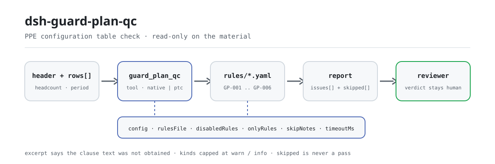

<div align="center">

<picture>
  <source media="(prefers-color-scheme: dark)" srcset="docs/assets/dsh-guard-plan-qc-flow-dark.svg">
  
</picture>

# dsh-guard-plan-qc

**Convierta una tabla de configuración de equipos de protección laboral en una lista de qué fila, qué columna y qué corregir — la conclusión queda en manos del revisor.**

Plugin verificador de datos para DeepSeek Harness: lee una tabla de configuración de equipos de protección laboral (la cabecera declara el número de personas y el periodo de configuración, y cada producto ocupa una fila), aplica el paquete de 6 reglas que trae (GP-001..GP-006) y solo enumera las divergencias que puede señalar dentro del material — nunca un juicio de cumplimiento, nunca una atribución de responsabilidad.

[Instalar](#instalación-en-tres-pasos) · [Configuración](#configuración) · [FAQ](#faq) · [简体中文](README.md) · [English](README.en.md) · [Español](README.es.md) · [Português](README.pt.md) · [हिन्दी](README.hi.md)

[](LICENSE)
[](#compatibilidad)
[](https://www.npmjs.com/package/dsh-guard-plan-qc)
[](https://github.com/PerryLink/dsh-guard-plan-qc/actions/workflows/ci.yml)
[](#compatibilidad)

[](https://github.com/PerryLink/dsh-guard-plan-qc/stargazers)
[](https://www.npmjs.com/package/dsh-guard-plan-qc)
[](https://dshfind.com/plugins/PerryLink/dsh-guard-plan-qc?ref=badge)
[](https://securityscorecards.dev/viewer/?uri=github.com/PerryLink/dsh-guard-plan-qc)
[](https://dsh.market/)
[](https://gitee.com/perrylink/dsh-guard-plan-qc)

```sh
dsh plugin --profile <name> add dsh-guard-plan-qc
```

</div>

<sub>Plugin comunitario, sin relación con DeepSeek. Repositorio canónico: <https://github.com/PerryLink/dsh-guard-plan-qc> (Gitee es un espejo).</sub>

## Qué es

`dsh-guard-plan-qc` lee una tabla de configuración de equipos de protección laboral —el número de personas y el periodo de configuración que declara el material, más una fila por producto configurado— y comprueba la completitud y la coherencia interna de esa tabla: que cada fila rellene 品名 (nombre), 规格型号 (especificación) y 配置数量 (cantidad), que la cantidad se analice como un número mayor que cero, que se pueda deducir del número de personas declarado por el factor por persona que usted configure, que la 发放日期 (fecha de entrega) caiga dentro del periodo de configuración, que la 有效截止日期 (fecha de caducidad) sea posterior a la fecha de entrega y que la tabla cubra las categorías de productos que usted exige.

No juzga si un equipo concreto es la protección correcta frente a un peligro concreto, si su nivel de protección basta ni si es equipo de protección especial; tampoco decide si la configuración cumple la normativa ni si hay responsabilidad alguna.

- **Para quién es**: responsables de seguridad y administradores de equipos de protección; no hace falta saber usar la línea de comandos — basta con entregar el material en el chat.
- **Qué aporta usted**: el material original sobre el que trabaja la comprobación (una tabla, un registro o un documento); el original nunca se modifica. Excel puede convertirse antes a JSON/YAML, incluso en el chat si la plataforma lo permite.
- **Qué recibe**: una lista de «qué fila, qué columna, qué falta y cómo corregirlo»; cada comprobación que no pudo ejecutarse se enumera en `skipped` con su motivo.

## Instalación en tres pasos

1. **Instalar** (elija un canal):

   ```sh
   # canal git (última main; equivale a git+https://github.com/PerryLink/dsh-guard-plan-qc.git)
   dsh plugin --profile <name> add github:PerryLink/dsh-guard-plan-qc
   # canal npm (versiones publicadas)
   dsh plugin --profile <name> add dsh-guard-plan-qc
   # canal tarball: tras pnpm pack en este repositorio
   dsh plugin --profile <name> add ./dsh-guard-plan-qc-<version>.tgz
   ```

   El canal npm instala el `lib/` ya construido; el canal git lo construye al instalar mediante el script `prepare` (tsdown), sin compilación manual.

2. **Configuración mínima** (los valores por defecto ya sirven; una fila del bundle sin `config` usa todos los valores por defecto y el paquete de reglas apunta al `rules/guard-plan-qc.yaml` incluido):

   ```yaml
   - insert:
       - id: dsh-guard-plan-qc
         name: dsh-guard-plan-qc
   ```

3. **Comprobar que ha montado**:

   ```sh
   dsh --profile <name> --dump-config | grep 'dsh-guard-plan-qc'
   ```

   Después entréguele una tabla. La salida esperada del ejemplo incluido (`samples/quickstart/expected/result.json`, entrada `samples/quickstart/input/GP-001-unsafe.json`):

   ```json
   {"tool":"guard_plan_qc","issueCount":1,"summary":{"error":0,"warn":0,"info":1},"skippedCount":5}
   ```

   Puede repetirlo en este repositorio (antes hay que construir `lib/` con `pnpm run build`):

   ```sh
   node samples/quickstart/run.mjs --json
   ```

**Desinstalar**: `dsh plugin --profile <name> remove dsh-guard-plan-qc` (o quite la fila del patch del perfil).

<details>
<summary>Usarlo en WorkBuddy / Coze</summary>

Busque «Safety Compliance Suite» en WorkBuddy / Coze (este control forma parte del conjunto; disponibilidad según el catálogo) para usar la misma capacidad de verificación sin línea de comandos.

</details>

<details>
<summary>Instalar desde el mercado de DSH Desktop</summary>

Todos los plugins de PerryLink están en el mercado integrado de DSH Desktop: **Mercado → Fuentes → Añadir fuente → pegar** `https://perrylink-dsh-catalog.perrylink.workers.dev/catalog-source.json` **→ seleccionar**. La instalación sigue exigiendo la verificación de identidad npm del mercado y su confirmación.

</details>

## Capacidades clave

`dsh-guard-plan-qc` registra la herramienta `guard_plan_qc`: lee una tabla de configuración, aplica el paquete de reglas versionado y devuelve un informe.

- **Seis reglas en un solo paquete de datos** — el paquete de reglas es datos, no código (`rules/guard-plan-qc.yaml`); cambiarlo cambia todo el conjunto de reglas sin tocar una línea de TypeScript.
- **Solo lectura sobre el material** — acepta JSON o YAML y nunca modifica el original; ESM puro, sin peticiones de red y sin llamadas al modelo.
- **Sin citas inventadas** — cada regla lleva `document` / `number` / `clause` / `excerpt` / `kind` / `source`; esta vez el paquete no obtuvo ningún texto literal de GB 39800.1, por lo que cada `excerpt` lo dice expresamente y queda marcado `derived-from-principle` o `institutional-configuration`: una descripción nunca se disfraza de cita.
- **La gravedad sigue a la evidencia** — `derived-from-principle` queda topada en `warn`, la configuración de la institución (`institutional-configuration`) en `info`, y un test lo afirma.
- **Una lista de incidencias vacía nunca es «no hay nada mal»** — cada comprobación que no pudo ejecutarse se declara en `skipped` con su motivo; la regla cuya lista `factors` o `requiredCategories` no está configurada se declara en `skipped` en lugar de pasar en silencio.
- **Sin factores por persona ni listas de productos incorporadas** — «cuántos artículos por persona» y «qué productos debe cubrir esta obra» varían con la categoría del equipo, el tipo de trabajo y el estándar de su institución, así que el plugin no codifica ninguno. Por eso tampoco detecta la carencia más importante: un producto que debería estar configurado y no aparece.
- **Lenguaje que no sentencia** — el informe enumera diferencias y nunca se pronuncia sobre cumplimiento, responsabilidad o corrección; una guarda de redacción lo impone y todo informe lleva el descargo de responsabilidad.

| Regla | Qué comprueba | Gravedad | Tipo de base |
|---|---|---|---|
| `GP-001` | cada fila rellena nombre, especificación y cantidad | info | institutional-configuration |
| `GP-002` | la cantidad se analiza como un número mayor que cero | warn | derived-from-principle |
| `GP-003` | la cantidad cuadra con el número de personas × el factor por persona (desactivada por defecto) | info | institutional-configuration |
| `GP-004` | la fecha de entrega cae dentro del periodo de configuración | warn | derived-from-principle |
| `GP-005` | la fecha de caducidad es posterior a la fecha de entrega | warn | derived-from-principle |
| `GP-006` | la tabla cubre las categorías que usted exige (desactivada por defecto) | info | institutional-configuration |

### Ejemplos

Estos son los puntos de entrada reales del plugin; instálelo una vez y llame a uno. La primera fila de la tabla siguiente es el caso detallado y las demás son casos breves.

**Ejemplo detallado** — herramienta `guard_plan_qc`, entrada:

```json
{"headcount":20,"rows":[{"品名":"安全帽","配置数量":"若干"}]}
```

Salida:

```json
{
  "id": "dsh-guard-plan-qc.GP-002.4f14475e",
  "ruleId": "GP-002",
  "severity": "warn",
  "locator": {
    "column": "配置数量",
    "row": 1
  },
  "found": "第 1 行配置数量「若干」不是数字",
  "expected": "配置数量应写成数字（可带单位，如「2双」）",
  "fix": "改用数字填写，例如 2 或 2双"
}
```

*Observado en `tests/fixtures/GP-002/GP-002-unsafe.json (cases.json expects GP-002 count 1); run via lib/index.mjs rules/guard-plan-qc.yaml`*

| Usted pregunta | Qué responde |
|---|---|
| Una fila tiene el nombre, pero deja 规格型号 vacío. ¿Se informa? | Sí. `GP-001` exige que cada fila rellene los campos de `requiredFields` —de fábrica 品名, 规格型号 y 配置数量, sustituibles por las columnas de su propia tabla— e informa de la fila junto con los campos que le faltan; una celda vacía cuenta como no rellenada. Comprueba que las columnas estén rellenas, no que el producto o su especificación sean los correctos. |
| La celda de 配置数量 dice 若干. ¿Es lo mismo que una cantidad de cero? | No. `GP-002` informa de ambos por separado: un valor que no puede analizar (como 若干) se informa como que no es un número, mientras que un valor que sí analiza pero no es mayor que cero se informa con la propia cifra. «2双», «１，２００» y «2 件» se analizan, con la unidad pegada. No comprueba si la cifra es real ni si la cantidad basta; con `checkQuantity` en false la regla no se ejecuta. |
| El número de personas es 20 y `factors` da 2 guantes aislantes por persona, pero la fila configura 30. ¿Se detecta? | Sí, una vez configurado `factors`. `GP-003` multiplica el factor por persona por el número de personas e informa de la fila coincidente cuya cantidad difiere más de su `tolerance`. `factors` viene vacío de fábrica, así que tal como se entrega la regla se declara en `skipped` con ese motivo en lugar de pasar en silencio; también se declara ahí si el material no declara el número de personas. El factor es el dato que usted consultó, no una cifra nacional: la regla no juzga si es razonable. |
| El periodo de configuración es 2026-03-01 a 2026-03-31 y una 发放日期 dice 2026-02-20. ¿Se informa? | Sí. `GP-004` informa de que esa fila es anterior a `periodFrom`. El periodo procede de `periodFrom` / `periodTo` en el nivel superior del material; si faltan los dos, la regla se declara en `skipped` en lugar de suponer un periodo, y una fecha que no puede analizar se informa aparte en vez de omitirse en silencio. |
| La 有效截止日期 es el mismo día que la 发放日期. ¿Pasa? | No. `GP-005` exige que la fecha de caducidad sea posterior a la fecha de entrega e informa de la fila cuando no lo es, y solo se ejecuta si la fila trae ambas fechas. Si ese periodo de validez es lo bastante largo —depende del producto y del puesto de trabajo— no se juzga. |
| La tabla pone 安全帽 y mi lista de categorías requeridas pone 安全头盔. ¿Se informará como no cubierta? | Sí. `GP-006` compara por contención literal contra 品名 y 规格型号, así que otra forma de nombrar el mismo producto se informa como no cubierta; incluya también las variantes habituales o unifique la terminología de la tabla. `requiredCategories` viene vacío de fábrica, así que tal como se entrega la regla se declara en `skipped`. Solo comprueba si la categoría aparece, no si el producto es apto para la obra. |

## Normas que sigue

| Documento | Número | Reglas que lo citan |
|---|---|---|
| 《个体防护装备配备规范》 (especificación de dotación de equipos de protección individual) | GB 39800.1—2020（个体防护装备配备规范 第1部分：总则；标准号不带"/T"⇒强制性；2020-12-24 发布、2022-01-01 实施；主管部门应急管理部；条号本次未取得） | GP-001, GP-002, GP-003, GP-004, GP-005, GP-006 |

**Límite:** este plugin comprueba una **tabla de configuración de equipos de protección laboral** en lo que una tabla puede exigir: que cada fila nombre un producto con especificación y cantidad, que la cantidad sea un número positivo, que cuadre con el número de personas que declara el material, que la fecha de entrega caiga dentro del periodo de configuración, que una fecha de caducidad siga a la de entrega y que la tabla cubra las categorías que usted exige. **No** juzga si un equipo concreto es la protección correcta frente a un peligro concreto, si su nivel de protección basta ni si es equipo de protección especial.

> ### ⚠️ Lea esto antes de fiarse de una cita del informe
>
> **Todos los `excerpt` del paquete de reglas de este plugin dicen, con todas las letras, que el texto de la cláusula no se obtuvo.** El régimen vive en **GB 39800.1《个体防护装备配备规范》** (por partes) y en el 《劳动防护用品监督管理规定》. La pasada de verificación de este plugin no pudo recuperar el texto literal de esas cláusulas, así que en lugar de parafrasear una cita el paquete declara el vacío en el propio campo `excerpt` y pone el razonamiento honesto en `note`. Por eso todo queda topado en `warn` (derivado de principio) o `info` (configurado localmente), y un test afirma que ninguna regla reclama una cita que no tiene. **Cuando se disponga de los textos hay que hacer dos cosas: sustituir cada `excerpt` por la cláusula real y elevar `kind` a `direct`.**
>
> **Los dos números que harían poderoso a este plugin son los dos que se niega a inventar.** Cuántos artículos necesita cada persona (`GP-003` `factors`) y qué categorías de producto debe cubrir un trabajo (`GP-006` `requiredCategories`) dependen de la identificación de peligros de *su* proyecto, no de una cifra nacional. Ambos salen **vacíos**, y la regla cuya lista no está configurada se declara en `skipped` en lugar de pasar.
>
> La conclusión es del revisor: este plugin enumera diferencias que puede señalar en el material y no decide hechos ni cumplimiento.

## Configuración

Todos los parámetros ajustables son campos Schemastery `Config` en `src/config.ts` (modificables desde cordis.yml); los umbrales por regla viven en el paquete de reglas bajo `rules/`. Una sobrescritura dirigida por id sustituye la fila entera: repita todas las claves que necesite.

| Clave | Tipo | Predeterminado | Descripción |
|---|---|---|---|
| `rulesFile` | string | `rules/guard-plan-qc.yaml` | Ruta del paquete de reglas, relativa a la raíz del paquete |
| `disabledRules` | string[] | `[]` | Ids de reglas que se dejan de ejecutar; cada una aparece en `skipped` |
| `onlyRules` | string[] | `[]` | Ejecutar solo estas reglas; vacío ejecuta todas |
| `skipNotes` | string | `""` | Nota añadida a cada motivo de `skipped` |
| `timeoutMs` | number | `120000` | Presupuesto de tiempo de espera cooperativo de la herramienta |

Parámetros por regla que conviene conocer:

- `GP-001` `requiredFields` — por defecto, las tres columnas exigidas (nombre, especificación y cantidad); sustitúyalas por las columnas de su propio formulario.
- `GP-002` `checkQuantity` — póngalo en `false` para dejar de comprobar la cantidad.
- `GP-003` `factors` — sus factores por persona; cada entrada es `{ match, perPerson, tolerance }`, donde `match` es una prueba de contención sobre el nombre del producto.
- `GP-006` `requiredCategories` — las categorías de producto que su obra debe cubrir; cada entrada se compara literalmente con el nombre y la especificación. También puede pasarse en cada llamada.

Ejemplo de sobrescritura en el patch del perfil:

```yaml
- insert:
    - id: dsh-guard-plan-qc
      name: dsh-guard-plan-qc
      config:
        disabledRules: [GP-006]
        timeoutMs: 180000
```

## Formato del material

La herramienta acepta JSON o YAML:

```yaml
subject: 某某厂房工程
headcount: 20
periodFrom: 2026-03-01
periodTo: 2026-03-31
rows:
  - { 品名: 安全帽,   规格型号: V 型 黄色, 配置数量: "20", 发放日期: 2026-03-05, 有效截止日期: 2028-03-04 }
  - { 品名: 绝缘手套, 规格型号: 12kV,      配置数量: "40", 发放日期: 2026-03-05 }
```

Las cantidades se leen como cadenas, así que una exportación de hoja de cálculo sirve tal cual: `2` con la unidad pegada, `1,200`, dígitos de ancho completo y `1.5` se analizan. Una celda que no es un número (palabras, o vacía) se informa como no analizable, lo que es **distinto** de una cantidad de cero: las dos necesitan arreglos diferentes, así que producen hallazgos diferentes.

`GP-004` necesita `periodFrom` y/o `periodTo`; sin ninguno, se declara en `skipped` en lugar de suponer un periodo. `GP-003` necesita `headcount`; si falta, lo dice. Los campos son opcionales en la capa de lectura y los valida el motor, de modo que una exportación parcial produce hallazgos de «falta esto» en lugar de un fallo.

## Fuentes de las reglas

Los datos de las reglas viven en `rules/guard-plan-qc.yaml`, separados del código: cada regla lleva documento, número, cláusula en la numeración propia de la fuente, extracto literal y URL de origen. La cabecera del paquete declara el vacío de citas por completo, y el `note` de cada regla repite la parte que le concierne. La guarda de carga exige `document` / `clause` / `excerpt` / `source` y prohíbe que una comprobación derivada de principio o configurada localmente se declare `error`; pero no distingue una cita de una descripción, así que este paquete se apoya en la cabecera, en los `note` de cada regla y en un test que afirma que cada `excerpt` admite el vacío. `check:citations` audita los extractos: en esta pasada las 6 reglas cuentan como «texto no obtenido» y `rules/citations-baseline.json` mantiene una base de 0 que solo puede encogerse. Un paquete que exagera su base falla al cargar en lugar de producir un informe de apariencia sólida.

## FAQ

<details>
<summary>¿Me dirá qué hay que configurar y en qué cantidad?</summary>

No: es el límite más importante del plugin. Cuántos artículos necesita cada persona (`GP-003` `factors`) y qué categorías debe cubrir una obra (`GP-006` `requiredCategories`) dependen de la identificación de peligros de su proyecto; ambos salen vacíos, y la regla sin configurar se declara en `skipped` en vez de darle una cifra genérica. Juzgar si un equipo basta y es adecuado exige identificación de peligros y certificación de producto, así que la conclusión queda en manos de los profesionales de seguridad y salud laboral.

</details>

<details>
<summary>¿Por qué el informe no trae ningún `error`, solo `warn` o `info`?</summary>

Porque la gravedad sigue a la evidencia: una comprobación derivada de principio (`kind: derived-from-principle`) queda topada en `warn`, una configuración de la institución (`kind: institutional-configuration`) en `info`, y un test lo afirma. Este paquete no obtuvo texto literal de GB 39800.1, así que no existe base `direct` y un `error` no estaría justificado. Enumera diferencias; no emite juicios reglados.

</details>

<details>
<summary>¿Una lista `issues` vacía puede leerse como «no hay nada mal»?</summary>

No. Cada comprobación que no pudo ejecutarse aparece en `skipped` con su motivo (una lista sin configurar, un `headcount` ausente, ningún periodo declarado, etc.). Lea `issues` y `skipped` juntos antes de sacar cualquier conclusión; `skippedCount` solo cuenta las reglas que de verdad no se ejecutaron, no las que se ejecutaron limpias.

</details>

<details>
<summary>Mi tabla es un Excel. ¿Puedo usarla directamente?</summary>

Sí: conviértala antes a JSON o YAML; en el chat la plataforma puede hacer la conversión si lo admite. La herramienta solo lee el material y nunca modifica el original; sin peticiones de red y sin llamadas al modelo, el material no sale de su máquina.

</details>

<details>
<summary>¿Aguantará un conjunto entero de tablas o un directorio de una vez?</summary>

La herramienta funciona en los modos `native` y `ptc`; para trabajo por lotes (por ejemplo, el conjunto de tablas de configuración de una obra) use `ptc`, donde el coste del esquema se paga una vez. Las comprobaciones son comparación local de campos y números: sin peticiones de red, sin llamadas al modelo; `timeoutMs` (120 s por defecto) es el presupuesto de tiempo de espera cooperativo.

</details>

## Solución de problemas

- **`GP-003` o `GP-006` se declaran en `skipped`.** Sus listas están vacías. `factors` y `requiredCategories` proceden de su identificación de peligros y el plugin no las adivina.
- **`GP-003` salta en una cantidad que fijé a propósito.** El factor configurado no es el que se está usando, o el número de personas del material está desactualizado. Suba `tolerance` o corrija el factor.
- **`GP-006` salta en un producto que sí está en la tabla.** La comparación es una prueba literal de contención sobre el nombre y la especificación, así que otra grafía del mismo producto no coincide. Incluya las grafías que usa o unifique la tabla.
- **`GP-004` no informa de nada sobre fechas.** No se declaró ningún periodo de configuración, o la tabla no trae fecha de entrega; en ambos casos la regla lo dice en `skipped`.
- **El plugin se instala pero la herramienta no aparece.** Compruebe que `main` resuelve a `lib/index.mjs` y que `pnpm run build` lo generó; un `main` equivocado hace que el cargador omita la entrada en silencio.
- **`dsh plugin add` rechaza el paquete por incompatibilidad.** El rango de peers cubre `0.1.x` y `0.2.x`; si su runtime queda fuera, conceda una exención explícita: `dsh plugin --profile <name> allow-version dsh-guard-plan-qc@0.1.0 --dsh-version <runtime> --accept-risk`
- **`check` informa `manifest-peers` como fallo.** El comprobador estático compara con un rango de peers codificado que es anterior a la línea 0.2; el runtime aplica la compatibilidad de peers al instalar, así que el rango declarado es el correcto. Es un problema conocido de `dsh-plugin-dev`.
- **Las horas parecen desplazadas.** Toda la aritmética es de hora de pared sobre las cadenas que usted entrega; no se hace conversión de zona horaria.

## Compatibilidad

| Superficie | Estado |
|---|---|
| Harness | Rango de peers `>=0.1.2-rc.1 <0.2.0 \|\| >=0.2.0-0 <0.3.0` — verificado para aceptar tanto `0.2.0-rc.2` como `0.2.1-rc.2`. `engines.dsh` se declara como `>=0.2.1-0 <0.3.0` y el host lo aplica desde 0.2.1 |
| Node | `^22.19.0 \|\| >=24.0.0` |
| Plataformas | Todas (ESM puro; sin código nativo, sin red, sin llamada al modelo) |
| Modo de herramienta | Funciona en `native` y `ptc`; para un directorio completo use `ptc` |

## Ecosistema y calidad

- [Espejo en Gitee](https://gitee.com/perrylink/dsh-guard-plan-qc) (espejo sincronizado; GitHub es el canónico)
- [Página del plugin en dshfind](https://dshfind.com/plugins/PerryLink/dsh-guard-plan-qc) (instalaciones y ranking)
- [Informe OpenSSF Scorecard](https://securityscorecards.dev/viewer/?uri=github.com/PerryLink/dsh-guard-plan-qc) (lo ejecuta [.github/workflows/scorecard.yml](.github/workflows/scorecard.yml))
- [DSH Market](https://dsh.market/) (publicado)
- **Canal de la tienda 1024**: `npm i -g dsh1024` una vez y luego `dsh1024 plugin --profile <name> add dsh-guard-plan-qc` (cuenta para el ranking de instalaciones de [deepseek1024.com](https://deepseek1024.com))
- [Base de conocimiento del ecosistema](https://perrylink.github.io/dsh-plugin-guide/): guía de desarrollo de plugins · datos medidos de selección · criterios de mantenimiento

## Desarrollo

```sh
pnpm install                                        # node ^22.19 || >=24
pnpm run typecheck                                  # tsc --noEmit
pnpm test                                           # vitest: un conjunto de fixtures por regla
pnpm run build                                      # tsdown -> lib/index.mjs + lib/index.d.mts
pnpm run verify:self-contained                      # las dependencias resuelven desde el registry
pnpm run check:lockfile                             # comprobación de deriva del lockfile
pnpm run check:readmes                              # consistencia de los README en cinco idiomas
pnpm run check:citations                            # comprobación de citas del paquete de reglas
node ../scripts/sync-shared.mjs dsh-guard-plan-qc    # refrescar src/shared desde ../_shared
pnpm pack                                           # el tarball publicado
```

El plugin es **solo datos**: `src/config.ts` declara todos los parámetros, el kit compartido aporta el lector y el motor de comprobación, y el paquete de reglas declara cada comprobación. Ejecución local del ejemplo (antes hay que construir `lib/` con `pnpm run build`):

```sh
node samples/quickstart/run.mjs
# => guard_plan_qc: 1 issue(s) — error 0, warn 0, info 1
# => skipped: 5
```

La entrada del ejemplo está en `samples/quickstart/input/`, la salida esperada en `samples/quickstart/expected/result.json` y la captura en `docs/assets/quickstart.png`. Las imágenes del README las genera por programa [`scripts/gen-readme-assets.py`](scripts/gen-readme-assets.py) (Python + Pillow) y se pueden volver a ejecutar sin riesgo; el diagrama de flujo antiguo de una sola variante y las imágenes de demostración se quedan en `docs/assets/` para enlaces externos, mientras los README solo citan el par claro/oscuro nuevo.

Temas: `deepseek-harness`, `dsh`, `dsh-plugin`, `cordis`, `guard`, `plan`

## Familia y agradecimientos

Este proyecto forma parte de la familia de plugins de DeepSeek Harness de [PerryLink](https://github.com/PerryLink) (todos Apache-2.0). Índice completo: [elegir un verificador por material](https://perrylink.github.io/zh/checkers/choose/) y [todos los plugins](https://github.com/PerryLink). Si le resulta útil, **una estrella ayuda a que la siguiente persona lo encuentre** — no desbloquea nada.

- [@PerryLink](https://github.com/PerryLink) — creador y mantenedor: el paquete de reglas de datos (GP-001..GP-006), la herramienta `guard_plan_qc`, la base de citas y la documentación en cinco idiomas.

<details>
<summary>Ver todos los plugins</summary>

| Plugin | Estado |
|---|---|
| **[dsh-aqua-input-check](https://github.com/PerryLink/dsh-aqua-input-check)** |  |
| **[dsh-archive-check](https://github.com/PerryLink/dsh-archive-check)** |  |
| **[dsh-auto-review](https://github.com/PerryLink/dsh-auto-review)** |  |
| **[dsh-autotier](https://github.com/PerryLink/dsh-autotier)** | 🧊 CONGELADO — ver el README del repo |
| **[dsh-bid-ca-precheck](https://github.com/PerryLink/dsh-bid-ca-precheck)** |  |
| **[dsh-bid-qual-check](https://github.com/PerryLink/dsh-bid-qual-check)** |  |
| **[dsh-cert-mcp](https://github.com/PerryLink/dsh-cert-mcp)** | 🧊 CONGELADO — ver el README del repo |
| **[dsh-checkpoint-rewind](https://github.com/PerryLink/dsh-checkpoint-rewind)** |  |
| **[dsh-click](https://github.com/PerryLink/dsh-click)** |  |
| **[dsh-composer-history](https://github.com/PerryLink/dsh-composer-history)** |  |
| **[dsh-contract-stance](https://github.com/PerryLink/dsh-contract-stance)** |  |
| **[dsh-customs-doc-check](https://github.com/PerryLink/dsh-customs-doc-check)** |  |
| **[dsh-data-quality](https://github.com/PerryLink/dsh-data-quality)** | 🧊 CONGELADO — ver el README del repo |
| **[dsh-demurrage-ledger](https://github.com/PerryLink/dsh-demurrage-ledger)** |  |
| **[dsh-doublecheck](https://github.com/PerryLink/dsh-doublecheck)** |  |
| **[dsh-drill-script-check](https://github.com/PerryLink/dsh-drill-script-check)** |  |
| **[dsh-eia-guide-check](https://github.com/PerryLink/dsh-eia-guide-check)** |  |
| **[dsh-emergency-plan](https://github.com/PerryLink/dsh-emergency-plan)** |  |
| **[dsh-essay-rubric-check](https://github.com/PerryLink/dsh-essay-rubric-check)** |  |
| **[dsh-evidence-check](https://github.com/PerryLink/dsh-evidence-check)** |  |
| **[dsh-export-ctl-check](https://github.com/PerryLink/dsh-export-ctl-check)** |  |
| **[dsh-fast](https://github.com/PerryLink/dsh-fast)** |  |
| **[dsh-fmea-table-check](https://github.com/PerryLink/dsh-fmea-table-check)** |  |
| **[dsh-forecast-penalty](https://github.com/PerryLink/dsh-forecast-penalty)** |  |
| **[dsh-fund-research](https://github.com/PerryLink/dsh-fund-research)** |  |
| **[dsh-github](https://github.com/PerryLink/dsh-github)** |  |
| **[dsh-gongwen-flow-check](https://github.com/PerryLink/dsh-gongwen-flow-check)** |  |
| **[dsh-gongwen-word-check](https://github.com/PerryLink/dsh-gongwen-word-check)** |  |
| **[dsh-guard-plan-qc](https://github.com/PerryLink/dsh-guard-plan-qc)** |  |
| **[dsh-hazchem-check](https://github.com/PerryLink/dsh-hazchem-check)** |  |
| **[dsh-hazplan-check](https://github.com/PerryLink/dsh-hazplan-check)** |  |
| **[dsh-hidden-risk-map](https://github.com/PerryLink/dsh-hidden-risk-map)** |  |
| **[dsh-hs-classify](https://github.com/PerryLink/dsh-hs-classify)** |  |
| **[dsh-icd-rule-check](https://github.com/PerryLink/dsh-icd-rule-check)** |  |
| **[dsh-industry-research](https://github.com/PerryLink/dsh-industry-research)** |  |
| **[dsh-lawcite-adapter](https://github.com/PerryLink/dsh-lawcite-adapter)** |  |
| **[dsh-laya](https://github.com/PerryLink/dsh-laya)** |  |
| **[dsh-lc-doc-check](https://github.com/PerryLink/dsh-lc-doc-check)** |  |
| **[dsh-learning-gap-check](https://github.com/PerryLink/dsh-learning-gap-check)** |  |
| **[dsh-library](https://github.com/PerryLink/dsh-library)** |  |
| **[dsh-local-ai](https://github.com/PerryLink/dsh-local-ai)** |  |
| **[dsh-lsp-actions](https://github.com/PerryLink/dsh-lsp-actions)** |  |
| **[dsh-mask](https://github.com/PerryLink/dsh-mask)** |  |
| **[dsh-mcp-panel](https://github.com/PerryLink/dsh-mcp-panel)** |  |
| **[dsh-medrec-qc](https://github.com/PerryLink/dsh-medrec-qc)** |  |
| **[dsh-memento](https://github.com/PerryLink/dsh-memento)** | 🧊 CONGELADO — ver el README del repo |
| **[dsh-nsfc-form-check](https://github.com/PerryLink/dsh-nsfc-form-check)** |  |
| **[dsh-nurse-record-check](https://github.com/PerryLink/dsh-nurse-record-check)** |  |
| **[dsh-observe](https://github.com/PerryLink/dsh-observe)** |  |
| **[dsh-origin-rvc-check](https://github.com/PerryLink/dsh-origin-rvc-check)** |  |
| **[dsh-ota-review-check](https://github.com/PerryLink/dsh-ota-review-check)** |  |
| **[dsh-output-styles](https://github.com/PerryLink/dsh-output-styles)** |  |
| **[dsh-paper-doc-adapter](https://github.com/PerryLink/dsh-paper-doc-adapter)** |  |
| **[dsh-permission-rules](https://github.com/PerryLink/dsh-permission-rules)** |  |
| **[dsh-permit-report-check](https://github.com/PerryLink/dsh-permit-report-check)** |  |
| **[dsh-pipeline-check](https://github.com/PerryLink/dsh-pipeline-check)** |  |
| **[dsh-pleading-draft](https://github.com/PerryLink/dsh-pleading-draft)** |  |
| **[dsh-plugin-doctor](https://github.com/PerryLink/dsh-plugin-doctor)** | 🚫 RETIRADO (repo archivado) |
| **[dsh-plugin-guide](https://github.com/PerryLink/dsh-plugin-guide)** |  |
| **[dsh-plugin-kit](https://github.com/PerryLink/dsh-plugin-kit)** | 🚫 RETIRADO (repo archivado) |
| **[dsh-plugin-upgrade](https://github.com/PerryLink/dsh-plugin-upgrade)** | 🚫 RETIRADO (repo archivado) |
| **[dsh-policy-brief-draft](https://github.com/PerryLink/dsh-policy-brief-draft)** |  |
| **[dsh-power-loss-split](https://github.com/PerryLink/dsh-power-loss-split)** |  |
| **[dsh-power-ticket-check](https://github.com/PerryLink/dsh-power-ticket-check)** |  |
| **[dsh-ppap-check](https://github.com/PerryLink/dsh-ppap-check)** |  |
| **[dsh-protest-deadline](https://github.com/PerryLink/dsh-protest-deadline)** |  |
| **[dsh-railway-window](https://github.com/PerryLink/dsh-railway-window)** |  |
| **[dsh-repair-order-qc](https://github.com/PerryLink/dsh-repair-order-qc)** |  |
| **[dsh-research-report](https://github.com/PerryLink/dsh-research-report)** |  |
| **[dsh-review-reply-check](https://github.com/PerryLink/dsh-review-reply-check)** |  |
| **[dsh-rulefile-check](https://github.com/PerryLink/dsh-rulefile-check)** |  |
| **[dsh-safety-brief-check](https://github.com/PerryLink/dsh-safety-brief-check)** |  |
| **[dsh-score](https://github.com/PerryLink/dsh-score)** | 🧊 CONGELADO — ver el README del repo |
| **[dsh-session-sync](https://github.com/PerryLink/dsh-session-sync)** |  |
| **[dsh-site-log-check](https://github.com/PerryLink/dsh-site-log-check)** |  |
| **[dsh-skill-pack-security](https://github.com/PerryLink/dsh-skill-pack-security)** |  |
| **[dsh-soe-decision-check](https://github.com/PerryLink/dsh-soe-decision-check)** |  |
| **[dsh-soilwater-check](https://github.com/PerryLink/dsh-soilwater-check)** |  |
| **[dsh-sop-sync-check](https://github.com/PerryLink/dsh-sop-sync-check)** |  |
| **[dsh-spc-gbt-adapter](https://github.com/PerryLink/dsh-spc-gbt-adapter)** |  |
| **[dsh-talk](https://github.com/PerryLink/dsh-talk)** |  |
| **[dsh-tender-extract](https://github.com/PerryLink/dsh-tender-extract)** |  |
| **[dsh-tender-matrix](https://github.com/PerryLink/dsh-tender-matrix)** |  |
| **[dsh-test-drive](https://github.com/PerryLink/dsh-test-drive)** |  |
| **[dsh-ticktick](https://github.com/PerryLink/dsh-ticktick)** | 🚫 RETIRADO (repo archivado) |
| **[dsh-translate](https://github.com/PerryLink/dsh-translate)** |  |
| **[dsh-warranty-calc](https://github.com/PerryLink/dsh-warranty-calc)** |  |
| **[dsh-budget](https://github.com/PerryLink/dsh-budget)** | 🧊 CONGELADO — ver el README del repo |
| **[dsh-claude-move](https://github.com/PerryLink/dsh-claude-move)** | 🧊 CONGELADO — ver el README del repo |
| **[dsh-defend](https://github.com/PerryLink/dsh-defend)** | 🧊 CONGELADO — ver el README del repo |
| **[dsh-draw](https://github.com/PerryLink/dsh-draw)** | 🧊 CONGELADO — ver el README del repo |
| **[dsh-reach](https://github.com/PerryLink/dsh-reach)** | 🧊 CONGELADO — ver el README del repo |
| **[dsh-background-agents](https://github.com/PerryLink/dsh-background-agents)** | 🚫 RETIRADO (repo archivado) |
| **[dsh-session-pin](https://github.com/PerryLink/dsh-session-pin)** | 🚫 RETIRADO (repo archivado) |
| **[dsh-team-rooms](https://github.com/PerryLink/dsh-team-rooms)** | 🚫 RETIRADO (repo archivado) |

</details>

## Licencia

[LICENSE](LICENSE) (Apache License 2.0) © 2026 dsh-guard-plan-qc contributors

<p align="center"><sub>Apache-2.0 · Plugin comunitario, sin relación con DeepSeek.</sub></p>
