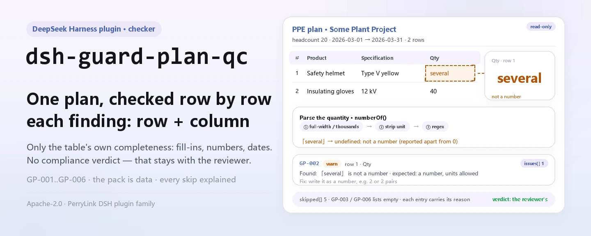
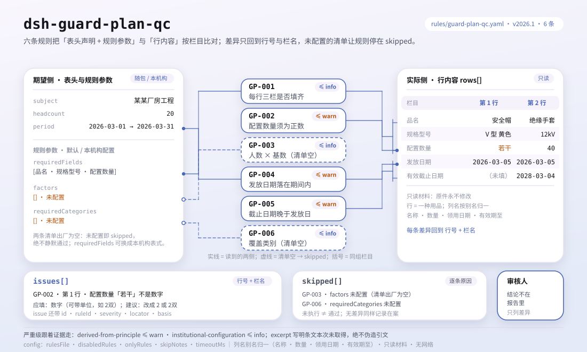

<div align="center">

<picture>
  <source media="(prefers-color-scheme: dark)" srcset="docs/assets/dsh-guard-plan-qc-hero-en-dark.webp">
  
</picture>

# dsh-guard-plan-qc

**एक श्रम सुरक्षा उपकरण विन्यास तालिका को «कौन-सी पंक्ति, कौन-सा स्तंभ, क्या सुधारें» की सूची में बदलें — अंतिम निर्णय समीक्षक के पास रहता है।**

DeepSeek Harness के लिए डेटा-आधारित जाँच प्लगइन: एक उपकरण विन्यास तालिका पढ़ता है (शीर्ष में व्यक्तियों की संख्या और विन्यास अवधि, तथा हर उपकरण के लिए एक पंक्ति), साथ आने वाले 6 नियमों का पैक (GP-001..GP-006) लागू करता है, और केवल वे अंतर गिनाता है जिन्हें सामग्री के भीतर इंगित किया जा सकता है — कोई अनुपालन निर्णय नहीं, कोई दायित्व निर्धारण नहीं।

[इंस्टॉल](#तीन-चरणों-में-शुरुआत) · [कॉन्फ़िगरेशन](#कॉन्फ़िगरेशन) · [FAQ](#faq) · [简体中文](README.md) · [English](README.en.md) · [Español](README.es.md) · [Português](README.pt.md) · [हिन्दी](README.hi.md)

[](LICENSE)
[](#संगतता)
[](https://www.npmjs.com/package/dsh-guard-plan-qc)
[](https://github.com/PerryLink/dsh-guard-plan-qc/actions/workflows/ci.yml)
[](#संगतता)

[](https://github.com/PerryLink/dsh-guard-plan-qc/stargazers)
[](https://www.npmjs.com/package/dsh-guard-plan-qc)
[](https://dshfind.com/plugins/PerryLink/dsh-guard-plan-qc?ref=badge)
[](https://securityscorecards.dev/viewer/?uri=github.com/PerryLink/dsh-guard-plan-qc)
[](https://dsh.market/)
[](https://gitee.com/perrylink/dsh-guard-plan-qc)

```sh
dsh plugin --profile <name> add dsh-guard-plan-qc
```

</div>

<sub>समुदाय प्लगइन, DeepSeek से संबद्ध नहीं। मानक रेपो: <https://github.com/PerryLink/dsh-guard-plan-qc> (Gitee एक मिरर है)।</sub>

## यह क्या है

`dsh-guard-plan-qc` एक श्रम सुरक्षा उपकरण विन्यास तालिका पढ़ता है — सामग्री में घोषित व्यक्तियों की संख्या और विन्यास अवधि, तथा प्रत्येक उपकरण की एक पंक्ति — और उसी तालिका की पूर्णता तथा आंतरिक संगति की जाँच करता है: क्या हर पंक्ति में 品名 (नाम), 规格型号 (विनिर्देश) और 配置数量 (मात्रा) भरे हैं, क्या मात्रा शून्य से बड़ी संख्या के रूप में पढ़ी जाती है, क्या वह घोषित व्यक्तियों की संख्या और आपके द्वारा कॉन्फ़िगर किए प्रति-व्यक्ति आधार से निकाली जा सकती है, क्या 发放日期 (वितरण तिथि) विन्यास अवधि के भीतर पड़ती है, क्या 有效截止日期 (वैधता अंत तिथि) वितरण तिथि के बाद है, और क्या तालिका आपकी अपेक्षित उपकरण श्रेणियों को समेटती है।

यह नहीं आँकता कि कोई उपकरण किसी विशेष संकट के विरुद्ध सही सुरक्षा है या नहीं, उसका सुरक्षा-स्तर पर्याप्त है या नहीं, या वह विशेष सुरक्षात्मक उपकरण है या नहीं; यह भी नहीं तय करता कि विन्यास अनुपालन में है या कोई दायित्व बनता है।

- **किसके लिए**: सुरक्षा अधिकारी और उपकरण प्रशासक; कमांड लाइन जानने की ज़रूरत नहीं — सामग्री चैट में सौंप दें।
- **आप क्या देते हैं**: जाँच की जाने वाली मूल सामग्री (तालिका, रजिस्टर या दस्तावेज़); मूल कभी नहीं बदला जाता। Excel को पहले JSON/YAML में बदला जा सकता है, प्लेटफ़ॉर्म दे तो चैट में भी।
- **आपको क्या मिलता है**: «कौन-सी पंक्ति, कौन-सा स्तंभ, क्या छूटा, कैसे सुधारें» की सूची; जो जाँच नहीं चल पाई वह `skipped` में कारण के साथ दर्ज होती है।

<picture>
  <source media="(prefers-color-scheme: dark)" srcset="docs/assets/dsh-guard-plan-qc-flow-v5-dark.svg">
  
</picture>

## तीन चरणों में शुरुआत

1. **इंस्टॉल करें** (कोई एक माध्यम चुनें):

   ```sh
   # git माध्यम (नवीनतम main; git+https://github.com/PerryLink/dsh-guard-plan-qc.git के बराबर)
   dsh plugin --profile <name> add github:PerryLink/dsh-guard-plan-qc
   # npm माध्यम (प्रकाशित संस्करण)
   dsh plugin --profile <name> add dsh-guard-plan-qc
   # tarball माध्यम: इस रेपो में pnpm pack के बाद
   dsh plugin --profile <name> add ./dsh-guard-plan-qc-<version>.tgz
   ```

   npm माध्यम पहले से बना `lib/` देता है; git माध्यम इंस्टॉल के समय `prepare` स्क्रिप्ट (tsdown) से बनाता है, हाथ से कंपाइल करने की ज़रूरत नहीं।

2. **न्यूनतम कॉन्फ़िगरेशन** (डिफ़ॉल्ट ही काफ़ी हैं; bundle पंक्ति में `config` न हो तो सब डिफ़ॉल्ट चलते हैं और नियम-पैक का पथ साथ आए `rules/guard-plan-qc.yaml` पर जाता है):

   ```yaml
   - insert:
       - id: dsh-guard-plan-qc
         name: dsh-guard-plan-qc
   ```

3. **जाँचें कि माउंट हुआ**:

   ```sh
   dsh --profile <name> --dump-config | grep 'dsh-guard-plan-qc'
   ```

   फिर एक तालिका सौंपें। साथ आए नमूने का अपेक्षित आउटपुट (`samples/quickstart/expected/result.json`, इनपुट `samples/quickstart/input/GP-001-unsafe.json`):

   ```json
   {"tool":"guard_plan_qc","issueCount":1,"summary":{"error":0,"warn":0,"info":1},"skippedCount":5}
   ```

   इस रेपो में दोबारा चला सकते हैं (पहले `pnpm run build` से `lib/` बनाएँ):

   ```sh
   node samples/quickstart/run.mjs --json
   ```

**अनइंस्टॉल**: `dsh plugin --profile <name> remove dsh-guard-plan-qc` (या प्रोफ़ाइल पैच से वह पंक्ति हटा दें)।

<details>
<summary>WorkBuddy / Coze में इस्तेमाल करें</summary>

WorkBuddy / Coze में «Safety Compliance Suite» खोजें (यह जाँच उसी समूह का एक भाग है; उपलब्धता कैटलॉग के अनुसार) और वही जाँच क्षमता बिना कमांड लाइन के पाएँ।

</details>

<details>
<summary>DSH Desktop मार्केट से इंस्टॉल करें</summary>

सभी PerryLink प्लगइन DSH Desktop के अंतर्निहित मार्केट में उपलब्ध हैं: **मार्केट → स्रोत → स्रोत जोड़ें → चिपकाएँ** `https://perrylink-dsh-catalog.perrylink.workers.dev/catalog-source.json` **→ चुनें**। इंस्टॉल के लिए मार्केट की npm पहचान जाँच और आपकी पुष्टि अब भी ज़रूरी है।

</details>

## मुख्य क्षमताएँ

`dsh-guard-plan-qc` टूल `guard_plan_qc` पंजीकृत करता है: एक विन्यास तालिका पढ़ता है, संस्करण-बद्ध नियम-पैक लागू करता है और रिपोर्ट लौटाता है।

- **छह नियम एक डेटा पैक में** — नियम-पैक डेटा है, कोड नहीं (`rules/guard-plan-qc.yaml`); उसे बदलने से पूरा नियम-समुच्चय बदल जाता है, TypeScript की एक पंक्ति छुए बिना।
- **सामग्री पर केवल पढ़ना** — JSON या YAML स्वीकारता है और मूल कभी नहीं बदलता; शुद्ध ESM, कोई नेटवर्क अनुरोध नहीं, कोई मॉडल कॉल नहीं।
- **कोई गढ़ा उद्धरण नहीं** — हर नियम में `document` / `number` / `clause` / `excerpt` / `kind` / `source` होते हैं; इस बार पैक को GB 39800.1 का कोई शब्दशः पाठ नहीं मिला, इसलिए हर `excerpt` यह स्पष्ट कहता है और `derived-from-principle` या `institutional-configuration` पर अंकित रहता है: विवरण को कभी उद्धरण का रूप नहीं दिया जाता।
- **गंभीरता साक्ष्य के अनुसार** — `derived-from-principle` अधिकतम `warn`, संस्था-कॉन्फ़िगरेशन (`institutional-configuration`) अधिकतम `info`, और एक टेस्ट इसकी पुष्टि करता है।
- **खाली समस्या-सूची का अर्थ «कुछ गड़बड़ नहीं» कभी नहीं** — जो जाँच नहीं चल पाई वह कारण के साथ `skipped` में दर्ज होती है; जिस नियम की `factors` या `requiredCategories` सूची सेट नहीं है वह चुपचाप पास होने के बजाय `skipped` में स्वयं को दर्ज करता है।
- **कोई अंतर्निहित प्रति-व्यक्ति आधार या उपकरण-सूची नहीं** — «प्रति व्यक्ति कितने» और «इस परियोजना में कौन-से उपकरण होने चाहिए» उपकरण-श्रेणी, कार्य-प्रकार और आपकी संस्था के मानक से बदलते हैं, इसलिए प्लगइन इन्हें हार्ड-कोड नहीं करता। इसी कारण वह सबसे बड़ी कमी भी नहीं पकड़ पाता: जो उपकरण होना चाहिए और तालिका में नहीं है।
- **निर्णय देने वाली भाषा नहीं** — रिपोर्ट केवल अंतर गिनाती है और अनुपालन, दायित्व या शुद्धता पर कभी निर्णय नहीं देती; शब्द-गार्ड इसे लागू करता है और हर रिपोर्ट के साथ अस्वीकरण रहता है।

| नियम | क्या जाँचता है | गंभीरता | आधार का प्रकार |
|---|---|---|---|
| `GP-001` | हर पंक्ति में नाम, विनिर्देश और मात्रा भरे हैं | info | institutional-configuration |
| `GP-002` | मात्रा शून्य से बड़ी संख्या के रूप में पढ़ी जाती है | warn | derived-from-principle |
| `GP-003` | मात्रा व्यक्तियों की संख्या × प्रति-व्यक्ति आधार से मेल खाती है (डिफ़ॉल्ट रूप से बंद) | info | institutional-configuration |
| `GP-004` | वितरण तिथि विन्यास अवधि के भीतर पड़ती है | warn | derived-from-principle |
| `GP-005` | वैधता अंत तिथि वितरण तिथि के बाद है | warn | derived-from-principle |
| `GP-006` | तालिका आपकी अपेक्षित श्रेणियों को समेटती है (डिफ़ॉल्ट रूप से बंद) | info | institutional-configuration |

### उदाहरण

ये प्लगइन के वास्तविक प्रवेश-बिंदु हैं; एक बार इंस्टॉल करें, फिर एक कॉल करें। नीचे दी तालिका की पहली पंक्ति विस्तृत केस है, बाकी संक्षिप्त केस हैं।

**विस्तृत उदाहरण** — टूल `guard_plan_qc`, इनपुट:

```json
{"headcount":20,"rows":[{"品名":"安全帽","配置数量":"若干"}]}
```

आउटपुट:

```json
{
  "id": "dsh-guard-plan-qc.GP-002.4f14475e",
  "ruleId": "GP-002",
  "severity": "warn",
  "locator": {
    "column": "配置数量",
    "row": 1
  },
  "found": "第 1 行配置数量「若干」不是数字",
  "expected": "配置数量应写成数字（可带单位，如「2双」）",
  "fix": "改用数字填写，例如 2 或 2双"
}
```

*स्रोत `tests/fixtures/GP-002/GP-002-unsafe.json (cases.json expects GP-002 count 1); run via lib/index.mjs rules/guard-plan-qc.yaml`*

| आपका सवाल | इसका जवाब |
|---|---|
| एक पंक्ति में नाम है पर 规格型号 खाली है। क्या यह दर्ज होता है? | हाँ। `GP-001` अपेक्षा करता है कि हर पंक्ति `requiredFields` के क्षेत्र भरे — फ़ैक्टरी में 品名, 规格型号 और 配置数量, जिन्हें आप अपनी तालिका के स्तंभों से बदल सकते हैं — और जो क्षेत्र छूटे हैं उनके नाम के साथ वह पंक्ति दर्ज करता है; खाली सेल अपूर्ण माना जाता है। यह देखता है कि स्तंभ भरे हैं, यह नहीं कि उपकरण या उसका विनिर्देश सही है। |
| 配置数量 के सेल में 若干 लिखा है। क्या यह शून्य मात्रा जैसा ही है? | नहीं। `GP-002` दोनों को अलग-अलग दर्ज करता है: जो मान पढ़ा न जा सके (जैसे 若干) वह «संख्या नहीं है» के रूप में दर्ज होता है, जबकि जो मान पढ़ा जाए पर शून्य से बड़ा न हो वह स्वयं उस अंक के साथ दर्ज होता है। «2双», «１，２００» और «2 件» पढ़े जाते हैं, इकाई साथ लिखी हो तो भी। यह नहीं जाँचता कि अंक सच है या मात्रा पर्याप्त है; `checkQuantity` false होने पर यह नियम चलता ही नहीं। |
| व्यक्तियों की संख्या 20 है और `factors` में इंसुलेटिंग दस्ताने प्रति व्यक्ति 2 हैं, पर पंक्ति में 30 दर्ज है। क्या यह पकड़ में आता है? | हाँ, `factors` कॉन्फ़िगर होने पर। `GP-003` प्रति-व्यक्ति आधार को व्यक्तियों की संख्या से गुणा करता है और वह मेल खाती पंक्ति दर्ज करता है जिसकी मात्रा उसकी `tolerance` से अधिक हटती है। `factors` फ़ैक्टरी में खाली है, इसलिए जैसा वितरित होता है वह नियम उसी कारण के साथ `skipped` में स्वयं को दर्ज करता है, चुपचाप पास नहीं होता; सामग्री में व्यक्तियों की संख्या न हो तो भी वह वहीं दर्ज होता है। आधार वही आँकड़ा है जो आपने देखा, राष्ट्रीय आँकड़ा नहीं: यह नियम उसकी उपयुक्तता नहीं आँकता। |
| विन्यास अवधि 2026-03-01 से 2026-03-31 है और एक 发放日期 में 2026-02-20 लिखा है। क्या यह दर्ज होता है? | हाँ। `GP-004` दर्ज करता है कि वह पंक्ति `periodFrom` से पहले है। अवधि सामग्री के शीर्ष स्तर पर दिए `periodFrom` / `periodTo` से आती है; दोनों न हों तो यह नियम कोई अवधि मान लेने के बजाय `skipped` में स्वयं को दर्ज करता है, और जो तिथि पढ़ी न जा सके वह चुपचाप छोड़े जाने के बजाय अलग से दर्ज होती है। |
| 有效截止日期 और 发放日期 एक ही दिन की हैं। क्या यह पास हो जाता है? | नहीं। `GP-005` अपेक्षा करता है कि वैधता अंत तिथि वितरण तिथि के बाद हो और जहाँ ऐसा नहीं है वह पंक्ति दर्ज करता है; यह तभी चलता है जब पंक्ति में दोनों तिथियाँ दर्ज हों। वह वैधता अवधि पर्याप्त लंबी है या नहीं — यह उपकरण और कार्य पर निर्भर है — यह नहीं आँका जाता। |
| तालिका में 安全帽 लिखा है और मेरी अपेक्षित श्रेणियों की सूची में 安全头盔। क्या यह «कवर नहीं» के रूप में दर्ज होगा? | हाँ। `GP-006` 品名 और 规格型号 के साथ शब्दशः समावेश की तुलना करता है, इसलिए उसी उपकरण का दूसरा नाम लिखा होने पर वह «कवर नहीं» के रूप में दर्ज होता है; सामान्य वर्तनियाँ भी सूची में रखें या तालिका की शब्दावली एक करें। `requiredCategories` फ़ैक्टरी में खाली है, इसलिए जैसा वितरित होता है वह नियम `skipped` में स्वयं को दर्ज करता है। यह केवल देखता है कि श्रेणी दिखती है या नहीं, यह नहीं कि उपकरण इस परियोजना के लिए उपयुक्त है। |

## यह किन मानकों पर आधारित है

| दस्तावेज़ | संख्यांक | इन्हें उद्धृत करने वाले नियम |
|---|---|---|
| 《个体防护装备配备规范》 (व्यक्तिगत सुरक्षा उपकरण आपूर्ति विनिर्देश) | GB 39800.1—2020（个体防护装备配备规范 第1部分：总则；标准号不带"/T"⇒强制性；2020-12-24 发布、2022-01-01 实施；主管部门应急管理部；条号本次未取得） | GP-001, GP-002, GP-003, GP-004, GP-005, GP-006 |

**सीमा:** यह प्लगइन एक **श्रम सुरक्षा उपकरण विन्यास तालिका** की उतनी ही जाँच करता है जितनी एक तालिका से अपेक्षित हो सकती है — कि हर पंक्ति विनिर्देश और मात्रा के साथ उपकरण का नाम दे, मात्रा धनात्मक संख्या हो, वह सामग्री में घोषित व्यक्तियों की संख्या से मेल खाए, वितरण तिथि विन्यास अवधि के भीतर पड़े, वैधता अंत तिथि वितरण तिथि के बाद हो, और तालिका आपकी अपेक्षित श्रेणियों को समेटे। यह **नहीं** आँकता कि कोई उपकरण किसी संकट के विरुद्ध सही सुरक्षा है, उसका स्तर पर्याप्त है, या वह विशेष सुरक्षात्मक उपकरण है।

> ### ⚠️ रिपोर्ट के किसी उद्धरण पर भरोसा करने से पहले यह पढ़ें
>
> **इस प्लगइन के नियम-पैक का हर `excerpt` स्पष्ट शब्दों में कहता है कि धारा का पाठ इस बार प्राप्त नहीं हुआ।** व्यवस्था **GB 39800.1《个体防护装备配备规范》** (भागों में) और 《劳动防护用品监督管理规定》 में है। इस प्लगइन के सत्यापन दौर में उन धाराओं का शब्दशः पाठ नहीं मिला, इसलिए उद्धरण का रूपांतर करने के बजाय पैक स्वयं `excerpt` क्षेत्र में यह अंतर बता देता है और ईमानदार तर्क `note` में रखता है। इसलिए सब कुछ `warn` (सिद्धांत-व्युत्पन्न) या `info` (स्थानीय रूप से कॉन्फ़िगर) तक सीमित है, और एक टेस्ट पुष्टि करता है कि कोई नियम ऐसा उद्धरण नहीं दावा करता जो उसके पास नहीं है। **पाठ मिलने पर दो काम करने होंगे: हर `excerpt` को वास्तविक धारा से बदलें और `kind` को `direct` तक बढ़ाएँ।**
>
> **जो दो आँकड़े इस प्लगइन को सचमुच सक्षम बनाते, वही दो हैं जिन्हें यह गढ़ने से इनकार करता है।** प्रति व्यक्ति कितने उपकरण चाहिए (`GP-003` `factors`) और किसी कार्य में कौन-सी उपकरण श्रेणियाँ होनी चाहिए (`GP-006` `requiredCategories`) — ये *आपकी* परियोजना के संकट-पहचान से तय होते हैं, किसी राष्ट्रीय आँकड़े से नहीं। दोनों **खाली** आते हैं, और जिस नियम की सूची सेट नहीं वह पास होने के बजाय `skipped` में स्वयं को दर्ज करता है।
>
> निर्णय समीक्षक का है: यह प्लगइन सामग्री में इंगित किए जा सकने वाले अंतर गिनाता है और तथ्य या अनुपालन तय नहीं करता।

## कॉन्फ़िगरेशन

सभी समायोज्य पैरामीटर `src/config.ts` में Schemastery `Config` क्षेत्र हैं (cordis.yml से बदले जा सकते हैं); प्रति-नियम सीमाएँ `rules/` के नियम-पैक में हैं। id के अनुसार ओवरराइड पूरी पंक्ति बदल देता है — जिन कुंजियों की ज़रूरत हो, सब दोहराएँ।

| कुंजी | प्रकार | डिफ़ॉल्ट | विवरण |
|---|---|---|---|
| `rulesFile` | string | `rules/guard-plan-qc.yaml` | नियम-पैक का पथ, पैकेज रूट के सापेक्ष |
| `disabledRules` | string[] | `[]` | बंद करने वाले नियम id; प्रत्येक `skipped` में दिखता है |
| `onlyRules` | string[] | `[]` | केवल ये नियम चलाएँ; खाली होने पर सभी नियम चलते हैं |
| `skipNotes` | string | `""` | हर `skipped` कारण के आगे जोड़ी जाने वाली टिप्पणी |
| `timeoutMs` | number | `120000` | उपकरण का सहकारी समय-सीमा बजट |

जानने योग्य नियम-स्तरीय पैरामीटर:

- `GP-001` `requiredFields` — डिफ़ॉल्ट रूप से तीन अनिवार्य स्तंभ (नाम, विनिर्देश और मात्रा); इन्हें अपने फ़ॉर्म के स्तंभों से बदलें।
- `GP-002` `checkQuantity` — मात्रा की जाँच रोकने के लिए `false` करें।
- `GP-003` `factors` — आपके प्रति-व्यक्ति आधार; हर प्रविष्टि `{ match, perPerson, tolerance }` है, जहाँ `match` उपकरण के नाम पर सबस्ट्रिंग परीक्षण है।
- `GP-006` `requiredCategories` — वे उपकरण श्रेणियाँ जो आपकी परियोजना में होनी चाहिए; हर प्रविष्टि नाम और विनिर्देश से शब्दशः मिलाई जाती है। इसे प्रत्येक कॉल में भी दिया जा सकता है।

प्रोफ़ाइल पैच में ओवरराइड का उदाहरण:

```yaml
- insert:
    - id: dsh-guard-plan-qc
      name: dsh-guard-plan-qc
      config:
        disabledRules: [GP-006]
        timeoutMs: 180000
```

## सामग्री का प्रारूप

टूल JSON या YAML स्वीकारता है:

```yaml
subject: 某某厂房工程
headcount: 20
periodFrom: 2026-03-01
periodTo: 2026-03-31
rows:
  - { 品名: 安全帽,   规格型号: V 型 黄色, 配置数量: "20", 发放日期: 2026-03-05, 有效截止日期: 2028-03-04 }
  - { 品名: 绝缘手套, 规格型号: 12kV,      配置数量: "40", 发放日期: 2026-03-05 }
```

मात्राएँ स्ट्रिंग से पढ़ी जाती हैं, इसलिए स्प्रेडशीट निर्यात जैसा है वैसा काम करता है: इकाई जुड़ी `2`, `1,200`, पूर्ण-चौड़ाई अंक और `1.5` सब पढ़े जाते हैं। जो सेल संख्या नहीं है (शब्द, या खाली) वह «पढ़ी नहीं जा सकती» के रूप में दर्ज होती है, जो शून्य मात्रा से **अलग** बात है — दोनों का सुधार अलग है, इसलिए निष्कर्ष भी अलग होते हैं।

`GP-004` को `periodFrom` और/या `periodTo` चाहिए; दोनों न हों तो यह कोई अवधि मान लेने के बजाय `skipped` में स्वयं को दर्ज करता है। `GP-003` को `headcount` चाहिए; न हो तो वह यह बता देता है। पढ़ने की परत में फ़ील्ड वैकल्पिक हैं और जाँच इंजन उन्हें सत्यापित करता है, इसलिए आंशिक निर्यात पर क्रैश के बजाय «अनुपस्थित» श्रेणी के निष्कर्ष मिलते हैं।

## नियमों के स्रोत

नियम-डेटा `rules/guard-plan-qc.yaml` में कोड से अलग रहता है: प्रत्येक नियम में दस्तावेज़, संख्या, स्रोत की अपनी क्रमांकन-प्रणाली के अनुसार धारा, शब्दशः उद्धरण और स्रोत URL होता है। पैक का शीर्ष उद्धरण-अंतर पूरा बताता है, और हर नियम का `note` उससे जुड़ा भाग दोहराता है। लोड-समय गार्ड `document` / `clause` / `excerpt` / `source` चाहता है और सिद्धांत-व्युत्पन्न या स्थानीय रूप से कॉन्फ़िगर जाँच को `error` बनाने से रोकता है; पर वह उद्धरण और विवरण में अंतर नहीं कर सकता — इसलिए यह पैक शीर्ष, प्रत्येक नियम के `note`, और उस टेस्ट पर टिका है जो पुष्टि करता है कि हर `excerpt` इस अंतर को स्वीकार करता है। `check:citations` उद्धरणों की जाँच करता है: इस दौर में सभी 6 नियम «पाठ नहीं मिला» प्लेसहोल्डर के रूप में गिने जाते हैं और `rules/citations-baseline.json` का आधार 0 है जो केवल घट सकता है। अपने आधार को बढ़ा-चढ़ाकर बताने वाला पैक लोड होते ही विफल होता है, भरोसेमंद दिखने वाली रिपोर्ट नहीं बनाता।

## FAQ

<details>
<summary>क्या यह बताएगा कि क्या और कितना विन्यास करना है?</summary>

नहीं — यही इस प्लगइन की सबसे बड़ी सीमा है। प्रति व्यक्ति कितने उपकरण चाहिए (`GP-003` `factors`) और किसी परियोजना में कौन-सी श्रेणियाँ होनी चाहिए (`GP-006` `requiredCategories`) आपकी परियोजना की संकट-पहचान पर निर्भर हैं; दोनों खाली आते हैं, और जो नियम सेट नहीं वह सामान्य आँकड़ा देने के बजाय `skipped` में स्वयं को दर्ज करता है। कोई उपकरण पर्याप्त और उपयुक्त है या नहीं, यह आँकने के लिए संकट-पहचान और उत्पाद-प्रमाणन चाहिए, इसलिए निर्णय व्यावसायिक स्वास्थ्य-सुरक्षा विशेषज्ञों के पास रहता है।

</details>

<details>
<summary>रिपोर्ट में कोई `error` क्यों नहीं, केवल `warn` या `info` क्यों?</summary>

क्योंकि गंभीरता साक्ष्य के अनुसार चलती है: सिद्धांत-व्युत्पन्न जाँच (`kind: derived-from-principle`) अधिकतम `warn`, संस्था-कॉन्फ़िगरेशन (`kind: institutional-configuration`) अधिकतम `info`, और एक टेस्ट इसकी पुष्टि करता है। इस पैक को GB 39800.1 का शब्दशः पाठ नहीं मिला, इसलिए `direct` आधार नहीं है और `error` उचित नहीं होगा। यह अंतर गिनाता है; कोई वैधानिक निर्णय नहीं देता।

</details>

<details>
<summary>क्या खाली `issues` सूची को «कुछ गड़बड़ नहीं» माना जा सकता है?</summary>

नहीं। जो जाँच नहीं चल पाई वह कारण के साथ `skipped` में दर्ज होती है (सूची सेट नहीं, `headcount` अनुपस्थित, कोई अवधि घोषित नहीं, आदि)। कोई निष्कर्ष निकालने से पहले `issues` और `skipped` साथ पढ़ें; `skippedCount` केवल उन नियमों को गिनता है जो सचमुच नहीं चले, उन्हें नहीं जो बिना अंतर के चले।

</details>

<details>
<summary>मेरी तालिका Excel में है। क्या सीधे इस्तेमाल कर सकता हूँ?</summary>

हाँ — पहले उसे JSON या YAML में बदलें; चैट में प्लेटफ़ॉर्म यह रूपांतरण कर सकता है। टूल केवल सामग्री पढ़ता है और मूल कभी नहीं बदलता; कोई नेटवर्क अनुरोध नहीं और कोई मॉडल कॉल नहीं, इसलिए सामग्री आपकी मशीन से बाहर नहीं जाती।

</details>

<details>
<summary>पूरी तालिका-श्रृंखला या पूरी निर्देशिका एक साथ संभलेगी?</summary>

टूल `native` और `ptc` दोनों मोड में चलता है; बैच कार्य (जैसे किसी साइट की सारी विन्यास तालिकाएँ) के लिए `ptc` चुनें, जहाँ स्कीमा की लागत एक बार चुकाई जाती है। जाँच स्वयं स्थानीय क्षेत्र और संख्या तुलना है — कोई नेटवर्क अनुरोध नहीं, कोई मॉडल कॉल नहीं; `timeoutMs` (डिफ़ॉल्ट 120 सेकंड) सहकारी समय-सीमा बजट है।

</details>

## समस्या निवारण

- **`GP-003` या `GP-006` स्वयं को `skipped` में दर्ज करते हैं।** उनकी सूचियाँ खाली हैं। `factors` और `requiredCategories` आपकी संकट-पहचान से आते हैं, प्लगइन उन्हें अनुमान से नहीं भरता।
- **`GP-003` उस मात्रा पर चलता है जो मैंने जान-बूझकर रखी।** जो आधार कॉन्फ़िगर है वही उपयोग में नहीं है, या सामग्री में व्यक्तियों की संख्या पुरानी है। `tolerance` बढ़ाएँ या आधार सुधारें।
- **`GP-006` उस उपकरण पर चलता है जो तालिका में मौजूद है।** तुलना नाम और विनिर्देश पर शब्दशः सबस्ट्रिंग परीक्षण है, इसलिए उसी उपकरण की दूसरी वर्तनी मेल नहीं खाती। अपनी प्रयुक्त वर्तनियाँ सूची में रखें या तालिका की शब्दावली एक करें।
- **`GP-004` तिथियों पर कुछ नहीं बताता।** कोई विन्यास अवधि घोषित नहीं हुई, या तालिका में वितरण तिथि नहीं है; दोनों हालत में नियम `skipped` में यह बता देता है।
- **प्लगइन इंस्टॉल हो गया पर टूल दिखता नहीं।** जाँचें कि `main` `lib/index.mjs` पर जाता है और `pnpm run build` ने उसे बनाया है; गलत `main` लोडर को प्रविष्टि चुपचाप छोड़ने पर मजबूर करता है।
- **`dsh plugin add` असंगत बताकर मना करता है।** peer range `0.1.x` और `0.2.x` दोनों को कवर करती है; बाहर होने पर स्पष्ट छूट दें: `dsh plugin --profile <name> allow-version dsh-guard-plan-qc@0.1.0 --dsh-version <runtime> --accept-risk`
- **`check` में `manifest-peers` विफल दिखता है।** स्थिर जाँचकर्ता 0.2 पंक्ति से पहले के हार्ड-कोडेड peer रेंज से तुलना करता है; रनटाइम इंस्टॉल के समय peer अनुकूलता लागू करता है, इसलिए घोषित रेंज सही है। यह `dsh-plugin-dev` की ज्ञात अपस्ट्रीम समस्या है।
- **समय खिसका हुआ लगता है।** सारी गणना आपके दिए स्ट्रिंग पर वॉल-क्लॉक है; कोई समय-क्षेत्र रूपांतरण नहीं होता।

## संगतता

| सतह | स्थिति |
|---|---|
| Harness | peer रेंज `>=0.1.2-rc.1 <0.2.0 \|\| >=0.2.0-0 <0.3.0` — `0.2.0-rc.2` और `0.2.1-rc.2` दोनों को स्वीकार करने के लिए सत्यापित। `engines.dsh` `>=0.2.1-0 <0.3.0` के रूप में घोषित है और 0.2.1 से होस्ट इसे लागू करता है |
| Node | `^22.19.0 \|\| >=24.0.0` |
| प्लेटफ़ॉर्म | सभी (शुद्ध ESM; कोई नेटिव कोड नहीं, कोई नेटवर्क नहीं, कोई मॉडल कॉल नहीं) |
| टूल मोड | `native` और `ptc` में काम करता है; पूरे फ़ोल्डर के लिए `ptc` चुनें |

## पारिस्थितिकी और गुणवत्ता

- [Gitee मिरर](https://gitee.com/perrylink/dsh-guard-plan-qc) (समन्वित मिरर; GitHub मानक है)
- [dshfind प्लगइन पृष्ठ](https://dshfind.com/plugins/PerryLink/dsh-guard-plan-qc) (इंस्टॉल और रैंकिंग)
- [OpenSSF Scorecard रिपोर्ट](https://securityscorecards.dev/viewer/?uri=github.com/PerryLink/dsh-guard-plan-qc) ([.github/workflows/scorecard.yml](.github/workflows/scorecard.yml) से संचालित)
- [DSH Market](https://dsh.market/) (सूचीबद्ध)
- **1024 स्टोर चैनल**: एक बार `npm i -g dsh1024`, फिर `dsh1024 plugin --profile <name> add dsh-guard-plan-qc` ([deepseek1024.com](https://deepseek1024.com) की इंस्टॉल रैंकिंग में गिना जाता है)
- [पारिस्थितिकी ज्ञान-कोश](https://perrylink.github.io/dsh-plugin-guide/): प्लगइन विकास मार्गदर्शिका · चयन के मापे गए आँकड़े · रखरखाव के मानदंड

## विकास

```sh
pnpm install                                        # node ^22.19 || >=24
pnpm run typecheck                                  # tsc --noEmit
pnpm test                                           # vitest: प्रति नियम एक फ़िक्स्चर जोड़ी
pnpm run build                                      # tsdown -> lib/index.mjs + lib/index.d.mts
pnpm run verify:self-contained                      # निर्भरताएँ registry से हल होती हैं
pnpm run check:lockfile                             # lockfile विचलन जाँच
pnpm run check:readmes                              # पाँच भाषाओं के README की संगति
pnpm run check:citations                            # नियम-पैक उद्धरण जाँच
node ../scripts/sync-shared.mjs dsh-guard-plan-qc    # ../_shared से src/shared ताज़ा करें
pnpm pack                                           # प्रकाशित tarball
```

यह प्लगइन **केवल डेटा** है: `src/config.ts` सभी समायोज्य वर्णन करता है, साझा किट पढ़नेवाला और जाँच इंजन देता है, और नियम-पैक हर जाँच घोषित करता है। स्थानीय नमूना चलाएँ (पहले `pnpm run build` से `lib/` बनाएँ):

```sh
node samples/quickstart/run.mjs
# => guard_plan_qc: 1 issue(s) — error 0, warn 0, info 1
# => skipped: 5
```

नमूना इनपुट `samples/quickstart/input/` में, अपेक्षित आउटपुट `samples/quickstart/expected/result.json` में, और स्क्रीनशॉट `docs/assets/quickstart.png` में है। README की छवियाँ [`scripts/gen-readme-assets.py`](scripts/gen-readme-assets.py) से कार्यक्रमपूर्वक बनती हैं — hero बैनर के लिए Pillow, संरचना चित्र के लिए हाथ से लिखा SVG — और दोबारा चलाई जा सकती हैं; पुराना एकल-संस्करण प्रवाह आरेख और डेमो छवियाँ बाहरी लिंक के लिए `docs/assets/` में रहती हैं, जबकि README केवल नया hero और flow-v5 संरचना चित्र उद्धृत करते हैं, दोनों हल्के और गहरे रूप में।

विषय: `deepseek-harness`, `dsh`, `dsh-plugin`, `cordis`, `guard`, `plan`

## परिवार और आभार

यह परियोजना [PerryLink](https://github.com/PerryLink) द्वारा रखरखाव किए जाने वाले DeepSeek Harness प्लगइन परिवार का हिस्सा है (सभी Apache-2.0)। पूरा सूचकांक: [सामग्री के अनुसार जाँचकर्ता चुनें](https://perrylink.github.io/zh/checkers/choose/) और [सभी प्लगइन](https://github.com/PerryLink)। अगर यह उपयोगी लगे तो **एक स्टार अगले व्यक्ति को इसे खोजने में मदद करता है** — इससे कोई सुविधा खुलती नहीं।

- [@PerryLink](https://github.com/PerryLink) — निर्माता एवं रखरखावकर्ता: डेटा-आधारित नियम-पैक (GP-001..GP-006), `guard_plan_qc` टूल, उद्धरण आधार और पाँच भाषाओं का दस्तावेज़।

<details>
<summary>सभी प्लगइन देखें</summary>

| प्लगइन | स्थिति |
|---|---|
| **[dsh-aqua-input-check](https://github.com/PerryLink/dsh-aqua-input-check)** |  |
| **[dsh-archive-check](https://github.com/PerryLink/dsh-archive-check)** |  |
| **[dsh-auto-review](https://github.com/PerryLink/dsh-auto-review)** |  |
| **[dsh-autotier](https://github.com/PerryLink/dsh-autotier)** | 🧊 फ़्रोज़न — रेपो README देखें |
| **[dsh-bid-ca-precheck](https://github.com/PerryLink/dsh-bid-ca-precheck)** |  |
| **[dsh-bid-qual-check](https://github.com/PerryLink/dsh-bid-qual-check)** |  |
| **[dsh-cert-mcp](https://github.com/PerryLink/dsh-cert-mcp)** | 🧊 फ़्रोज़न — रेपो README देखें |
| **[dsh-checkpoint-rewind](https://github.com/PerryLink/dsh-checkpoint-rewind)** |  |
| **[dsh-click](https://github.com/PerryLink/dsh-click)** |  |
| **[dsh-composer-history](https://github.com/PerryLink/dsh-composer-history)** |  |
| **[dsh-contract-stance](https://github.com/PerryLink/dsh-contract-stance)** |  |
| **[dsh-customs-doc-check](https://github.com/PerryLink/dsh-customs-doc-check)** |  |
| **[dsh-data-quality](https://github.com/PerryLink/dsh-data-quality)** | 🧊 फ़्रोज़न — रेपो README देखें |
| **[dsh-demurrage-ledger](https://github.com/PerryLink/dsh-demurrage-ledger)** |  |
| **[dsh-doublecheck](https://github.com/PerryLink/dsh-doublecheck)** |  |
| **[dsh-drill-script-check](https://github.com/PerryLink/dsh-drill-script-check)** |  |
| **[dsh-eia-guide-check](https://github.com/PerryLink/dsh-eia-guide-check)** |  |
| **[dsh-emergency-plan](https://github.com/PerryLink/dsh-emergency-plan)** |  |
| **[dsh-essay-rubric-check](https://github.com/PerryLink/dsh-essay-rubric-check)** |  |
| **[dsh-evidence-check](https://github.com/PerryLink/dsh-evidence-check)** |  |
| **[dsh-export-ctl-check](https://github.com/PerryLink/dsh-export-ctl-check)** |  |
| **[dsh-fast](https://github.com/PerryLink/dsh-fast)** |  |
| **[dsh-fmea-table-check](https://github.com/PerryLink/dsh-fmea-table-check)** |  |
| **[dsh-forecast-penalty](https://github.com/PerryLink/dsh-forecast-penalty)** |  |
| **[dsh-fund-research](https://github.com/PerryLink/dsh-fund-research)** |  |
| **[dsh-github](https://github.com/PerryLink/dsh-github)** |  |
| **[dsh-gongwen-flow-check](https://github.com/PerryLink/dsh-gongwen-flow-check)** |  |
| **[dsh-gongwen-word-check](https://github.com/PerryLink/dsh-gongwen-word-check)** |  |
| **[dsh-guard-plan-qc](https://github.com/PerryLink/dsh-guard-plan-qc)** |  |
| **[dsh-hazchem-check](https://github.com/PerryLink/dsh-hazchem-check)** |  |
| **[dsh-hazplan-check](https://github.com/PerryLink/dsh-hazplan-check)** |  |
| **[dsh-hidden-risk-map](https://github.com/PerryLink/dsh-hidden-risk-map)** |  |
| **[dsh-hs-classify](https://github.com/PerryLink/dsh-hs-classify)** |  |
| **[dsh-icd-rule-check](https://github.com/PerryLink/dsh-icd-rule-check)** |  |
| **[dsh-industry-research](https://github.com/PerryLink/dsh-industry-research)** |  |
| **[dsh-lawcite-adapter](https://github.com/PerryLink/dsh-lawcite-adapter)** |  |
| **[dsh-laya](https://github.com/PerryLink/dsh-laya)** |  |
| **[dsh-lc-doc-check](https://github.com/PerryLink/dsh-lc-doc-check)** |  |
| **[dsh-learning-gap-check](https://github.com/PerryLink/dsh-learning-gap-check)** |  |
| **[dsh-library](https://github.com/PerryLink/dsh-library)** |  |
| **[dsh-local-ai](https://github.com/PerryLink/dsh-local-ai)** |  |
| **[dsh-lsp-actions](https://github.com/PerryLink/dsh-lsp-actions)** |  |
| **[dsh-mask](https://github.com/PerryLink/dsh-mask)** |  |
| **[dsh-mcp-panel](https://github.com/PerryLink/dsh-mcp-panel)** |  |
| **[dsh-medrec-qc](https://github.com/PerryLink/dsh-medrec-qc)** |  |
| **[dsh-memento](https://github.com/PerryLink/dsh-memento)** | 🧊 फ़्रोज़न — रेपो README देखें |
| **[dsh-nsfc-form-check](https://github.com/PerryLink/dsh-nsfc-form-check)** |  |
| **[dsh-nurse-record-check](https://github.com/PerryLink/dsh-nurse-record-check)** |  |
| **[dsh-observe](https://github.com/PerryLink/dsh-observe)** |  |
| **[dsh-origin-rvc-check](https://github.com/PerryLink/dsh-origin-rvc-check)** |  |
| **[dsh-ota-review-check](https://github.com/PerryLink/dsh-ota-review-check)** |  |
| **[dsh-output-styles](https://github.com/PerryLink/dsh-output-styles)** |  |
| **[dsh-paper-doc-adapter](https://github.com/PerryLink/dsh-paper-doc-adapter)** |  |
| **[dsh-permission-rules](https://github.com/PerryLink/dsh-permission-rules)** |  |
| **[dsh-permit-report-check](https://github.com/PerryLink/dsh-permit-report-check)** |  |
| **[dsh-pipeline-check](https://github.com/PerryLink/dsh-pipeline-check)** |  |
| **[dsh-pleading-draft](https://github.com/PerryLink/dsh-pleading-draft)** |  |
| **[dsh-plugin-doctor](https://github.com/PerryLink/dsh-plugin-doctor)** | 🚫 रिटायर्ड (रेपो संग्रहीत) |
| **[dsh-plugin-guide](https://github.com/PerryLink/dsh-plugin-guide)** |  |
| **[dsh-plugin-kit](https://github.com/PerryLink/dsh-plugin-kit)** | 🚫 रिटायर्ड (रेपो संग्रहीत) |
| **[dsh-plugin-upgrade](https://github.com/PerryLink/dsh-plugin-upgrade)** | 🚫 रिटायर्ड (रेपो संग्रहीत) |
| **[dsh-policy-brief-draft](https://github.com/PerryLink/dsh-policy-brief-draft)** |  |
| **[dsh-power-loss-split](https://github.com/PerryLink/dsh-power-loss-split)** |  |
| **[dsh-power-ticket-check](https://github.com/PerryLink/dsh-power-ticket-check)** |  |
| **[dsh-ppap-check](https://github.com/PerryLink/dsh-ppap-check)** |  |
| **[dsh-protest-deadline](https://github.com/PerryLink/dsh-protest-deadline)** |  |
| **[dsh-railway-window](https://github.com/PerryLink/dsh-railway-window)** |  |
| **[dsh-repair-order-qc](https://github.com/PerryLink/dsh-repair-order-qc)** |  |
| **[dsh-research-report](https://github.com/PerryLink/dsh-research-report)** |  |
| **[dsh-review-reply-check](https://github.com/PerryLink/dsh-review-reply-check)** |  |
| **[dsh-rulefile-check](https://github.com/PerryLink/dsh-rulefile-check)** |  |
| **[dsh-safety-brief-check](https://github.com/PerryLink/dsh-safety-brief-check)** |  |
| **[dsh-score](https://github.com/PerryLink/dsh-score)** | 🧊 फ़्रोज़न — रेपो README देखें |
| **[dsh-session-sync](https://github.com/PerryLink/dsh-session-sync)** |  |
| **[dsh-site-log-check](https://github.com/PerryLink/dsh-site-log-check)** |  |
| **[dsh-skill-pack-security](https://github.com/PerryLink/dsh-skill-pack-security)** |  |
| **[dsh-soe-decision-check](https://github.com/PerryLink/dsh-soe-decision-check)** |  |
| **[dsh-soilwater-check](https://github.com/PerryLink/dsh-soilwater-check)** |  |
| **[dsh-sop-sync-check](https://github.com/PerryLink/dsh-sop-sync-check)** |  |
| **[dsh-spc-gbt-adapter](https://github.com/PerryLink/dsh-spc-gbt-adapter)** |  |
| **[dsh-talk](https://github.com/PerryLink/dsh-talk)** |  |
| **[dsh-tender-extract](https://github.com/PerryLink/dsh-tender-extract)** |  |
| **[dsh-tender-matrix](https://github.com/PerryLink/dsh-tender-matrix)** |  |
| **[dsh-test-drive](https://github.com/PerryLink/dsh-test-drive)** |  |
| **[dsh-ticktick](https://github.com/PerryLink/dsh-ticktick)** | 🚫 रिटायर्ड (रेपो संग्रहीत) |
| **[dsh-translate](https://github.com/PerryLink/dsh-translate)** |  |
| **[dsh-warranty-calc](https://github.com/PerryLink/dsh-warranty-calc)** |  |
| **[dsh-budget](https://github.com/PerryLink/dsh-budget)** | 🧊 फ़्रोज़न — रेपो README देखें |
| **[dsh-claude-move](https://github.com/PerryLink/dsh-claude-move)** | 🧊 फ़्रोज़न — रेपो README देखें |
| **[dsh-defend](https://github.com/PerryLink/dsh-defend)** | 🧊 फ़्रोज़न — रेपो README देखें |
| **[dsh-draw](https://github.com/PerryLink/dsh-draw)** | 🧊 फ़्रोज़न — रेपो README देखें |
| **[dsh-reach](https://github.com/PerryLink/dsh-reach)** | 🧊 फ़्रोज़न — रेपो README देखें |
| **[dsh-background-agents](https://github.com/PerryLink/dsh-background-agents)** | 🚫 रिटायर्ड (रेपो संग्रहीत) |
| **[dsh-session-pin](https://github.com/PerryLink/dsh-session-pin)** | 🚫 रिटायर्ड (रेपो संग्रहीत) |
| **[dsh-team-rooms](https://github.com/PerryLink/dsh-team-rooms)** | 🚫 रिटायर्ड (रेपो संग्रहीत) |

</details>

## लाइसेंस

[LICENSE](LICENSE) (Apache License 2.0) © 2026 dsh-guard-plan-qc contributors

<p align="center"><sub>Apache-2.0 · समुदाय प्लगइन, DeepSeek से संबद्ध नहीं।</sub></p>
