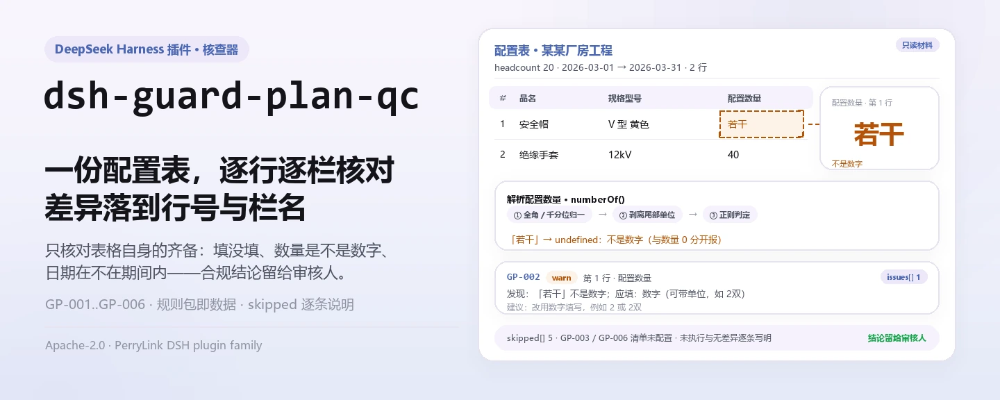
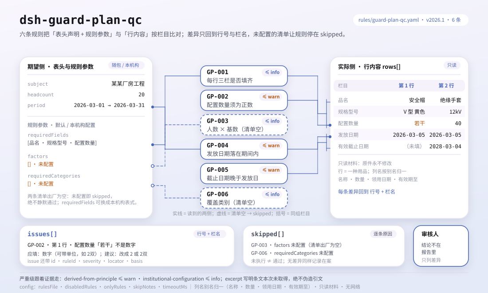

<div align="center">

<picture>
  <source media="(prefers-color-scheme: dark)" srcset="docs/assets/dsh-guard-plan-qc-hero-zh-dark.webp">
  
</picture>

# dsh-guard-plan-qc

**把一份劳动防护用品配置表逐行核对成「哪一行、哪一栏、差什么」的清单——结论留给审核人。**

面向 DeepSeek Harness 的数据型核查插件：读取一份劳保用品配置表（表头声明配置人数与配置期间，每种用品一行），按随包的 6 条规则（GP-001..GP-006）逐条核对，只列材料内部能指认的差异，不判合规、不认定责任。

[安装](#三步上手) · [配置](#配置) · [FAQ](#faq) · [简体中文](README.md) · [English](README.en.md)

[](LICENSE)
[](#兼容性)
[](https://www.npmjs.com/package/dsh-guard-plan-qc)
[](https://github.com/PerryLink/dsh-guard-plan-qc/actions/workflows/ci.yml)
[](#兼容性)

[](https://github.com/PerryLink/dsh-guard-plan-qc/stargazers)
[](https://www.npmjs.com/package/dsh-guard-plan-qc)
[](https://dshfind.com/plugins/PerryLink/dsh-guard-plan-qc?ref=badge)
[](https://securityscorecards.dev/viewer/?uri=github.com/PerryLink/dsh-guard-plan-qc)
[](https://dsh.market/)
[](https://gitee.com/perrylink/dsh-guard-plan-qc)

```sh
dsh plugin --profile <name> add dsh-guard-plan-qc
```

</div>

<sub>社区插件，与 DeepSeek 官方无关。唯一仓库：<https://github.com/PerryLink/dsh-guard-plan-qc>（Gitee 为镜像）。</sub>

## 它是什么

`dsh-guard-plan-qc` 读取一份劳动防护用品配置表——材料声明的配置人数与配置期间，加每种用品一行——并核对这份表格自身的齐备与自洽：每行是否填写品名、规格型号与配置数量，配置数量能否解析为大于零的数字，配置数量能否按配置人数与本机构配置的每人基数推算出来，发放日期是否落在配置期间内，有效截止日期是否晚于发放日期，以及配置表是否覆盖本机构要求的用品类别。

它不判定某项用品对某项危害因素是否属于正确的防护、防护等级是否足够、是否属于特种劳动防护用品，也不判定配置是否合规、是否构成责任问题。

- **给谁用**：安全员、劳保用品管理员；不用懂命令行，在对话里把材料交给它即可。
- **你交什么**：这项核对用到的原始材料（表格、清单或文书）；不改原件。Excel 可先转成 JSON/YAML，对话里也能代转。
- **它交什么**：一份「哪一行、哪一栏、差什么、怎么补」的清单；没能执行的检查逐条列入 `skipped` 并写明原因。

<picture>
  <source media="(prefers-color-scheme: dark)" srcset="docs/assets/dsh-guard-plan-qc-flow-v5-dark.svg">
  
</picture>

## 三步上手

1. **安装**（三选一）：

   ```sh
   # git 通道（最新 main；等价于 git+https://github.com/PerryLink/dsh-guard-plan-qc.git）
   dsh plugin --profile <name> add github:PerryLink/dsh-guard-plan-qc
   # npm 通道（已发布版本）
   dsh plugin --profile <name> add dsh-guard-plan-qc
   # tarball 通道：本仓库 pnpm pack 后
   dsh plugin --profile <name> add ./dsh-guard-plan-qc-<version>.tgz
   ```

   npm 通道装的是已构建的 `lib/`；git 通道在安装时由 `prepare` 脚本（tsdown）构建，无需手工编译。

2. **最小配置**（默认即可用；bundle 行不带 `config` 时全部走默认值，规则包路径指向随包的 `rules/guard-plan-qc.yaml`）：

   ```yaml
   - insert:
       - id: dsh-guard-plan-qc
         name: dsh-guard-plan-qc
   ```

3. **验证已生效**：

   ```sh
   dsh --profile <name> --dump-config | grep 'dsh-guard-plan-qc'
   ```

   然后把一份配置表交给它。仓内自带样例的期望输出（`samples/quickstart/expected/result.json`，输入为 `samples/quickstart/input/GP-001-unsafe.json`）：

   ```json
   {"tool":"guard_plan_qc","issueCount":1,"summary":{"error":0,"warn":0,"info":1},"skippedCount":5}
   ```

   在本仓库内可复跑（需先 `pnpm run build` 产出 `lib/`）：

   ```sh
   node samples/quickstart/run.mjs --json
   ```

**卸载**：`dsh plugin --profile <name> remove dsh-guard-plan-qc`（或从 profile patch 删掉该行）。

<details>
<summary>在 WorkBuddy / 扣子中使用</summary>

在 WorkBuddy / 扣子搜「安全合规核对包」（本检查是其中一项；上架以商城为准）即可调用同一套核对能力，无需命令行。

</details>

<details>
<summary>从 DSH Desktop 市场安装</summary>

所有 PerryLink 插件均可在 DSH Desktop 内置市场中浏览：**市场 → 来源 → 添加来源 → 粘贴** `https://perrylink-dsh-catalog.perrylink.workers.dev/catalog-source.json` **→ 选中**。安装仍需通过市场的 npm 身份校验与你的确认。

</details>

## 核心能力

`dsh-guard-plan-qc` 注册 `guard_plan_qc` 工具：读入一份配置表，套用版本化规则包，返回一份报告。

- **六条规则一包带走** —— 规则包是数据不是代码（`rules/guard-plan-qc.yaml`），换掉规则包即换掉整套检查，不动一行 TypeScript。
- **只读材料** —— 接受 JSON 或 YAML，原件永不修改；纯 ESM，无网络请求、不调用模型。
- **引文不造假** —— 每条规则带 `document` / `number` / `clause` / `excerpt` / `kind` / `source`；本规则包本次未取得 GB 39800.1 的逐字条文，因此每条 `excerpt` 都如实写明「未取得」并标为 `derived-from-principle` 或 `institutional-configuration`，绝不把描述包装成引文。
- **严重级跟着证据走** —— `derived-from-principle` 最高 `warn`，本机构配置（`institutional-configuration`）最高 `info`，并有测试断言。
- **空清单 ≠ 没问题** —— 每条没能执行的检查都进 `skipped` 并写明原因；`factors`、`requiredCategories` 未配置的规则自我报告 `skipped`，绝不静默通过。
- **不内置配备基数与用品清单** —— 「每人几件」「本工程该配哪些用品」随用品类别、作业类型与本机构标准变化，插件不硬编码，因此发现不了「该配绝缘手套却没配」这类需要危害辨识的判断。
- **措辞不作裁决** —— 报告只列差异，不判定合规、责任或正确性；措辞守卫（wording guard）强制执行，报告永远附带免责声明。

| 规则 | 核对内容 | 严重级 | 依据类别 |
|---|---|---|---|
| `GP-001` | 每行填写品名、规格型号与配置数量 | info | institutional-configuration |
| `GP-002` | 配置数量解析为大于零的数字 | warn | derived-from-principle |
| `GP-003` | 配置数量与配置人数 × 每人基数相符（默认关闭） | info | institutional-configuration |
| `GP-004` | 发放日期落在配置期间内 | warn | derived-from-principle |
| `GP-005` | 有效截止日期晚于发放日期 | warn | derived-from-principle |
| `GP-006` | 配置表覆盖本机构要求的用品类别（默认关闭） | info | institutional-configuration |

### 示例

以下为插件真实入口；安装后调用一次即可。第一行是详细走查，其余是简短案例。

**详细示例** —— 工具 `guard_plan_qc`，输入：

```json
{"headcount":20,"rows":[{"品名":"安全帽","配置数量":"若干"}]}
```

输出：

```json
{
  "id": "dsh-guard-plan-qc.GP-002.4f14475e",
  "ruleId": "GP-002",
  "severity": "warn",
  "locator": {
    "column": "配置数量",
    "row": 1
  },
  "found": "第 1 行配置数量「若干」不是数字",
  "expected": "配置数量应写成数字（可带单位，如「2双」）",
  "fix": "改用数字填写，例如 2 或 2双"
}
```

*Observed from `tests/fixtures/GP-002/GP-002-unsafe.json (cases.json expects GP-002 count 1); run via lib/index.mjs rules/guard-plan-qc.yaml`*

| 你会问 | 它怎么答 |
|---|---|
| 某行填了品名，规格型号空着，会被报出吗？ | 会。`GP-001` 要求每行填写 `requiredFields` 里的字段——出厂为 品名、规格型号、配置数量，可按本机构表式替换——缺哪项就连同缺失的栏目名一并报出该行，空串视为未填。它只核对栏目是否填了，不判断所配用品或其规格是否恰当。 |
| 配置数量栏写的是「若干」，这和填「0」是一回事吗？ | 不是。`GP-002` 把两者分开报：解析不了的值（如「若干」）报为不是数字，能解析但不大于零的值则连同该数字本身报出。「2双」「１，２００」「2 件」都能解析，单位可以连写。数字是否真实、数量够不够，它不核对；`checkQuantity` 为 false 时本条不执行。 |
| 配置人数 20 人，`factors` 里绝缘手套每人 2 双，表中该行只配了 30，能查出来吗？ | 配置了 `factors` 就能。`GP-003` 用每人基数乘以配置人数，差额超过 `tolerance` 的匹配行即报出。`factors` 出厂为空，未配置时本条在 `skipped` 里说明原因，不会静默通过；材料未声明配置人数时同样进 `skipped`。基数是你自己查来的数值，不是国家标准数值，本条不判断它是否合理。 |
| 配置期间是 2026-03-01 至 2026-03-31，某行发放日期写 2026-02-20，会报吗？ | 会。`GP-004` 报出该行发放日期早于 `periodFrom`。配置期间取自材料顶层的 `periodFrom` / `periodTo`；两者都缺时本条进 `skipped`，不会假定任何期间；解析不了的日期单独报出，不会静默跳过。 |
| 有效截止日期与发放日期填了同一天，算通过吗？ | 不算。`GP-005` 要求有效截止日期晚于发放日期，不满足即报出该行；只有该行同时写了这两个日期时才执行。这段有效期够不够长——取决于用品类别与作业环境——本条不判断。 |
| 表里写的是「安全帽」，本机构要求清单里写的是「安全头盔」，会报未覆盖吗？ | 会。`GP-006` 按品名与规格型号做字面包含比对，同一用品换个写法就会被报成未覆盖；请把常见写法一并列入清单，或统一台账用词。`requiredCategories` 出厂为空，未配置时本条进 `skipped`。它只核对类别是否出现，不判断该用品是否适用于本工程。 |

## 依据的标准

| 文件 | 文号 | 引用它的规则 |
|---|---|---|
| 《个体防护装备配备规范》 | GB 39800.1—2020（个体防护装备配备规范 第1部分：总则；标准号不带"/T"⇒强制性；2020-12-24 发布、2022-01-01 实施；主管部门应急管理部；条号本次未取得） | GP-001, GP-002, GP-003, GP-004, GP-005, GP-006 |

**边界：** 本插件核对一份**劳动防护用品配置表**，范围限于表格可以要求到的内容——每行是否写明用品名称、规格与数量，数量是否为正数，是否与方案中写明的配发人数相符，发放日期是否落在方案期间之内，失效日期是否晚于发放日期，以及表格是否覆盖你要求的类别。它**不**判定某种用品对某种危害因素是否属于正确的防护、其防护等级是否足够，也不判定其是否属于特种劳动防护用品。

> ### ⚠️ 在采信报告中的引文之前，请先读这一段
>
> **本插件规则包的每一条 `excerpt` 都写明：该条文本次未取得。** 劳动防护用品配备的规范载体是 **GB 39800.1《个体防护装备配备规范》**（分部分标准）与《劳动防护用品监督管理规定》等。本次核查未能逐字取得这些文件的条文原文，因此规则包不概括引文，而是把缺口直接写进 `excerpt` 字段，把诚实推理放进 `note`。所有命中因此封顶 `warn`（原则推导）或 `info`（本机构配置），并有测试断言没有任何规则声称拥有它并不拥有的引文。**取得文本后必须做两件事：把每条 `excerpt` 换成真实条款，并把 `kind` 升为 `direct`。**
>
> **会让本插件真正有判断力的两个数字，正是它拒绝编造的两个数字。** 每人需要几件（`GP-003` 的 `factors`）与一项作业必须覆盖哪些用品类别（`GP-006` 的 `requiredCategories`），取决于**你**这个项目的危害辨识结果，而不是某个全国数值。两者都出厂为空，未配置的规则在 `skipped` 里自我报告，而不是静默通过。
>
> 结论性判断留给审核人：本插件只列出材料内部可以逐条指认的差异，不判断事实真伪，也不评价合规性。

## 配置

全部可调参数都是 `src/config.ts` 里的 Schemastery `Config` 字段（可从 cordis.yml 覆盖），逐条阈值在 `rules/` 下的规则库文件里。按 id 覆盖会替换整行——请重述所有需要的键。

| 键 | 类型 | 默认值 | 说明 |
|---|---|---|---|
| `rulesFile` | string | `rules/guard-plan-qc.yaml` | 规则库文件路径，相对插件包根目录 |
| `disabledRules` | string[] | `[]` | 要停用的规则 id 列表；每条都会出现在 `skipped` 中 |
| `onlyRules` | string[] | `[]` | 只执行这些规则 id；留空表示执行全部规则 |
| `skipNotes` | string | `""` | 附加到每条 `skipped` 说明后的备注 |
| `timeoutMs` | number | `120000` | 工具协作式超时预算（毫秒） |

值得了解的规则级参数：

- `GP-001` `requiredFields` —— 默认 `[品名, 规格型号, 配置数量]`；换成本机构表式的栏目名。
- `GP-002` `checkQuantity` —— 设为 `false` 即停止核对配置数量。
- `GP-003` `factors` —— 你的每人基数，例如 `[{ match: 绝缘手套, perPerson: 2, tolerance: 0 }]`；`match` 对品名做子串匹配。
- `GP-006` `requiredCategories` —— 本工程必须覆盖的用品，例如 `[安全帽, 绝缘手套, 安全带]`；也可逐次调用时传入。

profile patch 覆盖示例：

```yaml
- insert:
    - id: dsh-guard-plan-qc
      name: dsh-guard-plan-qc
      config:
        disabledRules: [GP-006]
        timeoutMs: 180000
```

## 材料格式

工具接受 JSON 或 YAML：

```yaml
subject: 某某厂房工程
headcount: 20
periodFrom: 2026-03-01
periodTo: 2026-03-31
rows:
  - { 品名: 安全帽,   规格型号: V 型 黄色, 配置数量: "20", 发放日期: 2026-03-05, 有效截止日期: 2028-03-04 }
  - { 品名: 绝缘手套, 规格型号: 12kV,      配置数量: "40", 发放日期: 2026-03-05 }
```

配置数量从字符串读取，因此表格导出可直接使用：`2双`、`1,200`、`１２`、`1.5` 都能解析。解析不了的单元格（`若干`、空白）报为不可解析，这与「数量为零」是**两件事**——两者需要不同的修法，所以给出不同的发现。

`GP-004` 需要 `periodFrom` 与／或 `periodTo`；两者都缺时，它在 `skipped` 里自我报告，而不是假定一个期间。`GP-003` 需要 `headcount`；缺了它就说明缺了。字段在读取层是可选的，由检查引擎校验，因此部分导出的材料会产生「缺项」类差异，而不是让程序崩溃。

## 规则来源

规则数据在 `rules/guard-plan-qc.yaml`，与代码分离：每条规则都带文件名、文号、按原文自身编号体系的条款号、逐字摘录与来源地址。规则包头部完整写明引文缺口，每条规则的 `note` 复述与该条相关的部分。加载期守卫要求 `document` / `clause` / `excerpt` / `source` 齐全，并禁止原则性推断（`derived-from-principle`）或本机构配置（`institutional-configuration`）的检查标为 `error`；但它分辨不出一段描述和一段引文——因此本规则包依靠头部说明、逐条 `note`，以及一条断言「每条 `excerpt` 都承认这个缺口」的测试来把关。`check:citations` 逐条核对：本次 6 条规则全部作为「未取得原文」的占位计入，`rules/citations-baseline.json` 的基线为 0，且只能收缩。夸大依据的规则库会在加载期失败，而不会产出一份看起来很有底气的报告。

## FAQ

<details>
<summary>它会不会告诉我「该配什么、配多少」？</summary>

不会，这是本插件最重要的能力边界。每人几件（`GP-003` 的 `factors`）与应当配备哪些用品类别（`GP-006` 的 `requiredCategories`）取决于你这个项目的危害辨识结果；两者出厂为空，未配置时规则在 `skipped` 里自我报告，而不是给你一个通用数字。要判断某件用品够不够、合不合适，需要结合作业危害辨识与产品认证，结论留给职业健康与安全专业人员。

</details>

<details>
<summary>为什么报告里一条 `error` 都没有，全是 `warn` 或 `info`？</summary>

因为严重级跟着依据走：原则性推导（`kind: derived-from-principle`）封顶 `warn`，本机构配置（`kind: institutional-configuration`）封顶 `info`，并有测试断言。本规则包本次未取得 GB 39800.1 的逐字条文，所以不存在 `direct` 依据，也就不应该出现 `error`。它只列差异，不做法定判断。

</details>

<details>
<summary>`issues` 为空能当作「没问题」吗？</summary>

不能。每条没能执行的检查都列在 `skipped` 里并写明原因（清单未配置、材料缺 `headcount`、没有配置期间等）。判读报告时请把 `issues` 与 `skipped` 一起看完；`skippedCount` 只统计真正没执行的规则，规则执行了且没有差异不算 `skipped`。

</details>

<details>
<summary>表格是 Excel，能直接用吗？</summary>

可以，先转成 JSON 或 YAML；平台支持时在对话里就能代为转换。工具只读材料，永不修改原件；无网络请求、不调用模型，材料不出本机。

</details>

<details>
<summary>一次核对整套配置表或整个目录，性能吃得消吗？</summary>

工具在 `native` 与 `ptc` 两种模式都能跑；批量校验（例如一整套工地的配置表）建议 `ptc`，schema 成本只付一次。检查本身是纯本地的字段与数值比对，无网络请求、不调用模型；`timeoutMs`（默认 120 秒）是协作式超时预算。

</details>

## 排障

- **`GP-003` 或 `GP-006` 在 `skipped` 里自我报告。** 它们的清单为空。`factors` 与 `requiredCategories` 来自你的危害辨识，插件不会替你猜。
- **`GP-003` 在我刻意设定的数量上报出。** 你配置的基数不是实际在用的那个，或材料里的配置人数已经过期。调大 `tolerance`，或修正基数。
- **`GP-006` 报出表里明明有的用品。** 比对是对品名与规格型号做字面子串测试，所以 `安全帽` 匹配不上 `安全头盔`。把你用到的写法一并列入清单，或统一台账用词。
- **`GP-004` 对日期一字不提。** 材料没有声明配置期间，或表里没有发放日期；两种情况规则都会在 `skipped` 里说明。
- **插件装上了但工具不出现。** 确认 `main` 指向 `lib/index.mjs` 且 `pnpm run build` 已产出该文件；`main` 写错会让加载器静默跳过该条目。
- **`dsh plugin add` 以不兼容为由拒绝安装。** peer 范围覆盖 `0.1.x` 与 `0.2.x`；若运行时在其之外，可显式豁免：`dsh plugin --profile <name> allow-version dsh-guard-plan-qc@0.1.0 --dsh-version <runtime> --accept-risk`
- **`check` 把 `manifest-peers` 报为失败。** 静态检查器比对的是一份早于 0.2 世代的硬编码 peer 范围；安装期的 peer 校验以运行时为准，声明的范围才是正确的。这是 `dsh-plugin-dev` 的已知上游问题。
- **时间看起来偏移。** 全部计算都是对输入字符串做墙上时钟运算，不做时区换算。

## 兼容性

| 项目 | 状态 |
|---|---|
| Harness | 对等版本范围 `>=0.1.2-rc.1 <0.2.0 \|\| >=0.2.0-0 <0.3.0` —— 已实测同时接受 `0.2.0-rc.2` 与 `0.2.1-rc.2`。已声明 `engines.dsh`：0.2.1 起由宿主单独裁决，范围为 `>=0.2.1-0 <0.3.0` |
| Node | `^22.19.0 \|\| >=24.0.0` |
| 平台 | 全平台（纯 ESM；无原生代码、无联网、不调用模型） |
| 工具模式 | `native` / `ptc` 均可；批量校验整个目录时建议 `ptc`，schema 成本只付一次 |

## 生态与质量

- [Gitee 镜像](https://gitee.com/perrylink/dsh-guard-plan-qc)（同步镜像，以 GitHub 为准）
- [dshfind 插件页](https://dshfind.com/plugins/PerryLink/dsh-guard-plan-qc)（安装量与排名）
- [OpenSSF Scorecard 报告](https://securityscorecards.dev/viewer/?uri=github.com/PerryLink/dsh-guard-plan-qc)（由 [.github/workflows/scorecard.yml](.github/workflows/scorecard.yml) 驱动）
- [DSH Market](https://dsh.market/)（已上架）
- **1024 商店渠道**：先 `npm i -g dsh1024`，再 `dsh1024 plugin --profile <name> add dsh-guard-plan-qc`（计入 [deepseek1024.com](https://deepseek1024.com) 安装排行）
- [生态实测知识库](https://perrylink.github.io/dsh-plugin-guide/)：插件开发指南 · 选型实测数据 · 维护取舍判据

## 开发

```sh
pnpm install                                        # node ^22.19 || >=24
pnpm run typecheck                                  # tsc --noEmit
pnpm test                                           # vitest：每条规则一对夹具
pnpm run build                                      # tsdown -> lib/index.mjs + lib/index.d.mts
pnpm run verify:self-contained                      # 依赖 spec 均来自 registry
pnpm run check:lockfile                             # lockfile 漂移检查
pnpm run check:readmes                              # 五语 README 一致性
pnpm run check:citations                            # 规则包引文核查
node ../scripts/sync-shared.mjs dsh-guard-plan-qc    # 从 ../_shared 刷新 src/shared
pnpm pack                                           # 发布 tarball
```

本插件是**数据型**的：`src/config.ts` 声明全部可调参数，共享套件提供读取器与检查引擎，规则包声明每一条检查。本地样例试跑（需先 `pnpm run build` 产出 `lib/`）：

```sh
node samples/quickstart/run.mjs
# => guard_plan_qc: 1 issue(s) — error 0, warn 0, info 1
# => skipped: 5
```

样例输入在 `samples/quickstart/input/`，期望输出在 `samples/quickstart/expected/result.json`，截图见 `docs/assets/quickstart.png`。README 配图由 [`scripts/gen-readme-assets.py`](scripts/gen-readme-assets.py) 程序化生成——hero 横幅用 Pillow 画、结构图用手写 SVG 画——可重复执行；旧的单版流程图与演示图保留在 `docs/assets/` 供外链使用，README 只引用新生成的 hero 与 flow-v5 结构图（各含深浅双版）。

Topics：`deepseek-harness`, `dsh`, `dsh-plugin`, `cordis`, `guard`, `plan`

## 家族与致谢

本项目是 [PerryLink](https://github.com/PerryLink) 维护的 DeepSeek Harness 插件家族成员（全部 Apache-2.0）。完整家族索引见[按材料选核查器](https://perrylink.github.io/zh/checkers/choose/)与[全部插件](https://github.com/PerryLink)。如果这个插件帮到了你，**给个 star**——它不解锁任何功能，但会让下一个人更容易找到它。

- [@PerryLink](https://github.com/PerryLink) —— 创建者与维护者：数据型规则包（GP-001..GP-006）、`guard_plan_qc` 工具、引文基线与五语文档。

<details>
<summary>展开全部插件</summary>

| 插件 | 状态 |
|---|---|
| **[dsh-aqua-input-check](https://github.com/PerryLink/dsh-aqua-input-check)** |  |
| **[dsh-archive-check](https://github.com/PerryLink/dsh-archive-check)** |  |
| **[dsh-auto-review](https://github.com/PerryLink/dsh-auto-review)** |  |
| **[dsh-autotier](https://github.com/PerryLink/dsh-autotier)** | 🧊 已冻结 — 见仓库 README |
| **[dsh-bid-ca-precheck](https://github.com/PerryLink/dsh-bid-ca-precheck)** |  |
| **[dsh-bid-qual-check](https://github.com/PerryLink/dsh-bid-qual-check)** |  |
| **[dsh-cert-mcp](https://github.com/PerryLink/dsh-cert-mcp)** | 🧊 已冻结 — 见仓库 README |
| **[dsh-checkpoint-rewind](https://github.com/PerryLink/dsh-checkpoint-rewind)** |  |
| **[dsh-click](https://github.com/PerryLink/dsh-click)** |  |
| **[dsh-composer-history](https://github.com/PerryLink/dsh-composer-history)** |  |
| **[dsh-contract-stance](https://github.com/PerryLink/dsh-contract-stance)** |  |
| **[dsh-customs-doc-check](https://github.com/PerryLink/dsh-customs-doc-check)** |  |
| **[dsh-data-quality](https://github.com/PerryLink/dsh-data-quality)** | 🧊 已冻结 — 见仓库 README |
| **[dsh-demurrage-ledger](https://github.com/PerryLink/dsh-demurrage-ledger)** |  |
| **[dsh-doublecheck](https://github.com/PerryLink/dsh-doublecheck)** |  |
| **[dsh-drill-script-check](https://github.com/PerryLink/dsh-drill-script-check)** |  |
| **[dsh-eia-guide-check](https://github.com/PerryLink/dsh-eia-guide-check)** |  |
| **[dsh-emergency-plan](https://github.com/PerryLink/dsh-emergency-plan)** |  |
| **[dsh-essay-rubric-check](https://github.com/PerryLink/dsh-essay-rubric-check)** |  |
| **[dsh-evidence-check](https://github.com/PerryLink/dsh-evidence-check)** |  |
| **[dsh-export-ctl-check](https://github.com/PerryLink/dsh-export-ctl-check)** |  |
| **[dsh-fast](https://github.com/PerryLink/dsh-fast)** |  |
| **[dsh-fmea-table-check](https://github.com/PerryLink/dsh-fmea-table-check)** |  |
| **[dsh-forecast-penalty](https://github.com/PerryLink/dsh-forecast-penalty)** |  |
| **[dsh-fund-research](https://github.com/PerryLink/dsh-fund-research)** |  |
| **[dsh-github](https://github.com/PerryLink/dsh-github)** |  |
| **[dsh-gongwen-flow-check](https://github.com/PerryLink/dsh-gongwen-flow-check)** |  |
| **[dsh-gongwen-word-check](https://github.com/PerryLink/dsh-gongwen-word-check)** |  |
| **[dsh-guard-plan-qc](https://github.com/PerryLink/dsh-guard-plan-qc)** |  |
| **[dsh-hazchem-check](https://github.com/PerryLink/dsh-hazchem-check)** |  |
| **[dsh-hazplan-check](https://github.com/PerryLink/dsh-hazplan-check)** |  |
| **[dsh-hidden-risk-map](https://github.com/PerryLink/dsh-hidden-risk-map)** |  |
| **[dsh-hs-classify](https://github.com/PerryLink/dsh-hs-classify)** |  |
| **[dsh-icd-rule-check](https://github.com/PerryLink/dsh-icd-rule-check)** |  |
| **[dsh-industry-research](https://github.com/PerryLink/dsh-industry-research)** |  |
| **[dsh-lawcite-adapter](https://github.com/PerryLink/dsh-lawcite-adapter)** |  |
| **[dsh-laya](https://github.com/PerryLink/dsh-laya)** |  |
| **[dsh-lc-doc-check](https://github.com/PerryLink/dsh-lc-doc-check)** |  |
| **[dsh-learning-gap-check](https://github.com/PerryLink/dsh-learning-gap-check)** |  |
| **[dsh-library](https://github.com/PerryLink/dsh-library)** |  |
| **[dsh-local-ai](https://github.com/PerryLink/dsh-local-ai)** |  |
| **[dsh-lsp-actions](https://github.com/PerryLink/dsh-lsp-actions)** |  |
| **[dsh-mask](https://github.com/PerryLink/dsh-mask)** |  |
| **[dsh-mcp-panel](https://github.com/PerryLink/dsh-mcp-panel)** |  |
| **[dsh-medrec-qc](https://github.com/PerryLink/dsh-medrec-qc)** |  |
| **[dsh-memento](https://github.com/PerryLink/dsh-memento)** | 🧊 已冻结 — 见仓库 README |
| **[dsh-nsfc-form-check](https://github.com/PerryLink/dsh-nsfc-form-check)** |  |
| **[dsh-nurse-record-check](https://github.com/PerryLink/dsh-nurse-record-check)** |  |
| **[dsh-observe](https://github.com/PerryLink/dsh-observe)** |  |
| **[dsh-origin-rvc-check](https://github.com/PerryLink/dsh-origin-rvc-check)** |  |
| **[dsh-ota-review-check](https://github.com/PerryLink/dsh-ota-review-check)** |  |
| **[dsh-output-styles](https://github.com/PerryLink/dsh-output-styles)** |  |
| **[dsh-paper-doc-adapter](https://github.com/PerryLink/dsh-paper-doc-adapter)** |  |
| **[dsh-permission-rules](https://github.com/PerryLink/dsh-permission-rules)** |  |
| **[dsh-permit-report-check](https://github.com/PerryLink/dsh-permit-report-check)** |  |
| **[dsh-pipeline-check](https://github.com/PerryLink/dsh-pipeline-check)** |  |
| **[dsh-pleading-draft](https://github.com/PerryLink/dsh-pleading-draft)** |  |
| **[dsh-plugin-doctor](https://github.com/PerryLink/dsh-plugin-doctor)** | 🚫 已退役（仓库已归档） |
| **[dsh-plugin-guide](https://github.com/PerryLink/dsh-plugin-guide)** |  |
| **[dsh-plugin-kit](https://github.com/PerryLink/dsh-plugin-kit)** | 🚫 已退役（仓库已归档） |
| **[dsh-plugin-upgrade](https://github.com/PerryLink/dsh-plugin-upgrade)** | 🚫 已退役（仓库已归档） |
| **[dsh-policy-brief-draft](https://github.com/PerryLink/dsh-policy-brief-draft)** |  |
| **[dsh-power-loss-split](https://github.com/PerryLink/dsh-power-loss-split)** |  |
| **[dsh-power-ticket-check](https://github.com/PerryLink/dsh-power-ticket-check)** |  |
| **[dsh-ppap-check](https://github.com/PerryLink/dsh-ppap-check)** |  |
| **[dsh-protest-deadline](https://github.com/PerryLink/dsh-protest-deadline)** |  |
| **[dsh-railway-window](https://github.com/PerryLink/dsh-railway-window)** |  |
| **[dsh-repair-order-qc](https://github.com/PerryLink/dsh-repair-order-qc)** |  |
| **[dsh-research-report](https://github.com/PerryLink/dsh-research-report)** |  |
| **[dsh-review-reply-check](https://github.com/PerryLink/dsh-review-reply-check)** |  |
| **[dsh-rulefile-check](https://github.com/PerryLink/dsh-rulefile-check)** |  |
| **[dsh-safety-brief-check](https://github.com/PerryLink/dsh-safety-brief-check)** |  |
| **[dsh-score](https://github.com/PerryLink/dsh-score)** | 🧊 已冻结 — 见仓库 README |
| **[dsh-session-sync](https://github.com/PerryLink/dsh-session-sync)** |  |
| **[dsh-site-log-check](https://github.com/PerryLink/dsh-site-log-check)** |  |
| **[dsh-skill-pack-security](https://github.com/PerryLink/dsh-skill-pack-security)** |  |
| **[dsh-soe-decision-check](https://github.com/PerryLink/dsh-soe-decision-check)** |  |
| **[dsh-soilwater-check](https://github.com/PerryLink/dsh-soilwater-check)** |  |
| **[dsh-sop-sync-check](https://github.com/PerryLink/dsh-sop-sync-check)** |  |
| **[dsh-spc-gbt-adapter](https://github.com/PerryLink/dsh-spc-gbt-adapter)** |  |
| **[dsh-talk](https://github.com/PerryLink/dsh-talk)** |  |
| **[dsh-tender-extract](https://github.com/PerryLink/dsh-tender-extract)** |  |
| **[dsh-tender-matrix](https://github.com/PerryLink/dsh-tender-matrix)** |  |
| **[dsh-test-drive](https://github.com/PerryLink/dsh-test-drive)** |  |
| **[dsh-ticktick](https://github.com/PerryLink/dsh-ticktick)** | 🚫 已退役（仓库已归档） |
| **[dsh-translate](https://github.com/PerryLink/dsh-translate)** |  |
| **[dsh-warranty-calc](https://github.com/PerryLink/dsh-warranty-calc)** |  |
| **[dsh-budget](https://github.com/PerryLink/dsh-budget)** | 🧊 已冻结 — 见仓库 README |
| **[dsh-claude-move](https://github.com/PerryLink/dsh-claude-move)** | 🧊 已冻结 — 见仓库 README |
| **[dsh-defend](https://github.com/PerryLink/dsh-defend)** | 🧊 已冻结 — 见仓库 README |
| **[dsh-draw](https://github.com/PerryLink/dsh-draw)** | 🧊 已冻结 — 见仓库 README |
| **[dsh-reach](https://github.com/PerryLink/dsh-reach)** | 🧊 已冻结 — 见仓库 README |
| **[dsh-background-agents](https://github.com/PerryLink/dsh-background-agents)** | 🚫 已退役（仓库已归档） |
| **[dsh-session-pin](https://github.com/PerryLink/dsh-session-pin)** | 🚫 已退役（仓库已归档） |
| **[dsh-team-rooms](https://github.com/PerryLink/dsh-team-rooms)** | 🚫 已退役（仓库已归档） |

</details>

## License

[LICENSE](LICENSE)（Apache License 2.0）© 2026 dsh-guard-plan-qc contributors

<p align="center"><sub>Apache-2.0 · 社区插件，与 DeepSeek 无关。</sub></p>
