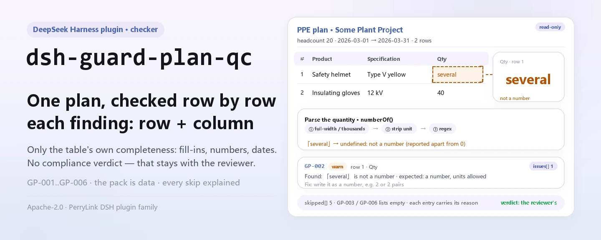
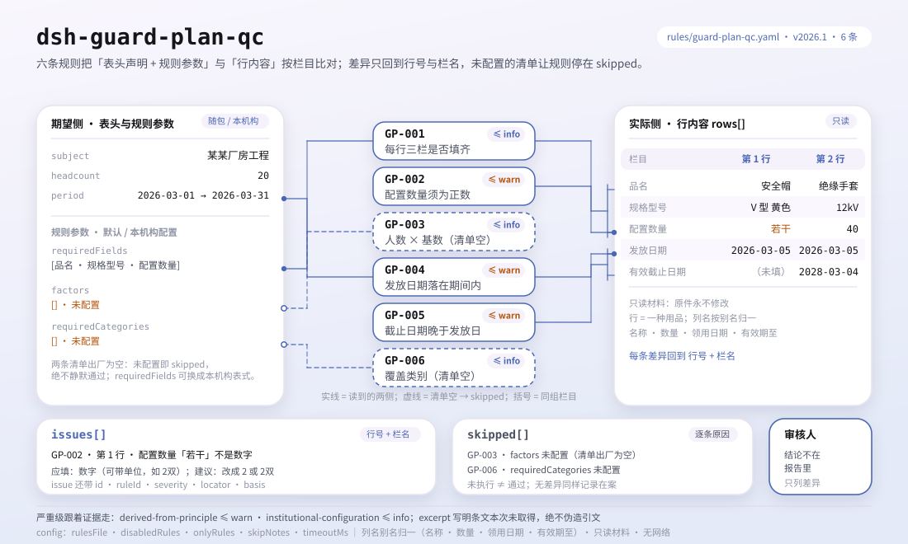

<div align="center">

<picture>
  <source media="(prefers-color-scheme: dark)" srcset="docs/assets/dsh-guard-plan-qc-hero-en-dark.webp">
  
</picture>

# dsh-guard-plan-qc

**Transforme uma tabela de configuração de equipamentos de proteção laboral numa lista de que linha, que coluna e o que corrigir — a conclusão fica com o revisor.**

Plugin verificador de dados para DeepSeek Harness: lê uma tabela de configuração de equipamentos de proteção laboral (o cabeçalho declara o número de pessoas e o período de configuração, e cada produto ocupa uma linha), aplica o pacote de 6 regras que traz (GP-001..GP-006) e apenas enumera as divergências que consegue apontar dentro do material — nunca um juízo de conformidade, nunca uma atribuição de responsabilidade.

[Instalar](#instalação-em-três-passos) · [Configuração](#configuração) · [FAQ](#faq) · [简体中文](README.md) · [English](README.en.md) · [Español](README.es.md) · [Português](README.pt.md) · [हिन्दी](README.hi.md)

[](LICENSE)
[](#compatibilidade)
[](https://www.npmjs.com/package/dsh-guard-plan-qc)
[](https://github.com/PerryLink/dsh-guard-plan-qc/actions/workflows/ci.yml)
[](#compatibilidade)

[](https://github.com/PerryLink/dsh-guard-plan-qc/stargazers)
[](https://www.npmjs.com/package/dsh-guard-plan-qc)
[](https://dshfind.com/plugins/PerryLink/dsh-guard-plan-qc?ref=badge)
[](https://securityscorecards.dev/viewer/?uri=github.com/PerryLink/dsh-guard-plan-qc)
[](https://dsh.market/)
[](https://gitee.com/perrylink/dsh-guard-plan-qc)

```sh
dsh plugin --profile <name> add dsh-guard-plan-qc
```

</div>

<sub>Plugin comunitário, sem relação com a DeepSeek. Repositório canônico: <https://github.com/PerryLink/dsh-guard-plan-qc> (o Gitee é um espelho).</sub>

## O que é

`dsh-guard-plan-qc` lê uma tabela de configuração de equipamentos de proteção laboral —o número de pessoas e o período de configuração que o material declara, mais uma linha por produto configurado— e verifica a completude e a coerência interna dessa tabela: se cada linha preenche 品名 (nome), 规格型号 (especificação) e 配置数量 (quantidade), se a quantidade é analisável como um número maior que zero, se pode ser deduzida do número de pessoas declarado pelo fator por pessoa que você configurar, se a 发放日期 (data de entrega) cai dentro do período de configuração, se a 有效截止日期 (data de validade) é posterior à data de entrega e se a tabela cobre as categorias de produtos que você exige.

Não julga se um equipamento concreto é a proteção correta frente a um perigo concreto, se o seu nível de proteção basta ou se é equipamento de proteção especial; também não decide se a configuração cumpre a norma nem se há responsabilidade.

- **Para quem é**: responsáveis de segurança e administradores de equipamentos de proteção; não é preciso saber usar a linha de comandos — basta entregar o material no chat.
- **O que você entrega**: o material original sobre o qual a verificação trabalha (uma tabela, um registro ou um documento); o original nunca é modificado. O Excel pode ser convertido antes para JSON/YAML, inclusive no chat se a plataforma o permitir.
- **O que recebe**: uma lista de «que linha, que coluna, o que falta e como corrigir»; cada verificação que não pôde ser executada é listada em `skipped` com o motivo.

<picture>
  <source media="(prefers-color-scheme: dark)" srcset="docs/assets/dsh-guard-plan-qc-flow-v5-dark.svg">
  
</picture>

## Instalação em três passos

1. **Instalar** (escolha um canal):

   ```sh
   # canal git (última main; equivale a git+https://github.com/PerryLink/dsh-guard-plan-qc.git)
   dsh plugin --profile <name> add github:PerryLink/dsh-guard-plan-qc
   # canal npm (versões publicadas)
   dsh plugin --profile <name> add dsh-guard-plan-qc
   # canal tarball: após pnpm pack neste repositório
   dsh plugin --profile <name> add ./dsh-guard-plan-qc-<version>.tgz
   ```

   O canal npm instala o `lib/` já construído; o canal git constrói-o na instalação através do script `prepare` (tsdown), sem compilação manual.

2. **Configuração mínima** (os padrões já servem; uma linha do bundle sem `config` usa todos os padrões e o pacote de regras aponta para o `rules/guard-plan-qc.yaml` incluído):

   ```yaml
   - insert:
       - id: dsh-guard-plan-qc
         name: dsh-guard-plan-qc
   ```

3. **Confirmar que montou**:

   ```sh
   dsh --profile <name> --dump-config | grep 'dsh-guard-plan-qc'
   ```

   Depois entregue-lhe uma tabela. A saída esperada do exemplo incluído (`samples/quickstart/expected/result.json`, entrada `samples/quickstart/input/GP-001-unsafe.json`):

   ```json
   {"tool":"guard_plan_qc","issueCount":1,"summary":{"error":0,"warn":0,"info":1},"skippedCount":5}
   ```

   Pode repeti-lo neste repositório (antes é preciso construir `lib/` com `pnpm run build`):

   ```sh
   node samples/quickstart/run.mjs --json
   ```

**Desinstalar**: `dsh plugin --profile <name> remove dsh-guard-plan-qc` (ou remova a linha do patch do perfil).

<details>
<summary>Usar no WorkBuddy / Coze</summary>

Procure «Safety Compliance Suite» no WorkBuddy / Coze (esta verificação é uma parte do conjunto; disponibilidade conforme o catálogo) para usar a mesma capacidade de verificação sem linha de comandos.

</details>

<details>
<summary>Instalar a partir do mercado do DSH Desktop</summary>

Todos os plugins do PerryLink estão no mercado integrado do DSH Desktop: **Mercado → Fontes → Adicionar fonte → colar** `https://perrylink-dsh-catalog.perrylink.workers.dev/catalog-source.json` **→ selecionar**. A instalação continua a exigir a verificação de identidade npm do mercado e a sua confirmação.

</details>

## Capacidades principais

`dsh-guard-plan-qc` registra a ferramenta `guard_plan_qc`: lê uma tabela de configuração, aplica o pacote de regras versionado e devolve um relatório.

- **Seis regras num único pacote de dados** — o pacote de regras é dados, não código (`rules/guard-plan-qc.yaml`); substituí-lo troca todo o conjunto de regras sem tocar numa linha de TypeScript.
- **Somente leitura sobre o material** — aceita JSON ou YAML e nunca modifica o original; ESM puro, sem pedidos de rede e sem chamadas ao modelo.
- **Sem citações inventadas** — cada regra leva `document` / `number` / `clause` / `excerpt` / `kind` / `source`; desta vez o pacote não obteve qualquer texto literal da GB 39800.1, por isso cada `excerpt` o diz expressamente e fica marcado `derived-from-principle` ou `institutional-configuration`: uma descrição nunca é disfarçada de citação.
- **A gravidade segue a evidência** — `derived-from-principle` fica limitada a `warn`, a configuração da instituição (`institutional-configuration`) a `info`, e um teste afirma-o.
- **Uma lista de problemas vazia nunca é «não há nada errado»** — cada verificação que não pôde ser executada é declarada em `skipped` com o motivo; a regra cuja lista `factors` ou `requiredCategories` não está configurada declara-se em `skipped` em vez de passar em silêncio.
- **Sem fatores por pessoa nem listas de produtos incorporadas** — «quantos artigos por pessoa» e «que produtos esta obra deve cobrir» variam com a categoria do equipamento, o tipo de trabalho e a norma da sua instituição, pelo que o plugin não codifica nenhum. Por isso também não deteta a lacuna mais importante: um produto que deveria estar configurado e não aparece.
- **Linguagem que não sentencia** — o relatório enumera diferenças e nunca se pronuncia sobre conformidade, responsabilidade ou correção; uma guarda de redação impõe isso e todo relatório leva o aviso de isenção.

| Regra | O que verifica | Gravidade | Tipo de base |
|---|---|---|---|
| `GP-001` | cada linha preenche nome, especificação e quantidade | info | institutional-configuration |
| `GP-002` | a quantidade é analisável como número maior que zero | warn | derived-from-principle |
| `GP-003` | a quantidade bate com o número de pessoas × o fator por pessoa (desligada por padrão) | info | institutional-configuration |
| `GP-004` | a data de entrega cai dentro do período de configuração | warn | derived-from-principle |
| `GP-005` | a data de validade é posterior à data de entrega | warn | derived-from-principle |
| `GP-006` | a tabela cobre as categorias que você exige (desligada por padrão) | info | institutional-configuration |

### Exemplos

Estes são os pontos de entrada reais do plugin; instale uma vez e chame um. A primeira linha da tabela seguinte é o caso detalhado e as restantes são casos curtos.

**Exemplo detalhado** — ferramenta `guard_plan_qc`, entrada:

```json
{"headcount":20,"rows":[{"品名":"安全帽","配置数量":"若干"}]}
```

Saída:

```json
{
  "id": "dsh-guard-plan-qc.GP-002.4f14475e",
  "ruleId": "GP-002",
  "severity": "warn",
  "locator": {
    "column": "配置数量",
    "row": 1
  },
  "found": "第 1 行配置数量「若干」不是数字",
  "expected": "配置数量应写成数字（可带单位，如「2双」）",
  "fix": "改用数字填写，例如 2 或 2双"
}
```

*Observado em `tests/fixtures/GP-002/GP-002-unsafe.json (cases.json expects GP-002 count 1); run via lib/index.mjs rules/guard-plan-qc.yaml`*

| Você pergunta | O que ele responde |
|---|---|
| Uma linha tem o nome, mas deixa 规格型号 vazio. Isso é reportado? | Sim. `GP-001` exige que cada linha preencha os campos de `requiredFields` —de fábrica 品名, 规格型号 e 配置数量, substituíveis pelas colunas da sua própria tabela— e reporta a linha juntamente com os campos que faltam; uma célula vazia conta como não preenchida. Verifica que as colunas estão preenchidas, não que o produto ou a sua especificação estejam corretos. |
| A célula de 配置数量 diz 若干. É o mesmo que uma quantidade zero? | Não. `GP-002` reporta os dois em separado: um valor que não consegue analisar (como 若干) é reportado como não sendo um número, enquanto um valor que analisa mas não é maior que zero é reportado com a própria cifra. «2双», «１，２００» e «2 件» são analisados, com a unidade junta. Não verifica se a cifra é real nem se a quantidade chega; com `checkQuantity` em false a regra não é executada. |
| O número de pessoas é 20 e `factors` dá 2 luvas isolantes por pessoa, mas a linha configura 30. Isso é detetado? | Sim, depois de configurar `factors`. `GP-003` multiplica o fator por pessoa pelo número de pessoas e reporta a linha correspondente cuja quantidade difere mais do que a sua `tolerance`. `factors` vem vazio de fábrica, portanto tal como é entregue a regra declara-se em `skipped` com esse motivo em vez de passar em silêncio; também se declara aí se o material não declarar o número de pessoas. O fator é o dado que você consultou, não uma cifra nacional: a regra não julga se é razoável. |
| O período de configuração é 2026-03-01 a 2026-03-31 e uma 发放日期 diz 2026-02-20. É reportado? | Sim. `GP-004` reporta que essa linha é anterior a `periodFrom`. O período vem de `periodFrom` / `periodTo` no topo do material; se faltarem ambos, a regra declara-se em `skipped` em vez de presumir um período, e uma data que não consegue analisar é reportada à parte em vez de ser omitida em silêncio. |
| A 有效截止日期 é o mesmo dia da 发放日期. Passa? | Não. `GP-005` exige que a data de validade seja posterior à data de entrega e reporta a linha quando não é, e só é executada se a linha trouxer as duas datas. Se esse período de validade é suficientemente longo —depende do produto e da função— não se julga. |
| A tabela diz 安全帽 e a minha lista de categorias exigidas diz 安全头盔. Será reportado como não coberto? | Sim. `GP-006` compara por contenção literal com 品名 e 规格型号, por isso outra forma de nomear o mesmo produto é reportada como não coberta; inclua também as variantes habituais ou unifique a terminologia da tabela. `requiredCategories` vem vazio de fábrica, portanto tal como é entregue a regra declara-se em `skipped`. Verifica apenas se a categoria aparece, não se o produto serve para a obra. |

## Normas que segue

| Documento | Número | Regras que o citam |
|---|---|---|
| 《个体防护装备配备规范》 (especificação de dotação de equipamentos de proteção individual) | GB 39800.1—2020（个体防护装备配备规范 第1部分：总则；标准号不带"/T"⇒强制性；2020-12-24 发布、2022-01-01 实施；主管部门应急管理部；条号本次未取得） | GP-001, GP-002, GP-003, GP-004, GP-005, GP-006 |

**Limite:** este plugin verifica uma **tabela de configuração de equipamentos de proteção laboral** naquilo que uma tabela pode exigir: que cada linha nomeie um produto com especificação e quantidade, que a quantidade seja um número positivo, que bata com o número de pessoas declarado pelo material, que a data de entrega caia dentro do período de configuração, que uma data de validade seja posterior à de entrega e que a tabela cubra as categorias que você exige. **Não** julga se um equipamento concreto é a proteção correta frente a um perigo concreto, se o seu nível de proteção basta ou se é equipamento de proteção especial.

> ### ⚠️ Leia isto antes de confiar numa citação do relatório
>
> **Todos os `excerpt` do pacote de regras deste plugin dizem, por palavras expressas, que o texto da cláusula não foi obtido.** O regime vive na **GB 39800.1《个体防护装备配备规范》** (por partes) e no 《劳动防护用品监督管理规定》. A passagem de verificação deste plugin não conseguiu obter o texto literal dessas cláusulas, por isso em vez de parafrasear uma citação o pacote declara a lacuna no próprio campo `excerpt` e coloca o raciocínio honesto no `note`. Tudo fica, portanto, limitado a `warn` (derivado de princípio) ou `info` (configurado localmente), e um teste afirma que nenhuma regra reclama uma citação que não tem. **Quando os textos estiverem disponíveis há duas coisas a fazer: substituir cada `excerpt` pela cláusula real e elevar `kind` a `direct`.**
>
> **Os dois números que tornariam este plugin poderoso são os dois que ele se recusa a inventar.** Quantos artigos cada pessoa precisa (`GP-003` `factors`) e que categorias de produto um trabalho deve cobrir (`GP-006` `requiredCategories`) dependem da identificação de perigos do *seu* projeto, não de uma cifra nacional. Ambos vêm **vazios**, e a regra cuja lista não está configurada declara-se em `skipped` em vez de passar.
>
> A conclusão é do revisor: este plugin enumera diferenças que consegue apontar no material e não decide factos nem conformidade.

## Configuração

Todos os parâmetros ajustáveis são campos Schemastery `Config` em `src/config.ts` (alteráveis a partir do cordis.yml); os limites por regra vivem no pacote de regras sob `rules/`. Uma sobreposição dirigida por id substitui a linha inteira: repita todas as chaves de que precisa.

| Chave | Tipo | Padrão | Descrição |
|---|---|---|---|
| `rulesFile` | string | `rules/guard-plan-qc.yaml` | Caminho do pacote de regras, relativo à raiz do pacote |
| `disabledRules` | string[] | `[]` | Ids de regras a desativar; cada uma aparece em `skipped` |
| `onlyRules` | string[] | `[]` | Executar apenas estas regras; vazio executa todas |
| `skipNotes` | string | `""` | Nota acrescentada a cada motivo de `skipped` |
| `timeoutMs` | number | `120000` | Orçamento de tempo limite cooperativo da ferramenta |

Parâmetros por regra que vale conhecer:

- `GP-001` `requiredFields` — por padrão, as três colunas exigidas (nome, especificação e quantidade); substitua-as pelas colunas do seu próprio formulário.
- `GP-002` `checkQuantity` — ponha `false` para deixar de verificar a quantidade.
- `GP-003` `factors` — os seus fatores por pessoa; cada entrada é `{ match, perPerson, tolerance }`, onde `match` é um teste de contenção sobre o nome do produto.
- `GP-006` `requiredCategories` — as categorias de produto que a sua obra deve cobrir; cada entrada é comparada literalmente com o nome e a especificação. Também pode ser passada em cada chamada.

Exemplo de sobreposição no patch do perfil:

```yaml
- insert:
    - id: dsh-guard-plan-qc
      name: dsh-guard-plan-qc
      config:
        disabledRules: [GP-006]
        timeoutMs: 180000
```

## Formato do material

A ferramenta aceita JSON ou YAML:

```yaml
subject: 某某厂房工程
headcount: 20
periodFrom: 2026-03-01
periodTo: 2026-03-31
rows:
  - { 品名: 安全帽,   规格型号: V 型 黄色, 配置数量: "20", 发放日期: 2026-03-05, 有效截止日期: 2028-03-04 }
  - { 品名: 绝缘手套, 规格型号: 12kV,      配置数量: "40", 发放日期: 2026-03-05 }
```

As quantidades são lidas como cadeias, por isso uma exportação de folha de cálculo serve tal como está: `2` com a unidade junta, `1,200`, dígitos de largura total e `1.5` são analisados. Uma célula que não é um número (palavras, ou vazia) é reportada como não analisável, o que é **diferente** de uma quantidade zero: as duas precisam de correções diferentes, por isso produzem achados diferentes.

`GP-004` precisa de `periodFrom` e/ou `periodTo`; sem nenhum, declara-se em `skipped` em vez de presumir um período. `GP-003` precisa de `headcount`; se faltar, diz isso. Os campos são opcionais na camada de leitura e validados pelo motor, pelo que uma exportação parcial produz achados de «falta isto» em vez de uma falha.

## Fontes das regras

Os dados das regras ficam em `rules/guard-plan-qc.yaml`, separados do código: cada regra leva documento, número, cláusula na numeração própria da fonte, trecho literal e URL de origem. O cabeçalho do pacote declara a lacuna de citações por inteiro, e o `note` de cada regra repete a parte que lhe diz respeito. A guarda de carregamento exige `document` / `clause` / `excerpt` / `source` e proíbe que uma verificação derivada de princípio ou configurada localmente seja declarada `error`; mas não distingue uma citação de uma descrição, pelo que este pacote se apoia no cabeçalho, nos `note` de cada regra e num teste que afirma que cada `excerpt` admite a lacuna. `check:citations` audita os trechos: nesta passagem as 6 regras contam como «texto não obtido» e `rules/citations-baseline.json` mantém uma base de 0 que só pode encolher. Um pacote que exagera a sua base falha ao carregar em vez de produzir um relatório de aparência sólida.

## FAQ

<details>
<summary>Ele vai dizer-me o que configurar e em que quantidade?</summary>

Não: é o limite mais importante do plugin. Quantos artigos cada pessoa precisa (`GP-003` `factors`) e que categorias uma obra deve cobrir (`GP-006` `requiredCategories`) dependem da identificação de perigos do seu projeto; ambos vêm vazios, e a regra por configurar declara-se em `skipped` em vez de lhe dar uma cifra genérica. Julgar se um equipamento basta e é adequado exige identificação de perigos e certificação de produto, pelo que a conclusão fica com os profissionais de segurança e saúde no trabalho.

</details>

<details>
<summary>Porque é que o relatório não traz nenhum `error`, só `warn` ou `info`?</summary>

Porque a gravidade segue a evidência: uma verificação derivada de princípio (`kind: derived-from-principle`) fica limitada a `warn`, uma configuração da instituição (`kind: institutional-configuration`) a `info`, e um teste afirma-o. Este pacote não obteve texto literal da GB 39800.1, por isso não existe base `direct` e um `error` não seria justificado. Enumera diferenças; não emite juízos regulamentares.

</details>

<details>
<summary>Uma lista `issues` vazia pode ser lida como «não há nada errado»?</summary>

Não. Cada verificação que não pôde ser executada aparece em `skipped` com o motivo (uma lista por configurar, um `headcount` em falta, nenhum período declarado, etc.). Leia `issues` e `skipped` em conjunto antes de tirar qualquer conclusão; `skippedCount` conta apenas as regras que de facto não correram, não as que correram limpas.

</details>

<details>
<summary>A minha tabela é um Excel. Posso usá-la diretamente?</summary>

Sim: converta-a antes para JSON ou YAML; no chat a plataforma pode fazer a conversão se o permitir. A ferramenta apenas lê o material e nunca modifica o original; sem pedidos de rede e sem chamadas ao modelo, o material não sai da sua máquina.

</details>

<details>
<summary>Aguenta um conjunto inteiro de tabelas ou um diretório de uma vez?</summary>

A ferramenta funciona nos modos `native` e `ptc`; para trabalho em lote (por exemplo, o conjunto de tabelas de configuração de uma obra) use `ptc`, onde o custo do esquema se paga uma vez. As verificações são comparação local de campos e números: sem pedidos de rede, sem chamadas ao modelo; `timeoutMs` (120 s por padrão) é o orçamento de tempo limite cooperativo.

</details>

## Solução de problemas

- **`GP-003` ou `GP-006` declaram-se em `skipped`.** As suas listas estão vazias. `factors` e `requiredCategories` vêm da sua identificação de perigos e o plugin não as adivinha.
- **`GP-003` dispara numa quantidade que fixei de propósito.** O fator configurado não é o que está em uso, ou o número de pessoas do material está desatualizado. Aumente `tolerance` ou corrija o fator.
- **`GP-006` dispara num produto que está na tabela.** A comparação é um teste literal de contenção sobre o nome e a especificação, por isso outra grafia do mesmo produto não coincide. Inclua as grafias que usa ou unifique a tabela.
- **`GP-004` não reporta nada sobre datas.** Não foi declarado nenhum período de configuração, ou a tabela não traz data de entrega; em ambos os casos a regra diz isso em `skipped`.
- **O plugin instala mas a ferramenta não aparece.** Confirme que `main` resolve para `lib/index.mjs` e que `pnpm run build` o gerou; um `main` errado faz o carregador saltar a entrada em silêncio.
- **`dsh plugin add` recusa o pacote por incompatibilidade.** A faixa de peers cobre `0.1.x` e `0.2.x`; se o seu runtime ficar fora dela, conceda uma isenção explícita: `dsh plugin --profile <name> allow-version dsh-guard-plan-qc@0.1.0 --dsh-version <runtime> --accept-risk`
- **`check` reporta `manifest-peers` como falha.** O verificador estático compara com uma faixa de peers codificada anterior à linha 0.2; o runtime aplica a compatibilidade de peers na instalação, por isso a faixa declarada é a correta. É um problema conhecido do `dsh-plugin-dev`.
- **As horas parecem deslocadas.** Toda a aritmética é de hora de parede sobre as cadeias que você entrega; não há conversão de fuso horário.

## Compatibilidade

| Superfície | Estado |
|---|---|
| Harness | Faixa de peers `>=0.1.2-rc.1 <0.2.0 \|\| >=0.2.0-0 <0.3.0` — verificada para aceitar tanto `0.2.0-rc.2` quanto `0.2.1-rc.2`. `engines.dsh` é declarado como `>=0.2.1-0 <0.3.0` e o host aplica-o desde 0.2.1 |
| Node | `^22.19.0 \|\| >=24.0.0` |
| Plataformas | Todas (ESM puro; sem código nativo, sem rede, sem chamada ao modelo) |
| Modo de ferramenta | Funciona em `native` e `ptc`; para um diretório inteiro use `ptc` |

## Ecossistema e qualidade

- [Espelho no Gitee](https://gitee.com/perrylink/dsh-guard-plan-qc) (espelho sincronizado; o GitHub é o canônico)
- [Página do plugin no dshfind](https://dshfind.com/plugins/PerryLink/dsh-guard-plan-qc) (instalações e ranking)
- [Relatório OpenSSF Scorecard](https://securityscorecards.dev/viewer/?uri=github.com/PerryLink/dsh-guard-plan-qc) (executado por [.github/workflows/scorecard.yml](.github/workflows/scorecard.yml))
- [DSH Market](https://dsh.market/) (publicado)
- **Canal da loja 1024**: `npm i -g dsh1024` uma vez e depois `dsh1024 plugin --profile <name> add dsh-guard-plan-qc` (conta para o ranking de instalações de [deepseek1024.com](https://deepseek1024.com))
- [Base de conhecimento do ecossistema](https://perrylink.github.io/dsh-plugin-guide/): guia de desenvolvimento de plugins · dados medidos de seleção · critérios de manutenção

## Desenvolvimento

```sh
pnpm install                                        # node ^22.19 || >=24
pnpm run typecheck                                  # tsc --noEmit
pnpm test                                           # vitest: um conjunto de fixtures por regra
pnpm run build                                      # tsdown -> lib/index.mjs + lib/index.d.mts
pnpm run verify:self-contained                      # as dependências resolvem a partir do registry
pnpm run check:lockfile                             # verificação de deriva do lockfile
pnpm run check:readmes                              # consistência dos README em cinco idiomas
pnpm run check:citations                            # verificação de citações do pacote de regras
node ../scripts/sync-shared.mjs dsh-guard-plan-qc    # refrescar src/shared a partir de ../_shared
pnpm pack                                           # o tarball publicado
```

O plugin é **só dados**: `src/config.ts` declara todos os parâmetros, o kit partilhado fornece o leitor e o motor de verificação, e o pacote de regras declara cada verificação. Execução local do exemplo (antes é preciso construir `lib/` com `pnpm run build`):

```sh
node samples/quickstart/run.mjs
# => guard_plan_qc: 1 issue(s) — error 0, warn 0, info 1
# => skipped: 5
```

A entrada do exemplo está em `samples/quickstart/input/`, a saída esperada em `samples/quickstart/expected/result.json` e a captura em `docs/assets/quickstart.png`. As imagens do README são geradas por programa por [`scripts/gen-readme-assets.py`](scripts/gen-readme-assets.py) — Pillow para o banner hero, SVG escrito à mão para o diagrama de estrutura — e podem ser reexecutadas sem risco; o diagrama de fluxo antigo de uma só variante e as imagens de demonstração ficam em `docs/assets/` para ligações externas, enquanto os README apenas citam o novo hero e o diagrama de estrutura flow-v5, cada um em claro e escuro.

Tópicos: `deepseek-harness`, `dsh`, `dsh-plugin`, `cordis`, `guard`, `plan`

## Família e agradecimentos

Este projeto faz parte da família de plugins de DeepSeek Harness da [PerryLink](https://github.com/PerryLink) (todos Apache-2.0). Índice completo: [escolher um verificador por material](https://perrylink.github.io/zh/checkers/choose/) e [todos os plugins](https://github.com/PerryLink). Se lhe for útil, **uma estrela ajuda a que a próxima pessoa o encontre** — não desbloqueia nada.

- [@PerryLink](https://github.com/PerryLink) — criador e mantenedor: o pacote de regras de dados (GP-001..GP-006), a ferramenta `guard_plan_qc`, a base de citações e a documentação em cinco idiomas.

<details>
<summary>Ver todos os plugins</summary>

| Plugin | Estado |
|---|---|
| **[dsh-aqua-input-check](https://github.com/PerryLink/dsh-aqua-input-check)** |  |
| **[dsh-archive-check](https://github.com/PerryLink/dsh-archive-check)** |  |
| **[dsh-auto-review](https://github.com/PerryLink/dsh-auto-review)** |  |
| **[dsh-autotier](https://github.com/PerryLink/dsh-autotier)** | 🧊 CONGELADO — ver o README do repo |
| **[dsh-bid-ca-precheck](https://github.com/PerryLink/dsh-bid-ca-precheck)** |  |
| **[dsh-bid-qual-check](https://github.com/PerryLink/dsh-bid-qual-check)** |  |
| **[dsh-cert-mcp](https://github.com/PerryLink/dsh-cert-mcp)** | 🧊 CONGELADO — ver o README do repo |
| **[dsh-checkpoint-rewind](https://github.com/PerryLink/dsh-checkpoint-rewind)** |  |
| **[dsh-click](https://github.com/PerryLink/dsh-click)** |  |
| **[dsh-composer-history](https://github.com/PerryLink/dsh-composer-history)** |  |
| **[dsh-contract-stance](https://github.com/PerryLink/dsh-contract-stance)** |  |
| **[dsh-customs-doc-check](https://github.com/PerryLink/dsh-customs-doc-check)** |  |
| **[dsh-data-quality](https://github.com/PerryLink/dsh-data-quality)** | 🧊 CONGELADO — ver o README do repo |
| **[dsh-demurrage-ledger](https://github.com/PerryLink/dsh-demurrage-ledger)** |  |
| **[dsh-doublecheck](https://github.com/PerryLink/dsh-doublecheck)** |  |
| **[dsh-drill-script-check](https://github.com/PerryLink/dsh-drill-script-check)** |  |
| **[dsh-eia-guide-check](https://github.com/PerryLink/dsh-eia-guide-check)** |  |
| **[dsh-emergency-plan](https://github.com/PerryLink/dsh-emergency-plan)** |  |
| **[dsh-essay-rubric-check](https://github.com/PerryLink/dsh-essay-rubric-check)** |  |
| **[dsh-evidence-check](https://github.com/PerryLink/dsh-evidence-check)** |  |
| **[dsh-export-ctl-check](https://github.com/PerryLink/dsh-export-ctl-check)** |  |
| **[dsh-fast](https://github.com/PerryLink/dsh-fast)** |  |
| **[dsh-fmea-table-check](https://github.com/PerryLink/dsh-fmea-table-check)** |  |
| **[dsh-forecast-penalty](https://github.com/PerryLink/dsh-forecast-penalty)** |  |
| **[dsh-fund-research](https://github.com/PerryLink/dsh-fund-research)** |  |
| **[dsh-github](https://github.com/PerryLink/dsh-github)** |  |
| **[dsh-gongwen-flow-check](https://github.com/PerryLink/dsh-gongwen-flow-check)** |  |
| **[dsh-gongwen-word-check](https://github.com/PerryLink/dsh-gongwen-word-check)** |  |
| **[dsh-guard-plan-qc](https://github.com/PerryLink/dsh-guard-plan-qc)** |  |
| **[dsh-hazchem-check](https://github.com/PerryLink/dsh-hazchem-check)** |  |
| **[dsh-hazplan-check](https://github.com/PerryLink/dsh-hazplan-check)** |  |
| **[dsh-hidden-risk-map](https://github.com/PerryLink/dsh-hidden-risk-map)** |  |
| **[dsh-hs-classify](https://github.com/PerryLink/dsh-hs-classify)** |  |
| **[dsh-icd-rule-check](https://github.com/PerryLink/dsh-icd-rule-check)** |  |
| **[dsh-industry-research](https://github.com/PerryLink/dsh-industry-research)** |  |
| **[dsh-lawcite-adapter](https://github.com/PerryLink/dsh-lawcite-adapter)** |  |
| **[dsh-laya](https://github.com/PerryLink/dsh-laya)** |  |
| **[dsh-lc-doc-check](https://github.com/PerryLink/dsh-lc-doc-check)** |  |
| **[dsh-learning-gap-check](https://github.com/PerryLink/dsh-learning-gap-check)** |  |
| **[dsh-library](https://github.com/PerryLink/dsh-library)** |  |
| **[dsh-local-ai](https://github.com/PerryLink/dsh-local-ai)** |  |
| **[dsh-lsp-actions](https://github.com/PerryLink/dsh-lsp-actions)** |  |
| **[dsh-mask](https://github.com/PerryLink/dsh-mask)** |  |
| **[dsh-mcp-panel](https://github.com/PerryLink/dsh-mcp-panel)** |  |
| **[dsh-medrec-qc](https://github.com/PerryLink/dsh-medrec-qc)** |  |
| **[dsh-memento](https://github.com/PerryLink/dsh-memento)** | 🧊 CONGELADO — ver o README do repo |
| **[dsh-nsfc-form-check](https://github.com/PerryLink/dsh-nsfc-form-check)** |  |
| **[dsh-nurse-record-check](https://github.com/PerryLink/dsh-nurse-record-check)** |  |
| **[dsh-observe](https://github.com/PerryLink/dsh-observe)** |  |
| **[dsh-origin-rvc-check](https://github.com/PerryLink/dsh-origin-rvc-check)** |  |
| **[dsh-ota-review-check](https://github.com/PerryLink/dsh-ota-review-check)** |  |
| **[dsh-output-styles](https://github.com/PerryLink/dsh-output-styles)** |  |
| **[dsh-paper-doc-adapter](https://github.com/PerryLink/dsh-paper-doc-adapter)** |  |
| **[dsh-permission-rules](https://github.com/PerryLink/dsh-permission-rules)** |  |
| **[dsh-permit-report-check](https://github.com/PerryLink/dsh-permit-report-check)** |  |
| **[dsh-pipeline-check](https://github.com/PerryLink/dsh-pipeline-check)** |  |
| **[dsh-pleading-draft](https://github.com/PerryLink/dsh-pleading-draft)** |  |
| **[dsh-plugin-doctor](https://github.com/PerryLink/dsh-plugin-doctor)** | 🚫 APOSENTADO (repo arquivado) |
| **[dsh-plugin-guide](https://github.com/PerryLink/dsh-plugin-guide)** |  |
| **[dsh-plugin-kit](https://github.com/PerryLink/dsh-plugin-kit)** | 🚫 APOSENTADO (repo arquivado) |
| **[dsh-plugin-upgrade](https://github.com/PerryLink/dsh-plugin-upgrade)** | 🚫 APOSENTADO (repo arquivado) |
| **[dsh-policy-brief-draft](https://github.com/PerryLink/dsh-policy-brief-draft)** |  |
| **[dsh-power-loss-split](https://github.com/PerryLink/dsh-power-loss-split)** |  |
| **[dsh-power-ticket-check](https://github.com/PerryLink/dsh-power-ticket-check)** |  |
| **[dsh-ppap-check](https://github.com/PerryLink/dsh-ppap-check)** |  |
| **[dsh-protest-deadline](https://github.com/PerryLink/dsh-protest-deadline)** |  |
| **[dsh-railway-window](https://github.com/PerryLink/dsh-railway-window)** |  |
| **[dsh-repair-order-qc](https://github.com/PerryLink/dsh-repair-order-qc)** |  |
| **[dsh-research-report](https://github.com/PerryLink/dsh-research-report)** |  |
| **[dsh-review-reply-check](https://github.com/PerryLink/dsh-review-reply-check)** |  |
| **[dsh-rulefile-check](https://github.com/PerryLink/dsh-rulefile-check)** |  |
| **[dsh-safety-brief-check](https://github.com/PerryLink/dsh-safety-brief-check)** |  |
| **[dsh-score](https://github.com/PerryLink/dsh-score)** | 🧊 CONGELADO — ver o README do repo |
| **[dsh-session-sync](https://github.com/PerryLink/dsh-session-sync)** |  |
| **[dsh-site-log-check](https://github.com/PerryLink/dsh-site-log-check)** |  |
| **[dsh-skill-pack-security](https://github.com/PerryLink/dsh-skill-pack-security)** |  |
| **[dsh-soe-decision-check](https://github.com/PerryLink/dsh-soe-decision-check)** |  |
| **[dsh-soilwater-check](https://github.com/PerryLink/dsh-soilwater-check)** |  |
| **[dsh-sop-sync-check](https://github.com/PerryLink/dsh-sop-sync-check)** |  |
| **[dsh-spc-gbt-adapter](https://github.com/PerryLink/dsh-spc-gbt-adapter)** |  |
| **[dsh-talk](https://github.com/PerryLink/dsh-talk)** |  |
| **[dsh-tender-extract](https://github.com/PerryLink/dsh-tender-extract)** |  |
| **[dsh-tender-matrix](https://github.com/PerryLink/dsh-tender-matrix)** |  |
| **[dsh-test-drive](https://github.com/PerryLink/dsh-test-drive)** |  |
| **[dsh-ticktick](https://github.com/PerryLink/dsh-ticktick)** | 🚫 APOSENTADO (repo arquivado) |
| **[dsh-translate](https://github.com/PerryLink/dsh-translate)** |  |
| **[dsh-warranty-calc](https://github.com/PerryLink/dsh-warranty-calc)** |  |
| **[dsh-budget](https://github.com/PerryLink/dsh-budget)** | 🧊 CONGELADO — ver o README do repo |
| **[dsh-claude-move](https://github.com/PerryLink/dsh-claude-move)** | 🧊 CONGELADO — ver o README do repo |
| **[dsh-defend](https://github.com/PerryLink/dsh-defend)** | 🧊 CONGELADO — ver o README do repo |
| **[dsh-draw](https://github.com/PerryLink/dsh-draw)** | 🧊 CONGELADO — ver o README do repo |
| **[dsh-reach](https://github.com/PerryLink/dsh-reach)** | 🧊 CONGELADO — ver o README do repo |
| **[dsh-background-agents](https://github.com/PerryLink/dsh-background-agents)** | 🚫 APOSENTADO (repo arquivado) |
| **[dsh-session-pin](https://github.com/PerryLink/dsh-session-pin)** | 🚫 APOSENTADO (repo arquivado) |
| **[dsh-team-rooms](https://github.com/PerryLink/dsh-team-rooms)** | 🚫 APOSENTADO (repo arquivado) |

</details>

## Licença

[LICENSE](LICENSE) (Apache License 2.0) © 2026 dsh-guard-plan-qc contributors

<p align="center"><sub>Apache-2.0 · Plugin comunitário, sem relação com a DeepSeek.</sub></p>
